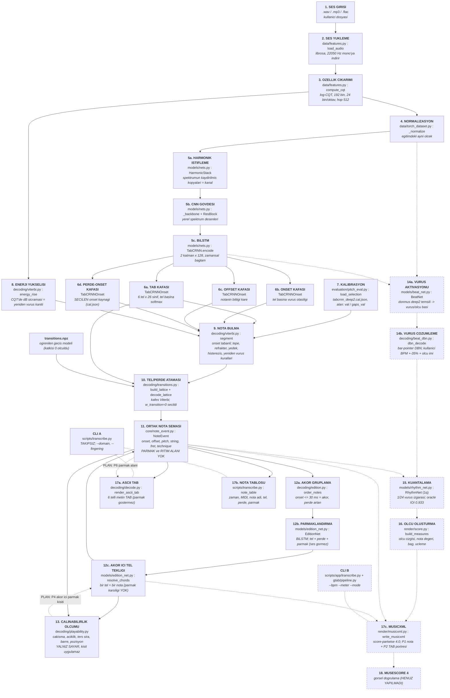
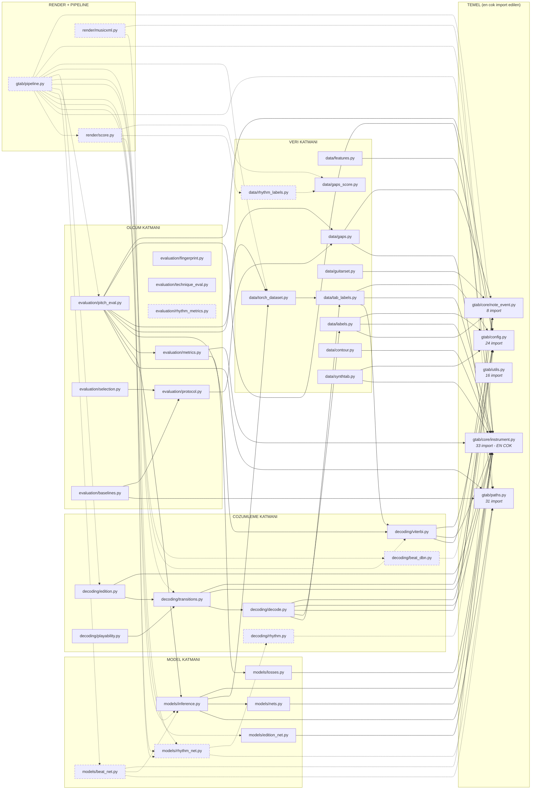
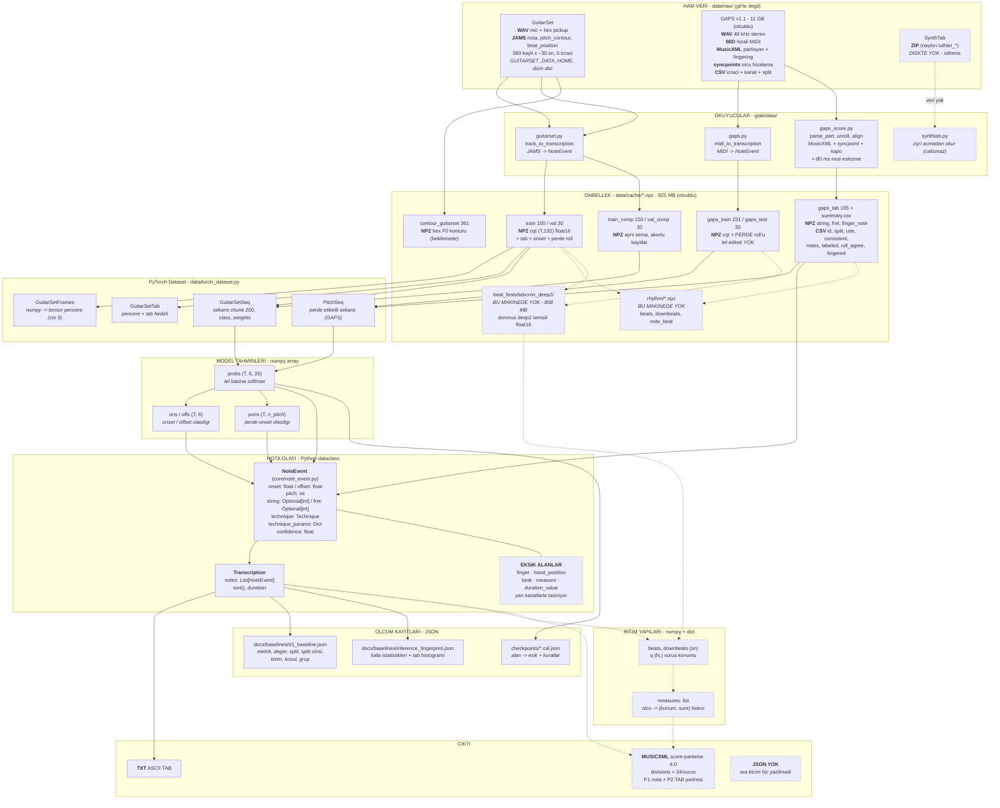
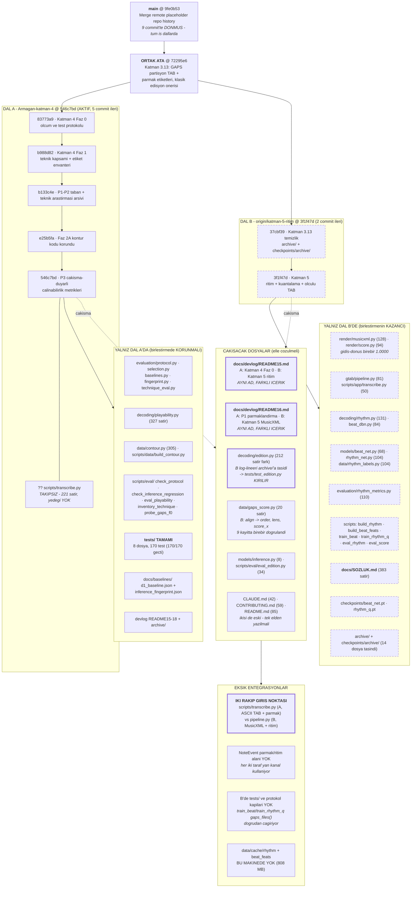
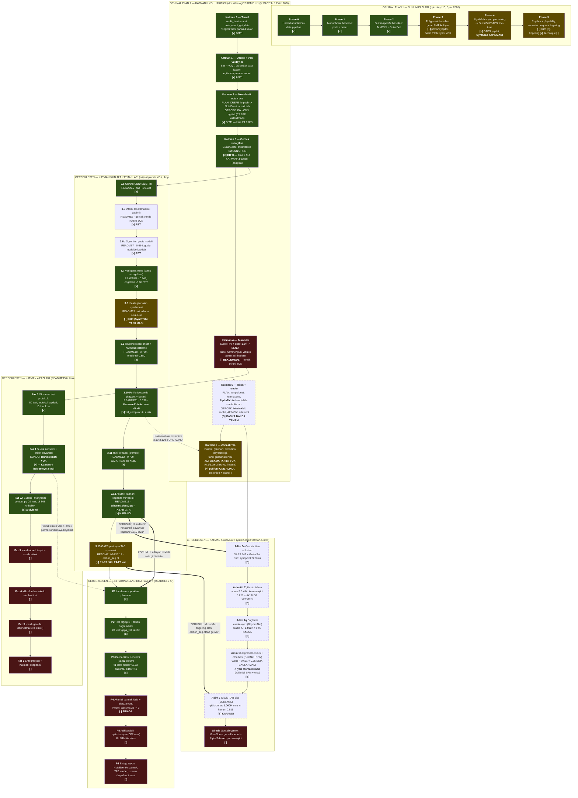
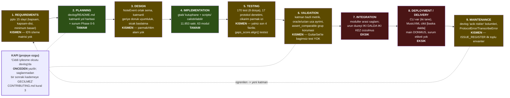
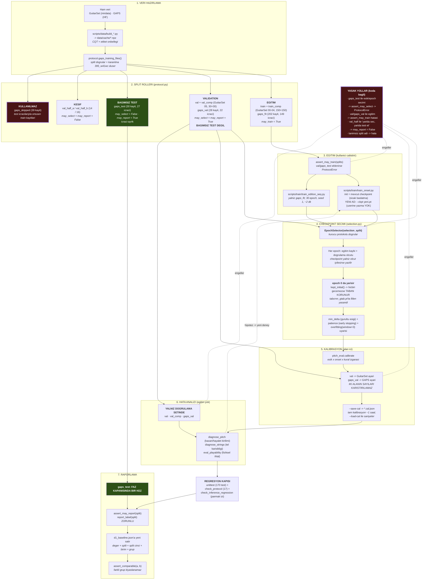

# KLASİK GİTAR AUDIO-TO-TAB — ANA PROJE RAPORU

> **Rapor tarihi:** 14 Ekim 2026
> **Denetlenen durum:** dal `Armagan-katman-4`, HEAD `546c7bde677a1828e69c652a232c6f4f813fbf92`
> **Salt okunur karşılaştırma:** `origin/katman-5-ritim` @ `3f1f47d`
> **Kapsam:** yalnız analiz, doğrulama ve dokümantasyon. Hiçbir kod, model, checkpoint, önbellek,
> dal veya devlog değiştirilmedi. Eğitim yapılmadı, veri indirilmedi.

Bu rapor, daha önce hazırlanan beş denetim belgesinin (`PROJECT_SDLC_AUDIT.md`,
`SYSTEM_ARCHITECTURE.md`, `ISSUE_REGISTER.md`, `MODEL_DATASET_INVENTORY.md`, `ROADMAP_NEXT.md`)
**doğrulanmış, birleştirilmiş ve görselleştirilmiş** versiyonudur. O belgeler yerinde korunuyor;
ayrıntı için onlara atıf yapılır.

## Bu raporda kullanılan kanıt düzeyleri

| İşaret | Anlamı |
|---|---|
| **ölçüldü** | Bu denetim sırasında fiilen çalıştırıldı ve çıktısı görüldü |
| **devlog kaydı** | Devlog'da yazılı, bu denetimde yeniden üretilmedi (satır referansı verilir) |
| **DOĞRULAMA GEREKİYOR** | Kanıtı eksik ya da eski bir modele ait; güncel ölçüm yok |

Bu denetimde fiilen çalıştırılanlar:

| Komut | Sonuç |
|---|---|
| `git rev-parse HEAD` / `git status` | `546c7bde…`, iki takipsiz yol (`docs/audit/`, `scripts/transcribe.py`) |
| `.venv/Scripts/python -m unittest discover -s tests -t .` | **170/170 geçti** (8,6 sn) |
| `python -m scripts.eval.check_protocol` | **17/17 geçti** |
| `python -m py_compile scripts/transcribe.py` | derleniyor |
| AST import taraması (63 modül) | §1.2 bağımlılık grafiği |
| `git diff --stat HEAD origin/katman-5-ritim` | 104 dosya farkı |
| `git log --diff-filter=A -- docs/devlog/README.md` | orijinal roadmap commit'i `99b82cb` |
| disk envanteri (`data/cache`, `data/raw`, `checkpoints`) | 825 MB / 11 GB / 20 dosya |

---

# BÖLÜM 1 — GÖRSEL SİSTEM MİMARİSİ VE KOD/VERİ İLİŞKİLERİ

Dört diyagram. Kaynak dosyaları `docs/audit/diagrams/` altında (`.mmd`).

**Render notu:** Bu ortamda Mermaid CLI (`mmdc`) ve Graphviz (`dot`) **kurulu değil**; `npx --no-install mmdc`
başarısız oldu ve kurulum yeni bağımlılık olacağından yapılmadı (talimat gereği). Bu nedenle **SVG/PNG
üretilemedi**; Mermaid kaynakları korundu. Diyagramlar VS Code (Markdown Preview Mermaid eklentisi) veya
GitHub üzerinde doğrudan görüntülenir.

**Tüm diyagramlarda çizgi anlamı aynıdır:**

| Çizgi | Anlam |
|---|---|
| **Düz** (`-->`) | Bugün mevcut dalda (`Armagan-katman-4`) çalışan bağlantı |
| **Kesikli** (`-.->`) | **Yalnız** `origin/katman-5-ritim` dalında var; mevcut dalda YOK |
| **Kalın** (`==>`) | Zorunlu teknik bağımlılık |
| **Etiketli "PLAN"** | Henüz yazılmamış, planlanan bağlantı |

## 1.1 Ana Audio-to-TAB pipeline

Kaynak: `docs/audit/diagrams/01-pipeline.mmd`. Her kutuda üç bilgi var: bileşen adı, Python dosyası
veya model, kısa görev. Bağlantılar tahmin değil — AST import taraması ve fonksiyon çağrılarıyla
doğrulandı.



**Diyagramı okuma notları (hepsi doğrulandı).**

1. **Onset kaynağı seçimle belirlendi.** `tabcrnn_deep2.cal.json` iki alanda da **perde-onset kafasını** (6d) seçti (`--onset-source pitch`); tel onset kafası (6b) yedekte. Kaynak: `CLAUDE.md:33`, README13 §a.
2. **Kafes Viterbi'nin katkısı sıfır ölçüldü** (`w_transition = 0` seçiliyor) ama kod yolda ve her çağrıda çalışıyor. Bkz. §7.6.
3. **Üç farklı tel/perde kullanımı var ve karıştırılmaz:**
   - *ses modu*: tel/perde adım 10'dan (kafes) gelir — "duyulan konum";
   - *edisyon modu*: tel/perde adım 12b'den (EditionNet) gelir — "klasik edisyon önerisi";
   - *ses + yalnız parmak* (`scripts/transcribe.py --fingering`): konum ses zincirinden gelir, EditionNet'e `fixed` olarak verilir, modelden **yalnız parmak** alınır. Bu üçüncü kombinasyon **yalnız mevcut dalda** var.
4. **Çalınabilirlik modülü (13) hiçbir kısıt uygulamıyor**, yalnız sayıyor (README18 tasarım kararı K1). Kısıt uygulaması P4'ün işi.
5. **İki CLI aynı zincirin farklı parçalarını sürüyor** — kritik entegrasyon sorunu, §1.4 ve §7.1.

## 1.2 Kod bağımlılıkları (gerçek import grafiği)

Bu diyagram **mantıksal veri akışı değil**, AST taramasıyla çıkarılmış gerçek `import` ilişkileridir
(63 modül tarandı). Ok yönü: "A, B'yi import eder". Kaynak: `docs/audit/diagrams/02-code-deps.mmd`.



### Kullanıcının sorduğu dosyaların bağımlılıkları ve aktarılan veri

| Dosya | Import ettiği (iç) | Kimler onu import ediyor | Aktarılan veri |
|---|---|---|---|
| `data/features.py` | `config` | 5 modül (`build_*`, `transcribe`, `app/transcribe`) | `np.ndarray (T, 192)` log-CQT dB |
| `models/inference.py` | `core/instrument`, `data/torch_dataset`, `models/nets`, `paths` | **15 modül** | `probs (T,6,26)`, `ons/offs (T,6)`, `pons (T,n_pitch)` |
| `decoding/viterbi.py` | `config`, `core/instrument`, `core/note_event` | **11 modül** | `segs = [(kare_basi, kare_sonu, perde)]` |
| `decoding/transitions.py` | `config`, `core/instrument`, **`decoding/decode`** | 6 modül | kafes + `[(tel, perde)]` atama listesi |
| `core/note_event.py` | — (yaprak) | 8 modül | `NoteEvent` / `Transcription` dataclass |
| `decoding/edition.py` | `core/instrument`, `decoding/transitions` | 6 modül | `order` (sıra), `chord` (bool dizi) |
| `models/edition_net.py` | `core/instrument` | 5 modül | `(tel, perde, parmak)` dizileri |
| `gtab/pipeline.py` **[katman-5]** | 14 iç modül (en çok bağımlı dosya) | `app/transcribe`, `eval_score` | `dict(notes, string, fret, finger, beats, downbeats, q, measures, …)` |
| `render/score.py` **[katman-5]** | `data/gaps_score` (TPQ), `data/rhythm_labels`, `models/rhythm_net` | `pipeline`, `eval_score` | `measures` listesi + `first_beat` |
| `render/musicxml.py` **[katman-5]** | `core/instrument`, `models/rhythm_net` (TICKS) | `app/transcribe`, `eval_score` | `.musicxml` dosyası (yan etki) |
| `scripts/transcribe.py` (takipsiz) | 14 iç modül | — | stdout + `.txt` |
| `scripts/app/transcribe.py` **[katman-5]** | `data/features`, `pipeline`, `render/musicxml`, `utils` | — | `.musicxml` |

### Grafikten çıkan yapısal bulgular

1. **`CONTRIBUTING.md` kural 4 mekanik olarak doğrulandı:** `scripts/` dosyaları birbirini import etmiyor. **Tek istisna:** `tests/test_edition.py → scripts.eval.eval_edition`. Bu istisna `ISSUE_REGISTER E-09`'un (mir_eval kapı eksikliği) doğrudan nedeni — zincir `eval_edition → pitch_eval → mir_eval` olduğu için `mir_eval` olmayan ortamda test atlanmıyor, hata veriyor.
2. **Katman sıralaması bir yerde ters:** `data/tab_labels.py → decoding/viterbi.py`. Veri katmanı çözümleme katmanını import ediyor. Döngü oluşmuyor (viterbi veri katmanını import etmiyor) ama katman ihlali; `valley_frames`/`fragment_frames` fonksiyonları `pick_peaks`'i kullanıyor.
3. **İmport döngüsü yok** (doğrulandı): `transitions → decode` var, `decode → transitions` yok.
4. **`gtab/pipeline.py` sistemin en bağımlı dosyası** (14 iç import). Omurga olarak doğru konumda; §12'de tek giriş noktası olarak önerilmesinin teknik gerekçesi bu.
5. **`gtab/evaluation/` iki farklı amaca hizmet ediyor:** ölçüm çekirdeği (`metrics`, `pitch_eval`, `rhythm_metrics`) ve süreç kapıları (`protocol`, `selection`, `baselines`, `fingerprint`). İkinci grup aslında bir "deney yönetimi" paketi; `protocol.py` 10 modül tarafından import ediliyor.
6. **Katman-5'in eğitim script'leri protokol kapılarını kullanmıyor:** `train_beat.py` ve `train_rhythm_q.py` `gaps_files`'ı **doğrudan** çağırıyor, `protocol.gaps_training_files()` kullanmıyor — çünkü o dalda `protocol.py` yok. `ISSUE_REGISTER E-08`'in katman-5'e uzanan hâli.

## 1.3 Veri ve şema ilişkileri

**SQL veritabanı yok, JSON ara katmanı yok.** Bu diyagram dosya biçimleri ve dizi/dataclass alanları
arasındaki gerçek dönüşümleri gösterir. Kaynak: `docs/audit/diagrams/03-data-flow.mmd`.



### Gerçekten kullanılan formatlar ve alanlar

| Katman | Format | Alanlar |
|---|---|---|
| Ham ses | **WAV** (GuitarSet mic+hex; GAPS 48 kHz stereo) | — |
| Ham etiket | **JAMS** (GuitarSet) · **MID** + **MusicXML** + **syncpoints** + **CSV** (GAPS) | GAPS MusicXML'de `notations/technical/fingering` okunuyor |
| Önbellek | **NPZ** | `cqt (T,192) float16`; GuitarSet'te + `tab`, onset, perde roll; GAPS'te yalnız perde roll |
| TAB etiketi | **NPZ** + **CSV** | `string`, `fret`, `finger_note`; CSV: `id, split, use, consistent, shift, notes, labeled, known_frames, roll_agree, fingered, open_finger0, dt_med_ms` (dosyadan okundu) |
| Model girdisi | **torch.Tensor** | pencere `(B,1,9,192)` veya sekans `(B,1,L,192)` |
| Model çıktısı | **numpy array** | `probs (T,6,26)`, `ons/offs (T,6)`, `pons (T,n_pitch)` |
| Nota olayı | **Python dataclass** | `NoteEvent`: 8 alan — **parmak ve ritim yok** |
| Kalibrasyon | **JSON** | `checkpoints/*.cal.json`: alan → (ölçüt, perde eşiği, onset eşiği, kurallar) |
| Ölçüm kaydı | **JSON** | `d1_baseline.json`, `inference_fingerprint.json` |
| Çıktı | **TXT** (ASCII TAB) · **MUSICXML** (katman-5) | MusicXML: `divisions=24/vuruş`, P1 nota + P2 TAB portresi |

**Boşluk — kullanıcının sorduğu JSON/JavaScript katmanı:** Projede **yok**. MusicXML doğrudan
`measures` + paralel numpy dizilerinden yazılıyor:
`write_musicxml(out, measures, pitch, string, fret, sig, beat_q, bpm=…, finger=…, title=…)`.
AlphaTab web görüntüleyici için bir JSON katmanı gerekirse bu **yeni iştir** (orijinal Katman 5
hedefiydi, ertelendi).

## 1.4 Branch ve katman mimarisi

Kaynak: `docs/audit/diagrams/04-branches.mmd`. Rakamlar `git diff --stat HEAD origin/katman-5-ritim`
çıktısından (104 dosya).



### Branch karşılaştırma özeti

| | `Armagan-katman-4` (A) | `origin/katman-5-ritim` (B) |
|---|---|---|
| HEAD | `546c7bd` | `3f1f47d` |
| Ortak atadan ileri | 5 commit | 2 commit |
| Odak | ölçüm protokolü + parmaklandırma (P1-P3) | ritim + MusicXML |
| WAV→TAB girişi | `scripts/transcribe.py` (takipsiz) | `gtab/pipeline.py` + `scripts/app/transcribe.py` |
| Çıktı | ASCII TAB + nota tablosu | **MusicXML** (nota + TAB portresi) |
| Ritim | yok (saniye) | vuruş + ölçü başı + kuantalama + ölçü |
| Parmaklandırma | `--fingering`, konum **sabit** | `--mode edisyon`, konumu da model seçer |
| Alan seçimi | `--domain gaps_val` / `val`, çıktıda yazılı | `domain="gaps_val"` (CLI'da yok) |
| Test | **170 test** | **yok** |
| Protokol kapıları | var | yok |
| Çalınabilirlik ölçümü | var (41 test) | yok |
| Sözlük | yok | `docs/SOZLUK.md` (383 satır) |

---

# BÖLÜM 2 — ORİJİNAL ROADMAP

## 2.1 Orijinal roadmap nerede? (arama sonucu)

Repoda **iki ayrı orijinal plan** var ve ikisi farklı şeyler. Üçüncü ve dördüncü belge sonradan
üretilmiş türevlerdir.

| # | Plan | Dosya | Tarih / commit | Niteliği |
|---|---|---|---|---|
| **1** | **Akademik plan** — Phase 0-5 + 7 adımlı yol haritası + ana araştırma sorusu | `inputs/Klasik_Gitar_AI_Proje_Sunumu.pptx` (15 slayt; slayt 9 mimari, slayt 10 Phase 0-5, slayt 12 ölçüm planı, slayt 13 kapsam, slayt 14 yol haritası) | **Eylül 2026** (slayt 1) | **EN ESKİ ORİJİNAL.** `CLAUDE.md:6-7` bunu "ana plan (yön buradan)" ilan ediyor |
| **2** | **Mühendislik planı** — Katman 0-6 katmanlı yol haritası | **`docs/devlog/README.md`** | **commit `99b82cb`**, 1 Ekim 2026 ("Initial import: guitar tab transcription pipeline") | **ORİJİNAL KATMAN ROADMAP'İ.** Kod yapısının referansı |
| 3 | Güncellenmiş katman planı (aynı belgenin sürümleri) | `docs/devlog/README1.md`, `README2.md`, `README3.md` | aynı commit + sonraki | Aynı 7 katman listesi, tamamlanma kutuları güncellenmiş. README4'ten sonra dosyalar katman devlog'una dönüşüyor |
| 4 | Vitrin yol haritası | kök `README.md` "Yol haritası" bölümü | güncellenmiş ama **iki taban geride** | Türev; 3.10/3.13 açık gösteriyor, oysa kapandılar (`ISSUE_REGISTER G-05`) |
| 5 | **Denetim önerisi (ORİJİNAL DEĞİL)** | `docs/audit/ROADMAP_NEXT.md` | 14 Ekim 2026 (bu denetim) | **İkinci plan.** §12'de ayrı tutuldu |

**Tespit yöntemi:** `git log --oneline --diff-filter=A -- docs/devlog/README.md` → `99b82cb`.
Belgenin başlığı: *"Gitar Tab Transkripsiyon — Katmanlı Yol Haritası"*. Tasarım ilkesi aynı dosyada
yazılı: *"Özellikleri değil, ARAYÜZLERİ önden sağlamlaştır. NoteEvent bugün yarı boş
(string/fret/technique = None); her katman bir alanı doldurur."*

## 2.2 Orijinal planların eşlenmesi

| Sunum (Plan 1) | Katman roadmap (Plan 2) |
|---|---|
| Phase 0 — Unified annotation / data pipeline | Katman 0 + Katman 1 |
| Phase 1 — Monophonic baseline (pitch, onset) | Katman 2 |
| Phase 2 — Guitar-specific baseline (TabCNN, GuitarSet) | Katman 3 |
| Phase 3 — Polyphonic baseline (genel AMT ile kıyas) | Katman 6'nın polifoni kalemi |
| Phase 4 — SynthTab Nylon pretraining → GuitarSet/GAPS fine-tuning | Katman 3.8 alt adımları (sonradan açıldı) |
| Phase 5 — Rhythm + playability; sonra technique + fingering | Katman 4 + Katman 5 |
| (slayt 9 modül 8 "Application") | Katman 5'in AlphaTab kalemi |

**Sunumun 7 adımlı yol haritası (slayt 14)** ayrı bir sıralama veriyor:
1. Datasetleri ve ortak annotation şemasını hazırlama → **yapıldı**
2. Monophonic ve TabCNN baseline'larını yeniden üretme → **yapıldı**
3. Polyphonic model + classical domain adaptation deneyleri → **kısmen** (GAPS yapıldı, SynthTab yok)
4. String/fret ve playability post-processing → **kısmen** (P3 ölçüm bitti, P4 kısıt uygulaması yok)
5. Rhythm / selected techniques; zaman kalırsa fingering optimizer → **ritim [katman-5'te] · technique yok · fingering yapıldı**
6. Kendi klasik gitar test seti ile gerçek dünya değerlendirmesi → **YAPILMADI**
7. TAB + audio + fretboard demonstrasyon uygulaması → **YAPILMADI**

## 2.3 Orijinal Katman roadmap'i — tam metin ve durum

`docs/devlog/README.md` @ `99b82cb`'den aynen alınan 7 katman:

| Katman | Orijinal amaç (planda yazdığı gibi) | Orijinal alt aşama sayısı | Gerçekleşen alt aşama | Mevcut durum |
|---|---|---|---|---|
| **0 — Temel** | "Değiştirmesi pahalı 4 karar sabitlendi: `config.py`, `instrument.py`, `note_event.py`, `get_data.py`" | yok (4 madde) | — | **TAMAM** (planda `[x]` işaretli) |
| **1 — Özellik + veri yükleyici** | "Ses → CQT; GuitarSet'i şemaya bağlayan tam data loader; eğitim/doğrulama ayrımı" | yok | — | **TAMAM** (README1'de `[x]`) |
| **2 — Monofonik uçtan uca** | "**CREPE** ile pitch → NoteEvent → naif tab (en düşük pozisyon). İlk çalışan çıktı, kalite düşük olsa da." | yok | — | **TAMAM** — ama **CREPE kullanılmadı**, `PitchCNN` eğitildi; kare F1 0,853 (README3) |
| **3 — Gerçek string/fret** | "GuitarSet'in tel etiketleriyle TabCNN/CRNN tarzı model. Artık pozisyon tahmin değil, gerçek." | yok | **9 alt katman** (3.5 … 3.13) sonradan açıldı | **TAMAM ama hâlâ sürüyor** (3.13 P4-P6 açık) |
| **4 — Teknikler** | "Sürekli F0 eğrisi + onset zarfı → önce BEND, sonra slide, hammer/pull, vibrato. **Senin asıl hedefin.**" | yok | **Faz 0 … Faz 6** (README15'te tanımlandı) | **BEKLEMEDE** — Faz 0-2A bitti, Faz 1 "teknik etiketi yok" buldu |
| **5 — Ritim + render** | "Tempo/beat takibi, kuantalama; **AlphaTab** ile bend/slide sembollü gerçek tab görseli." | yok | **Adım 0a, 0b, 1q, 1b, 2** | **BAŞKA DALDA TAMAM** — AlphaTab yerine **MusicXML** seçildi; AlphaTab ertelendi |
| **6 — Zorlaştırma** | "Polifoni (akorlar), distortion dayanıklılığı, farklı gitarlar/akortlar." | **yok** | **hiç açılmadı** | **polifoni ÖNE ALINDI** (3.10-3.12), distortion ve alternatif akort **yapılmadı** |

### Katman 6 hakkında net cevap

Kullanıcının sorusu: *"Katman 6 hangi aşamalardan oluşuyor? Roadmap'te 6.1, 6.2, 6.3 … varsa tamamını çıkar."*

**Katman 6'nın alt aşaması YOKTUR.** Tüm repo tarandı (`grep -rn "Katman 6|6\.1|6\.2|6\.3"` → `docs/devlog/*.md`,
`archive/*.md`, `README.md`, `CLAUDE.md`, `CONTRIBUTING.md`): Katman 6 **beş yerde** geçiyor ve her birinde
**tek satırlık aynı tanım** var, hiçbir yerde 6.1/6.2/6.3 gibi bir alt aşama tanımlanmamış:

| Yer | İfade |
|---|---|
| `docs/devlog/README.md:29` | "Katman 6 — Zorlaştırma. Polifoni (akorlar), distortion dayanıklılığı, farklı gitarlar/akortlar." |
| `docs/devlog/README1.md:31` | aynı |
| `docs/devlog/README2.md:34` | aynı |
| `docs/devlog/README3.md:20` | "Katman 6 — Zorlaştırma. Polifoni (akor), distortion, farklı gitarlar." (kısaltılmış) |
| kök `README.md:231` | "Katman 6 — Zorlaştırma: polifoni (akorlar), distortion dayanıklılığı, farklı gitar/akort desteği" |
| `docs/devlog/README8.md:14` | "Bu, Katman 6 (polifoni) için de ilk adım." (comp verisi hakkında) |

Dolayısıyla Katman 6 **üç iş kaleminden** oluşuyor ve bunların durumu şöyle:

| Katman 6 kalemi | Durum | Kanıt |
|---|---|---|
| **Polifoni (akorlar)** | **ÖNE ALINDI ve büyük ölçüde yapıldı** — Katman 3.10/3.11/3.12 bu işi yaptı | README11 (hayalet + kaçan perde), README12 (hızlı tekrarlar), README13 (derin CNN); val_comp nota F1 0,807; polifoni kırılımı 2/3/4+ ölçülüyor |
| **Distortion dayanıklılığı** | **YAPILMADI** | Hiçbir devlog'da distortion deneyi yok. Not: klasik gitar odağına geçildiği için (naylon tel, distortion yok) bu kalem **hedefle ilgisini yitirdi** |
| **Farklı gitarlar / akortlar** | **KISMEN** — altyapı var, deney yok | `core/instrument.py` çoklu enstrüman destekliyor (bas 4 tel, 7 telli test edildi — README6); MusicXML yazıcısı `<staff-tuning>` ile scordatura alıyor. Ancak **modeller yalnız standart akortla eğitildi** ve alternatif akort deneyi yapılmadı. Sunum slayt 13 bunu **"Future work"** kolonunda tutuyor |

**Önemli uyarı:** Katman 6, orijinal planın sonundaki "zorlaştırma" katmanıdır ve içeriğinin bir kısmı
(polifoni) projenin **çekirdek hedefi** olduğu anlaşıldığı için öne alınmıştır. Bu bir plan ihlali değil,
ölçüme dayalı bir yeniden sıralamadır (sunum slayt 2 "Ana hedef: polifonik klasik gitar" diyor; polifoniyi
en sona bırakan Plan 2 ile sunum arasında bir çelişki vardı ve sunum lehine çözüldü).

## 2.4 Gerçekleşen alt aşamalar (orijinal planda olmayan)

Bu alt aşamalar **orijinal roadmap'te yoktur**; ihtiyaca göre açıldılar. Orijinal katman gibi
sunulmamalıdır.

### Katman 3'ün alt katmanları

| Alt katman | Amaç | Yapılacak iş | İlgili kod/model | Ön koşul | Tamamlanma kriteri | Durum |
|---|---|---|---|---|---|---|
| **3.5** | Zamansal model | CNN + BiLSTM | `TabCRNN`, `tabcrnn.pt` | 3 | tab F1 > 0,586 | **TAMAM** 0,634 (README5) |
| **3.6** | Tel ataması (el yapımı) | Viterbi hareket maliyeti | `decoding/viterbi.py` | 3.5 | greedy'yi geçmeli | **RET** — gerçek veride katkı yok (README6) |
| **3.6b** | Tel ataması (öğrenilen) | log-lineer geçiş modeli | `transitions.py`, `transitions.npz` | 3.6 | greedy + baseline'ı geçmeli | **RET** — `w_tr=0` seçildi; CNN'e +0,021, CRNN'e 0 (README7) |
| **3.7** | Veri genişletme | GuitarSet comp (180 kayıt) + CQT çoğaltma | `build_comp.py`, `tabcrnn_comp.pt` | 3.6b | tab F1 > 0,664 **ve** oracle tel > 0,738 | **KISMEN** 0,667 / 0,762 (sınırda); çoğaltma **−0,06 RET** (README8) |
| **3.8** | Klasik gitar alan uyarlaması | GAPS indir + ölç + ince ayar | `gaps.py`, `tabcrnn_gaps.pt` | 3.7 | GAPS nota F1 ≥ +0,03 **ve** GS tab F1 kaybı ≤ 0,01 | **KISMEN** — alt adımlar aşağıda |
| **3.9** | Tel/perde sesini öğrenmek | onset kafası + harmonik istifleme | `TabCRNNOnset`, `HarmonicStack`, `tabcrnn_onset_h.pt` | 3.8 | GS tab F1 ≥ 0,72 **ve** val_comp nota F1 ≥ +0,10 | **TAMAM** 0,739 / oracle tel 0,850 (README10) |
| **3.10** | Polifonide perde | hayalet + kaçan nota; çözümleme kuralları, offset kafası | `tabcrnn_rep_off.pt`, `diagnose_pitch` | 3.9 | GAPS nota F1 + val_comp 0,780/0,830 | **KISMEN** — fingerstyle ölçütü tamam (0,689), **val_comp ölçütü sağlanmadı** (README11 son satır) |
| **3.11** | Hızlı tekrarlar (tremolo) | yerel tepe, noisy-OR, vadi eğitimi | `pick_peaks`, `tabcrnn_rep_valley.pt` | 3.10 | GAPS <100 ms kaçma −10 puan **ve** nota F1 düşmesin | **KISMEN** — tab F1 en iyi (0,769) ama **kabul kuralı sağlanmadı** (GAPS nota −0,013); yine kapandı (README12 §8f) |
| **3.12** | Akustik katman | kapasite ölçümü → derin CNN + perde-onset kafası | `overfit_gaps.py`, **`tabcrnn_deep2.pt`** | 3.11 | GAPS onset F1 (model) ≥ +0,03 | **TAMAM / KAPANDI** — onset 0,377 → 0,524; GAPS nota 0,720 → **0,779**; tab F1 **0,777** (README13) |
| **3.13** | GAPS partisyon TAB + parmak | tel etiketi + sol el parmağı | `gaps_score.py`, `edition_seq.pt` | 3.12 | tel > naif, parmak > taban | **KISMEN** — Adım 2b kabul; **P4-P6 açık** (README14/16/17/18) |

### Katman 3.8'in alt adımları (README9:34-41 — orijinal plana en yakın alt aşama tanımı)

| Adım | İş | Sunumdaki karşılığı | Çıktı | Durum |
|---|---|---|---|---|
| **3.8a** | GAPS indir + önbellek (CQT + perde roll'u) | Phase 0 | `data/cache/gaps_{train,test}` | **TAMAM** (231 + 30 kayıt, ölçüldü) |
| **3.8b** | Alan farkı ölçümü: GuitarSet modelini GAPS test'te değerlendir | Değerlendirme planı | taban sayılar | **TAMAM** — `tabcrnn_comp.pt` GAPS nota F1 0,255 (README9:143) |
| **3.8c** | GAPS ile perde denetimli ince ayar (karışık batch) | Phase 4: classical domain adaptation | `tabcrnn_gaps.pt` | **TAMAM** — 0,255 → 0,360 |
| **3.8d** | **SynthTab nylon ön-eğitimi → GuitarSet → GAPS** | **Phase 4: SynthTab pretraining** | `tabcrnn_syn*.pt` | **YAPILMADI** — README13 "3b gerekmedi" dedi; veri de silinmiş (bkz. §10) |
| **3.8e** | GAPS partisyon TAB'ı + `.match` → tel etiketi; `<fingering>` → parmaklandırma verisi | Slayt 10-11 (fingering) | "Katman 7'ye girdi" | **TAMAM** — Katman 3.13 olarak yapıldı. *Not: "Katman 7" hiçbir yerde tanımlı değil; `README16.md:50` bu çelişkiyi kendisi tespit etmiş* |

### Katman 4'ün fazları (README15'te tanımlandı — orijinal planda yok)

| Faz | Amaç | Yapılacak iş | İlgili kod | Ön koşul | Tamamlanma kriteri | Durum |
|---|---|---|---|---|---|---|
| **Faz 0** | Ölçüm ve test protokolü | veri protokolü + teknik ölçütleri + test altyapısı + D1 referansı | `protocol.py`, `technique_eval.py`, `selection.py`, `baselines.py`, `fingerprint.py`, `tests/` | 3.12 | 11 kabul kriteri (README15 tablosu) | **TAMAM** — 80 test, 17 denetim, parmak izi farksız |
| **Faz 1** | Teknik kapsamı + etiket envanteri | hangi teknik ölçülebilir, hangi etiket kaynağı, kaç örnek | `inventory_technique.py` | Faz 0 | envanter çıkarılmış olmalı | **TAMAM — kritik sonuç:** teknik etiketi **YOK** (GAPS 300 dosya: slide 0, glissando 0, harmonic 0, trill 0, slur 4, tremolo 1) |
| **Faz 2A** | Sürekli F0 altyapısı | GuitarSet hex `pitch_contour`, GAPS mono F0 | `data/contour.py` (305), `build_contour.py`, `probe_gaps_f0.py` | Faz 1 | kontur kalitesi ölçülmüş | **TAMAM, arşivlendi** — 29 test, 18 MB önbellek |
| **Faz 3** | Kural tabanlı tespit + sözde etiket üretimi | GuitarSet hex'ten türetilmiş etiket | — | Faz 2 | — | **YAPILMADI** |
| **Faz 4** | Mikrofondan teknik sınıflandırıcı (eğitim) | macro-F1 ölçütü, `EpochSelector` | — | Faz 3 | macro-F1 > çoğunluk tabanı | **YAPILMADI** |
| **Faz 5** | Klasik gitarda doğrulama | GAPS + **elle etiketli küçük küme (zorunlu)** | — | Faz 4 | — | **YAPILMADI** |
| **Faz 6** | Entegrasyon, regresyon, kök README + yol haritası güncellemesi, Katman 4 kapanışı | — | — | Faz 5 | — | **YAPILMADI** |

**Katman 4'ün durdurulma gerekçesi (README16 §1):** *"teknik tespiti ancak kuraldan türetilmiş sözde
etiketlerle yapılabilir, doğruluğu yalnız insan dinlemesiyle sınanabilir ve klasik gitarda sayısal bir
doğruluk iddia edilemez."* Buna karşılık parmaklandırmada **gerçek etiket** var (165 kayıt, 159.647 nota,
38.828'i parmak numaralı) → emek oraya kaydırıldı. Katman 4 **durdurulmadı, beklemeye alındı**; Faz 0-2A
çıktıları yerinde ve arşivli.

### Katman 3.13'ün parmaklandırma fazları (README16 §7)

| Faz | İş | Kabul ölçütü | Durum |
|---|---|---|---|
| **P1** | İnceleme + yeniden planlama | — | **TAMAM** (README16) |
| **P2** | Mevcut davranışı sabitleyen testler + checkpoint doğrulaması + yayımlanmış metriklerin yeniden üretimi | `gaps_val` tel/parmak/ürün birebir | **TAMAM** — 0,766 / 0,675 / 0,382 birebir (README17; bu denetimde **tekrar doğrulandı**) |
| **P3** | Çalınabilirlik denetimi (yalnız ölçüm) | üç yöntemin ihlal oranları yan yana | **TAMAM** — 41 test; model %8,52 çakışma, naif %13,44, **editör %0,00** (README18) |
| **P4** | Akor içi parmak kısıtı + el pozisyonu çıktısı | çakışma 22 → **0**, `gaps_val` parmak 0,675 **düşmesin** | **SIRADA — yapılmadı** |
| **P5** | Açıklanabilir optimizasyon (DP / beam search) ile BiLSTM karşılaştırması | açıklanabilir ≥ BiLSTM − 0,02 ise tercih | **YAPILMADI** |
| **P6** | Entegrasyon: `NoteEvent`'e parmak / el pozisyonu, TAB render'ında gösterim, uzman değerlendirmesi | parmak izi farksız; uzman kabul oranı raporlanır | **YAPILMADI** |

### Katman 5'in adımları (yalnız `origin/katman-5-ritim`)

| Adım | İş | Kabul ölçütü | Sonuç | Durum |
|---|---|---|---|---|
| **0a** | Gerçek ritim etiketleri (`build_rhythm`) | syncpoint uyumu | GAPS 143/231 + GuitarSet 360; ölçü başı ↔ syncpoint medyan **22,9 ms** | **TAMAM [B]** |
| **0b** | Eğitimsiz taban (vuruş dp/plp, ölçü başı kuralı, kuantalayıcı) | kuantalayıcı ≥ 0,90 · vuruş F ≥ 0,75 · ölçü başı F ≥ 0,80 | kuantalayıcı **0,821 ✗** · vuruş F **0,444 ✗** · ölçü başı **0,789 ✗** (sınırda) | **TAMAM [B] — üçü de sağlanmadı** |
| **1q** | Bağlamlı kuantalayıcı (RhythmNet, BiLSTM + yapısal çözümleme) | gaps_test oracle IOI **≥ 0,90** ve uçtan uca ≥ kural (0,588) | oracle **0,933 ✓** · uçtan uca **0,617 ✓** | **KABUL [B]** |
| **1b** | Öğrenilen vuruş + ölçü başı (BeatNet + bar-pointer DBN) | vuruş F ≥ 0,75 · ölçü başı F ≥ 0,60 · uçtan uca IOI ≥ 0,833 | yarı otomatik: **0,631 / 0,582 / 0,695** — hiçbiri sağlanmadı | **[B] eşikler sağlanmadı → kullanıcı kararıyla yarı otomatik mod kullanılıyor** |
| **2** | Ölçülü TAB çıktısı (MusicXML) | gidiş-dönüş ≥ 0,999 · ölçü doluluğu %100 · dosya geçerliliği %100 | gidiş-dönüş **1,0000** · doluluk **%100** · geçerlilik **%100**; ölçü içi konum **0,611** | **KAPANDI [B]** |
| **(sırada)** | Görselleştirme: MuseScore görsel kontrol + **AlphaTab web görüntüleyici** | — | — | **YAPILMADI** (orijinal Katman 5 hedefi) |

## 2.5 Planlanan ↔ Gerçekleşen ↔ Önerilen

Üç durum ayrı tutulur. **Kanıt kuralı:** bir faz başka dalda tamamlanmışsa mevcut dalda "tamamlandı"
gösterilmez; doküman "tamamlandı" diyor ama test kanıtı yoksa **DOĞRULAMA GEREKİYOR** yazılır.

| Konu | **1. PLANLANDI** (orijinal) | **2. GERÇEKLEŞTİRİLDİ** (kod/git/devlog kanıtı) | **3. ÖNERİLİYOR** (§12) |
|---|---|---|---|
| Monofonik perde | Katman 2: **CREPE** ile pitch | `PitchCNN` eğitildi, CREPE kullanılmadı; kare F1 0,853 | — |
| Tel/perde | Katman 3: TabCNN/CRNN | 9 alt katman; `tabcrnn_deep2.pt`, tab F1 **0,777** (validation) | A teli ölçümü (§7.1) |
| Polifoni | **Katman 6** (en son) | **3.10-3.12'de öne alındı**; val_comp nota F1 0,807 | akor fragmanı deneyi (§7.4) |
| Klasik gitar uyarlaması | Phase 4 | GAPS ile yapıldı: nota F1 0,255 → **0,779** (bağımsız test) | — |
| **SynthTab ön-eğitimi** | **Phase 4 / 3.8d — ana araştırma sorusu** | **YAPILMADI**; veri de silinmiş | kapsam ölçümü → karar (§10) |
| Teknikler | Katman 4 "asıl hedef" | Faz 0-2A altyapı; **Faz 1: etiket yok** → beklemede | Faz 5'te elle etiketli küme |
| Parmaklandırma | Slayt 10-11 (slayt 13: "başarırsa ekle") | 3.13: `edition_seq.pt`; tel 0,815 / parmak 0,636 (bağımsız test) | **P4** (§7.5) |
| Çalınabilirlik | Slayt 9 modül 4 + slayt 12 metrikleri | **P3 ölçümü yapıldı**; kısıt uygulaması yok | **P4** |
| Ritim + kuantalama | Katman 5 | **[B] katman-5'te tamam**; yarı otomatik, eşikler sağlanmadı | birleştirme (§12) |
| Render | Katman 5: **AlphaTab** | **MusicXML** seçildi [B]; AlphaTab yapılmadı | MuseScore doğrulaması (§8) |
| Distortion dayanıklılığı | Katman 6 | **YAPILMADI** — klasik gitar odağıyla ilgisini yitirdi | kapsam dışı bırakılması önerilir |
| Alternatif akort | Katman 6 / slayt 13 "Future work" | altyapı var (`instrument.py`, `<staff-tuning>`), deney yok | future work |
| Bağımsız test seti | Slayt 12: "performer-disjoint; mümkünse device/room-disjoint" · slayt 14 adım 6 "kendi test setimiz" | GAPS icracı-ayrık **var**; GuitarSet'te bağımsız test **YOK**; kendi test seti **YOK** | kendi test seti (§12 İş 9) |
| Uzman değerlendirmesi | Slayt 12 (playability/fingering) | **YAPILMADI** | P6 |
| Cihaz/oda robustness | Slayt 12 "mic vs USB mic vs telefon" | **YAPILMADI** | kendi test seti ile |
| Basic Pitch kıyası | Phase 3 | **YAPILMADI** | opsiyonel |
| Attention/Transformer | Slayt 10 model adayları | **DENENMEDİ** — kapasite farkı 0,004 ölçüldüğü için gerekmedi | gerekmez; tezde gerekçesi yazılmalı |
| Uygulama (TAB + audio + fretboard) | Slayt 9 modül 8, slayt 14 adım 7 | **YAPILMADI** | AlphaTab (en son) |

## 2.6 Görsel roadmap

Kaynak: `docs/audit/diagrams/05-original-roadmap.mmd`. Düz çizgi = orijinal planlanan sıra;
**kalın çizgi = zorunlu teknik bağımlılık** (orijinal sıralamadan bağımsız olarak kodun dayattığı sıra).



## 2.7 Katman 4 → 5 → 6 geçişleri ve zorunlu teknik bağımlılıklar

**Orijinal sıralama** 4 → 5 → 6'dır. **Gerçek teknik bağımlılıklar** bu sıralamayı zorunlu kılmıyor:

| Geçiş | Orijinal sıra | Gerçek teknik bağımlılık | Sonuç |
|---|---|---|---|
| 3.12 → Katman 5 (ritim) | Katman 4'ten sonra | **ZORUNLU:** ritim kuantalayıcısı `deep2`'nin bulduğu notalara dayanıyor; nota kapsamı **0,810** ritmin tavanını belirliyor | Katman 5, Katman 4 olmadan yapılabildi ve yapıldı |
| 3.12 → 3.13 (parmaklandırma) | planda yok | **ZORUNLU:** `EditionNet` nota dizisi girdisi ister | Yapıldı |
| 3.13 → Katman 5 Adım 2 | planda yok | **ZORUNLU:** MusicXML'in `<fingering>` alanı `edition_seq.pt`'tan geliyor | Yapıldı |
| Katman 4 (teknikler) | 5'ten **önce** | **BAĞIMLILIK YOK** ama **veri engeli var**: teknik etiketi yok | Beklemede; sıra tersine döndü (5 önce yapıldı) |
| Katman 6 (polifoni) | **en son** | **BAĞIMLILIK YOK**; sunum bunu çekirdek hedef sayıyor | 3.10-3.12'de öne alındı |
| Katman 6 (distortion) | en son | bağımlılık yok | Klasik gitar odağıyla ilgisini yitirdi |
| Katman 6 (alternatif akort) | en son | altyapı hazır (`instrument.py`, `<staff-tuning>`) ama modeller standart akortla eğitildi | Future work |

**Önemli sonuç:** Katman 4'ün beklemeye alınması bir teknik bağımlılık ihlali **değildir** — Katman 5 ve
3.13, Katman 4'e ihtiyaç duymuyor. Tek gerçek kayıp, teknik işaretlerinin MusicXML çıktısında
bulunmaması (§8).

---

# BÖLÜM 3 — SDLC UYGUNLUĞU

Ayrıntılı değerlendirme: `docs/audit/PROJECT_SDLC_AUDIT.md` (15 başlık). Burada istenen 9 aşamalı
özet ve döngü diyagramı var.

## 3.1 Dokuz aşamalı değerlendirme

| SDLC aşaması | Projedeki karşılığı | Durum | Eksik |
|---|---|---|---|
| **1. Requirements** | `inputs/Klasik_Gitar_AI_Proje_Sunumu.pptx` (15 slayt): kapsam, kapsam-dışı, "minimum güçlü başarı", ölçüm planı. `CLAUDE.md:6-7` her oturumda okunmasını kural yapıyor | **Kısmen** | ID'li, durumlu gereksinim izleme matrisi yok. Ana araştırma sorusu (slayt 6) hiçbir devlog'da gereksinim kalemi olarak takip edilmiyor. Slayt 12'nin iki kalemi (uzman değerlendirmesi, cihaz/oda robustness) hiç uygulanmadı |
| **2. Planning** | İki orijinal plan (§2.1) + katman başına devlog + "ciddi iyileşme ölçütü önceden yazılır" kuralı | **Tamam** | Katman 6 alt aşama tanımı yok (ama tek satırlık tanım bilinçli olabilir) |
| **3. Design** | `NoteEvent` ortak şeması; katmanlı geriye dönük uyumluluk; sıcak başlatma (`nets.py:206`); artık blokların sıfır-gamma ile birebir aynı başlangıç vermesi | **Kısmen** | `NoteEvent` **parmak ve ritim alanı taşımıyor** → iki dalda iki ayrı yan kanal. "Tek veri sözleşmesi" iddiası bu noktada kırık |
| **4. Implementation** | `gtab/` kütüphane (yalnız import) + `scripts/` çalıştırılabilir; 11.853 satır, 63 modül; script'ler birbirini import etmiyor (**mekanik olarak doğrulandı**, §1.2) | **Tamam** | Ölü/arşivlik kod mevcut dalda ayrışmamış (`synthtab.py` veri yok, el yapımı Viterbi çürütülmüş ama yolda) |
| **5. Testing** | 170 test / 8 dosya (**170/170 ölçüldü**); 17 protokol denetimi (**17/17 ölçüldü**); çıkarım parmak izi (kare düzeyinde, CPU, saniyeler) | **Kısmen** | Testler yalnız son 4 fazda eklendi (14 katman testsiz geçti). **Kritik yollar testsiz:** `gaps_score.align()` (255 satır — tüm parmak ve ritim etiketlerinin kaynağı), `build_gaps_tab.py`, `eval_edition.py` bütün olarak, `scripts/transcribe.py`. `test_edition.py` kapısı `mir_eval`'i kapsamıyor |
| **6. Validation** | Katman bazlı metrik; oracle ↔ uçtan uca ayrımı; `assert_comparable` grup koruması; `report_label` zorunluluğu; D1 referans tablosu + toleranslar (koşu 0,002 / eğitim 0,01) | **Kısmen** | **GuitarSet'te bağımsız test YOK** (6 oyuncudan 5'i eğitimde, 05 hem seçim hem rapor). Tel başına doğruluk güncel tabanda ölçülmemiş. `gaps_test` bir kez karar kuralında kullanıldı (README14 Adım 2) |
| **7. Integration** | Modüller arası entegrasyon sağlam (veri akışı kesintisiz, §1.1) | **Eksik** | **Ürün düzeyi entegrasyon iki dalda iki kez çözülmüş.** Devlog adları çakışıyor (README15/16). Katman-5 kodu test ağında yok |
| **8. Deployment / Delivery** | İki CLI (`scripts/transcribe.py` takipsiz; `scripts/app/transcribe.py` [B]); MusicXML çıktısı [B] | **Eksik** | `main` 9 commit'te **donmuş**, sürüm etiketi yok, teslim sürümü yok. `scripts/transcribe.py` yalnız bu makinede (yedeksiz). MuseScore görsel doğrulaması yapılmamış |
| **9. Maintenance** | Devlog "açık riskler" bölümleri; `ProtocolError` / `TranscribeError` gibi açık nedenli hatalar; `CLAUDE.md` "denenmiş, işe yaramayan" listesi (7 kalem) | **Kısmen** | Sorunlar 21 devlog'a dağılmıştı; `ISSUE_REGISTER.md` ilk toplu envanter (43 kalem). Kapanmış sorunların "kapandı" işareti devlog'larda yok |

## 3.2 SDLC döngü diyagramı

Kaynak: `docs/audit/diagrams/06-sdlc.mmd`.



## 3.3 Kullanıcının sorularına cevaplar

**Mevcut geliştirme yaklaşımımız nedir?**
**Hibrit:** çekirdeği *araştırma odaklı geliştirme* (research-driven development), üzerine
*iteratif/artımlı* yazılım disiplini giydirilmiş. Birim "sprint" değil **hipotez**: ölç → hipotez →
tek değişken → yeniden ölç → kabul/ret. Agile'a tam uyum yok ve bu bilinçli: sabit süreli iterasyon
yok, faz uzunluğunu ölçüm sonucu belirliyor. Tek istisna **Katman 4 Faz 0**: orada ölçüm protokolü,
kabul kriterleri ve test altyapısı **uygulamadan önce** kuruldu (170 testin 80'i, hiç model eğitilmeden)
— bu faz test-first/V-model karakterinde ve projenin en olgun parçası.

**SDLC'ye ne kadar uygun?**
Dokuz aşamadan **2'si tamam, 5'i kısmen, 2'si eksik**. Bilimsel süreç (requirements → planning →
validation ekseni) olgun; **teslim ekseni (integration → deployment) zayıf.** Bu, araştırma ağırlıklı
bitirme projelerinde tipik bir profildir ama tez teslimi için integration/delivery kapatılmalı.

**En güçlü alanlarımız.**
1. **Ölçüm ve deney disiplini.** Kabul ölçütü **önceden** yazılıyor ve sağlanmadığında gerçekten reddediliyor: `tabcrnn_gtab.pt` (hiçbir epoch ep 0'ı geçemedi), `tabcrnn_aug.pt` (−0,06), log-lineer edisyon (parmak < taban) — üçü de RET.
2. **Negatif sonuçların kaydı.** `CLAUDE.md:119-123`'te 7 kalemlik "denenmiş, işe yaramayan" listesi. Araştırma projelerinde en sık kaybedilen bilgi türü.
3. **Metrik karıştırmanın mekanik önlenmesi.** `baselines.py:87 assert_comparable` — 0,815 (oracle nota + edisyon) ile 0,655 (uçtan uca) aynı tabloda karşılaştırılamıyor.
4. **Veri sızıntısı kontrolleri koda bağlı.** `assert_may_select("gaps_test")` → `ProtocolError`; `EpochSelector` kurucusunda otomatik. 17 denetim, kanal düzeyi sızıntı kontrolü dahil.
5. **Devlog kalitesi.** 21 dosya, tutarlı iskelet, **kendi hatalarını kaydediyor** (README18 §6'da beş ölçüm hatası ve düzeltmesi).

**En zayıf alanlarımız.**
1. **Yazılım konfigürasyon yönetimi:** iki dal paralel, devlog adları çakışıyor, `main` donmuş.
2. **Entegrasyon:** iki rakip giriş noktası; `NoteEvent` parmak/ritim taşımıyor.
3. **Vitrin dokümantasyonu:** kök `README.md` iki taban geride ve manşet sayıların validation olduğunu söylemiyor.
4. **Test kapsamı:** etiket üretim zinciri (`gaps_score.align()`) testsiz.

**Git, test, dokümantasyon ve entegrasyon süreçlerimiz yeterli mi?**

| Süreç | Yeterli mi | Gerekçe |
|---|---|---|
| **Git** | **Hayır** | Dal başına katman kuralı iyi, ama iki dal paralel ilerleyip çakıştı; `main`'e hiç birleştirme yapılmadı; takipsiz ürün dosyası var |
| **Test** | **Kısmen** | 170 test + 3 regresyon katmanı güçlü; ama son 4 fazda eklendi ve etiket üretim yolu kapsanmıyor |
| **Dokümantasyon** | **İkiye ayrılıyor** | Devlog: **yüksek** kalite. Vitrin (`README.md`, `CONTRIBUTING.md`): iki taban geride |
| **Entegrasyon** | **Hayır** | Ürün düzeyi entegrasyon iki kez çözülmüş, birleştirilmemiş |

**Hangi süreçleri iyileştirmeliyiz? (öncelik sırası)**
1. Dal birleştirme + devlog numaralandırması (bilgi kaybı riski).
2. Vitrin dokümanları + checkpoint üretim künyesi (`checkpoints/PROVENANCE.md`) — tez görünürlüğü.
3. `NoteEvent` şemasının genişletilmesi (entegrasyonun ön koşulu).
4. Etiket üretim zincirinin testlenmesi.

---

# BÖLÜM 4 — README / DEVLOG GEÇMİŞİ

## 4.1 Güncel devlog sayısı (doğrulandı)

**21 dosya** (önceki denetimin sayısı doğrulandı): `docs/devlog/` altında **19** (`README.md` +
`README1.md`…`README18.md`) ve `docs/devlog/archive/` altında **2**. Katman-5 dalında ayrıca
`README15.md` ve `README16.md` **farklı içerikle** var (toplam farklı belge sayısı 23).

**Yapısal not:** `README.md`, `README1`, `README2`, `README3` **aynı belgenin sürümleridir** — hepsi
7 katmanlık yol haritasını içerir, yalnız tamamlanma kutuları güncellenmiştir. `README4`'ten itibaren
dosyalar katman devlog'una dönüşüyor. Yani numaralı dosyalar iki farklı amaca hizmet ediyor.

## 4.2 Devlog tablosu (kronolojik)

| README | Katman/Phase | Yapılan çalışma | Kod/model | Test/sonuç | Kalan sorun |
|---|---|---|---|---|---|
| **README.md** | **ORİJİNAL ROADMAP** (Katman 0 bitti) | 7 katmanlık yol haritası + tasarım ilkesi ("arayüzleri önden sağlamlaştır") | `config.py`, `instrument.py`, `note_event.py`, `get_data.py` | — | Katman 1-6 planlandı |
| **README1** | Roadmap v2 (Katman 1 bitti) | features (log-CQT), labels, build_dataset | `features.py`, `labels.py` | — | — |
| **README2** | Roadmap v3 (Katman 2 bitti) | PitchCNN, decode, train | `PitchCNN`, `pitchcnn.pt` | kare F1 — | **CREPE planlanmıştı, PitchCNN yapıldı** |
| **README3** | Roadmap v4 (Katman 3 bitti) | tab etiketleri, TabCNN, iki metrik (pitch F1 / tab F1) | `tab_labels.py`, `TabCNN`, `tabcnn.pt` | Katman 2 kare F1 **0,853** (eşik 0,90) | tab F1 < pitch F1; fark = tel atama kalitesi |
| **README4** | Katman 3 konsolidasyon | `class_weights` bug düzeltmesi, `mode_filter`/`smooth_tab`, cosine LR, **sessizlik-marjı taraması** | `train_tab.py --sweep` | — | `class_weights`'te mean-normalizasyon kaldırıldı (modeli sessizliğe çökertiyordu) |
| **README5** | **Katman 3.5** | CNN + BiLSTM | `TabCRNN`, `tabcrnn.pt` | tab F1 **0,634** (taban 0,586) | tel sıçraması azaldı ama sürüyor |
| **README6** | **Katman 3.6** | El yapımı Viterbi hareket maliyeti | `viterbi.py`, `eval_viterbi.py` | Sentetikte 0,600 → 0,684; **gerçek veride katkı YOK** | "Gitarist en az el hareketi ilkesine uymuyor" |
| **README7** | **Katman 3.6b** | Öğrenilen log-lineer geçiş modeli | `transitions.py`, `transitions.npz` | Oracle tel: naif 0,206 → el yapımı 0,337 → **öğrenilen 0,662**. Uçtan uca: CNN +0,021, **CRNN 0 (w_tr=0)** | Darboğaz **akustik tel ayrımı** (oracle'da CRNN %74) |
| **README8** | **Katman 3.7** | GuitarSet comp (180 kayıt) + CQT perde kaydırmalı çoğaltma | `build_comp.py`, `tabcrnn_comp.pt`, `tabcrnn_aug.pt` | comp: 0,667 / oracle tel 0,762 (+0,035). **Çoğaltma −0,06 → RET** | "GuitarSet-mic'te azalan getiri"; çoğaltma tel kimliğini bozuyor |
| **README9** | **Katman 3.8** (Phase 3-4) | Klasik gitar planı: GAPS + SynthTab; **alt adımlar 3.8a-3.8e**; ana deney tablosu | `gaps.py`, `synthtab.py`, `build_gaps.py` | `tabcrnn_comp.pt` GAPS nota F1 **0,255** (alan farkı kanıtlandı) | **3.8d (SynthTab) hiç yapılmadı**; "12 icracı hem train hem test'te" tespiti → `--disjoint` |
| **README10** | **Katman 3.9** | Hata analizi (Adım 0) → onset kafası (Adım 1) → harmonik istifleme (Adım 2) | `TabCRNNOnset`, `HarmonicStack`, `tabcrnn_onset_h.pt` | tab F1 **0,739**, oracle tel **0,850**, akorlu nota F1 0,46 → 0,72 | **A teli 0,60** (satır 30); tel hatalarının %98-99'u komşu tel; "teli vuruş anından seç" **çürütüldü** |
| **README11** | **Katman 3.10** | Polifonide perde: hayalet/kaçan kırılımı, çözümleme kuralları, offset kafası | `diagnose_pitch.py`, `tabcrnn_poly.pt`, `tabcrnn_rep_off.pt` | tab F1 **0,760**, GAPS nota 0,689 | **val_comp ölçütü (0,780/0,830) sağlanmadı** → kapanış kullanıcı kararına kaldı. "<100 ms tekrarlar %75 kaçıyor" |
| **README12** | **Katman 3.11** | Hızlı tekrarlar: yerel tepe, noisy-OR, vadi eğitimi | `pick_peaks`, `calibrate_repeats`, `tabcrnn_rep_valley.pt` | tab F1 **0,769** (en iyi); GAPS 0,720 | **Kabul kuralı sağlanmadı** (GAPS nota −0,013), yine kapandı. "Vadi kanıtı precision'ı çökertiyor → eğitimsiz yol GAPS için tükendi" |
| **README13** | **Katman 3.12** | Kapasite mi veri mi: aşırı öğrenme testi → derin CNN + perde-onset kafası | `overfit_gaps.py`, `ResBlock`, **`tabcrnn_deep2.pt` + `.cal.json`** | GAPS onset 0,377 → **0,524**; GAPS nota 0,720 → **0,779**; tab F1 **0,777**. Kapasite farkı 0,004 | **"3b (SynthTab) gerekmedi"** — ama bu, araştırma sorusunu cevaplamıyor (§10). `<100 ms` tekrar değişmedi |
| **README14** | **Katman 3.13** | GAPS partisyon TAB'ı → tel etiketi + parmak; "klasik edisyon önerisi" | `gaps_score.py`, `build_gaps_tab.py`, `edition.npz` (RET), **`edition_seq.pt`** | gaps_test tel **0,815** (naif 0,745), parmak **0,636** (taban 0,566) | `tabcrnn_gtab.pt` **RET** ("partisyon TAB'ı icracıya genellenmiyor"); **`gaps_test` karar kuralında kullanıldı** |
| **README15** | **Katman 4 Faz 0** | Veri protokolü + teknik ölçütleri + test altyapısı + D1 referansı + parmak izi + seçim kuralları | `protocol.py`, `technique_eval.py`, `selection.py`, `baselines.py`, `fingerprint.py`, 80 test | **80/80 test**, **17/17 protokol**, parmak izi farksız | **5 açık risk** kendi kaydında: GuitarSet'te bağımsız test yok; teknik etiketi yok; karantina eski kodda etkisiz; kapılar yalnız yeni kodda; parmak izi 2 kayıtla sınırlı |
| **README16** | **Katman 3.13 / P1** | Teknik tanımanın beklemeye alınması + parmaklandırma incelemesi + P2-P6 yol haritası | (inceleme) | Üç parmaklandırma sonucu koşullarıyla ayrıldı: %63,6 / %43,4 / %33,1 | 6 eksik: entegrasyon yok, şema parmak taşımıyor, fiziksel kısıt yok, yumuşak maliyet yok, referans mutlak doğru değil, testsizlik |
| **README17** | **P2** | Parmaklandırma test altyapısı + başlangıç doğrulaması | `tests/test_edition.py` (20 test) | **129/129 test**; `gaps_val` tel/parmak/ürün **birebir** (0,766/0,675/0,382) | `gaps_test` doğrulanmadı (protokol); uçtan uca zincir, etiket üretimi, `eval_edition` test dışı |
| **README18** | **P3** | Fiziksel çalınabilirlik analizi (yalnız ölçüm) | `playability.py` (327), `eval_playability.py` (245), 41 test | Kesişimde çakışma: model **22 (%8,52)**, naif 25 (%13,44), **editör 0 (%0,00)**; açıklık ≥4: %3,59 / %27,42 / **%0,00** | 8 sınırlama; **P4'ün ana hedefi:** akor içi parmak kısıtı. Kendi kapsamında maks açıklık **22 yarım ses** |
| **archive/README16_…faz1** | **Katman 4 Faz 1** | Teknik etiket envanteri | `inventory_technique.py` (300) | 230 kayıt, 170 icracı, 386.296 nota tarandı | **Teknik etiketi yok** → Katman 4 beklemeye alındı |
| **archive/README17_…faz2a** | **Katman 4 Faz 2A** | Sürekli F0 altyapısı + kontur temizliği | `contour.py` (305), `build_contour.py`, `probe_gaps_f0.py`, 29 test | ≥1 SUSPECT 84, ≥1 INVALID/EMPTY 57, birleşim 121 kayıt | Arşivde **bilinen sayı hatası** (satır 189: "69" yanlış etiketlenmiş); tarihsel kayıt olduğu için düzeltilmedi |
| **[B] README15** | **Katman 5** (Adım 0a-1b) | Ritim etiketleri, eğitimsiz taban, bağlamlı kuantalayıcı, öğrenilen vuruş | `rhythm_labels.py`, `rhythm.py`, `beat_dbn.py`, `rhythm_net.py`, `beat_net.py`, **`rhythm_q.pt`**, **`beat_net.pt`** | 1q oracle IOI **0,933** KABUL; 1b vuruş F 0,631 **eşik sağlanmadı** | Yarı otomatik mod (kullanıcı BPM + ölçü) kullanıcı kararıyla kabul; "tap" modu yedek |
| **[B] README16** | **Katman 5 Adım 2** | Ölçülü TAB çıktısı (MusicXML) | `render/score.py`, `render/musicxml.py`, `pipeline.py`, `app/transcribe.py`, `eval_score.py` | Gidiş-dönüş **1,0000** (202 partisyon, 159.796 nota); dosya geçerliliği %100; **ölçü içi konum 0,611** | Tek ritim sesi, `<tuplet>` parantezi yok, tek ölçü imi; **MuseScore görsel kontrolü yapılmadı**; AlphaTab yok |

## 4.3 Zaman çizelgesi

| Tarih | Olay |
|---|---|
| **Eylül 2026** | Sunum hazırlandı (Plan 1: Phase 0-5, araştırma sorusu, 7 adımlı yol haritası) |
| **1 Ekim 2026** | `99b82cb` "Initial import" — Katman 0-3.5 kodu + **orijinal katman roadmap'i** + önbellek + ilk 3 checkpoint. Aynı gün Katman 3.6/3.6b/3.7 ölçümleri (README7, README8 "1 Ekim 2026") |
| **~2-6 Ekim** | Katman 3.6-3.8 (`caa6ab6`): tel ataması, veri genişletme, klasik gitar uyarlaması + repo yeniden yapılandırma (`gtab/` + `scripts/`) |
| **7 Ekim** | Katman 3.10 Adım 2 sonuçları (README11) |
| **8 Ekim** | Katman 3.11 Adım 0-1 ölçümleri |
| **9 Ekim** | Katman 3.11 Adım 1b + Adım 4; Katman 3.12 Adım 0 + 3a (`tabcrnn_deep.pt` → `deep2` seçimi) |
| **10 Ekim** | `deep2` kalibrasyonu → **Katman 3.12 KAPANDI**, taban `tabcrnn_deep2.pt`. Katman 3.13 Adım 2 (edisyon önerisi) kabul |
| **11 Ekim** | **Yoğun gün:** Katman 4 Faz 0 (`83773a9`) + Faz 1 (`b988d82`) + P1-P2 (`b133c4e`) + Faz 2A arşivi (`e25b5fa`) + P3 (`546c7bd`) — **ve paralel olarak** diğer dalda Katman 5 ritim + MusicXML (`37cbf39`, `3f1f47d`). İki dalın çakışması bu gün oluştu |
| **14 Ekim** | Bu denetim (`docs/audit/`) |

**Çıkarım:** Proje ~13 günde 14 katman/alt katman ilerledi. 11 Ekim'de **iki dal aynı gün paralel
ilerledi** ve devlog numaralandırması çakıştı — hız ile konfigürasyon yönetimi arasındaki gerilim
tam burada görünüyor.

## 4.4 Aynı numara, farklı içerik (branch çakışması)

| Dosya | `Armagan-katman-4` | `origin/katman-5-ritim` |
|---|---|---|
| `README15.md` | Katman 4 Faz 0 — Ölçüm ve test protokolü | Katman 5 — Ritim ve kuantalama |
| `README16.md` | Katman 3.13 Devamı / P1 — Parmaklandırma incelemesi | Katman 5 Adım 2 — Ölçülü TAB (MusicXML) |

`git diff --stat` farkı: README15 **615 satır**, README16 **243 satır**. Düz `git merge` bu iki
dosyada çatışır ve dikkatsiz çözümde **bir tarafın devlog'u kaybolur** — devlog projenin tek tarihsel
kaydı olduğu için bu geri alınamaz bilgi kaybıdır (`ISSUE_REGISTER E-04`).

---

# BÖLÜM 5 — KOD VE MODÜL AÇIKLAMALARI

Satır sayıları diskten ölçüldü. `[B]` = yalnız `origin/katman-5-ritim`.

## 5.1 Veri hazırlama

| Dosya | Girdi | Görevi | Çıktı | İlişkili dosyalar |
|---|---|---|---|---|
| `scripts/data/get_guitarset.py` | — | GuitarSet'i `mirdata` ile indirir (`GUITARSET_DATA_HOME`) | ham WAV + JAMS | `config`, `data/guitarset` |
| `scripts/data/get_gaps.py` | `--splits` | GAPS'i HuggingFace'ten indirir (~15 GB) | `data/raw/gaps_hf/` | `data/gaps` |
| `scripts/data/build_guitarset.py` | ham GuitarSet | Solo kayıtları filtreler, oyuncuya göre train/val böler, CQT + perde roll hesaplar | `data/cache/{train,val}/*.npz` | `features`, `guitarset`, `labels` |
| `scripts/data/build_tab_labels.py` | mevcut önbellek | Önbelleğe `tab` etiketi ekler — **CQT'yi yeniden hesaplamaz** | aynı `.npz` + `tab` | `tab_labels` |
| `scripts/data/build_comp.py` | ham GuitarSet | Akorlu (comp) kayıtlar; yarıda kalırsa devam eder | `data/cache/{train_comp,val_comp}` | `features`, `guitarset`, `labels`, `tab_labels` |
| `scripts/data/build_gaps.py` | ham GAPS | `--disjoint` ile **icracı-ayrık** önbellek (270 → 231; 39 kayıt dışlanır) | `data/cache/gaps_{train,test}` | `features`, `gaps`, `labels` |
| `scripts/data/build_gaps_tab.py` | GAPS MusicXML + MIDI + syncpoint | Partisyon TAB'ını sese hizalar; tel/perde/parmak etiketi üretir | `data/cache/gaps_tab/*.npz` + `summary.csv` | **`gaps_score`**, `instrument` |
| `scripts/data/build_synthtab.py` | SynthTab zip | Naylon alt kümesinden önbellek (`--inspect`, `--timbre`, `--max-hours`) | `data/cache/synthtab_*` | `synthtab` · **VERİ YOK, çalışmaz** |
| `scripts/data/build_contour.py` | GuitarSet hex JAMS | F0 kontur temizliği (Katman 4 Faz 2A) | `data/cache/contour_guitarset/` (18 MB) | `contour` · **beklemede** |
| `scripts/data/build_rhythm.py` `[B]` | GAPS partisyon + GuitarSet JAMS | Gerçek ritim etiketleri (vuruş, ölçü başı, nota konumu) | `data/cache/rhythm/*.npz` | `rhythm_labels`, `gaps_score` · **önbellek yok** |
| `scripts/data/build_beat_feats.py` `[B]` | önbellek CQT + deep2 | Donmuş deep2 ara temsili (BeatNet girdisi) | `data/cache/beat_feats/` (808 MB) | `beat_net`, `inference` · **önbellek yok** |

## 5.2 Özellik çıkarımı ve veri sözleşmesi

| Dosya | Satır | Girdi | Görevi | Çıktı |
|---|---|---|---|---|
| `gtab/config.py` | 39 | — | Ses/CQT sabitleri: 22050 Hz, hop 512 (~23,2 ms), 192 bin, 24 bin/oktav, C1'den 8 oktav. **Değiştirmek tüm modelleri geçersiz kılar** | sabitler |
| `gtab/paths.py` | 33 | çıplak ad | Proje yolları; `ckpt_path` çıplak adı `checkpoints/` altında çözer | yol |
| `gtab/utils.py` | 15 | — | `set_seed(1)`, `get_device()` | — |
| `gtab/data/features.py` | 45 | ses dosyası | `load_audio` (22050 Hz mono) → `compute_cqt` (log-CQT dB) | `np.ndarray (T, 192)` |
| `gtab/core/instrument.py` | 60 | perde | Akort; "bu perde hangi tel/perdelerde çalınır" (`pitch_to_positions`); enstrüman aralığı. **En çok import edilen modül (33)** | `[(tel, fret)]` |
| `gtab/core/note_event.py` | 73 | — | **Ortak nota şeması:** `NoteEvent` (8 alan), `Transcription`, `Technique` enum | dataclass |
| `gtab/data/labels.py` | 64 | `Transcription` | Notalar → kare bazlı perde ve onset roll'u | `(T, n_pitch)` |
| `gtab/data/tab_labels.py` | 200 | notalar + tab | Tel/perde hedefleri (26 sınıf/tel), tel başına onset, kısa nota ağırlığı, `valley_frames`, `fragment_frames` | hedef dizileri |
| `gtab/data/torch_dataset.py` | 349 | önbellek dizini | 4 Dataset: `GuitarSetFrames`, `GuitarSetTab`, `GuitarSetSeq` (chunk 200 + `class_weights` + `augment`), `PitchSeq` (GAPS) | torch tensörleri |
| `gtab/data/guitarset.py` | 45 | JAMS track | Oyuncu/solo-akor ayrımı, nota dönüşümü | `Transcription` |
| `gtab/data/gaps.py` | 56 | GAPS dizini | Metadata okuma, MIDI → `Transcription`, `gaps_files()` icracı-ayrık bölme | dosya listeleri |
| `gtab/data/gaps_score.py` | 255 | MusicXML + MIDI + syncpoint | **Partisyon hizalama:** `parse_part`, `unroll` (tekrar açma), `score_notes`, `match_notes`, **`align()`** (syncpoint + kapo + ±80 ms) | `(ölçü, tick, perde, tel, fret, parmak)` |
| `gtab/data/contour.py` | 305 | hex JAMS | F0 kontur temizliği, atlama/geçerlilik işaretleri, nota başına kontur | `StringContour`, `NoteContour` |
| `gtab/data/synthtab.py` | 150 | zip | Zip'i açmadan okuma, akort, tel notaları | tab hedefleri · **veri yok** |
| `gtab/data/rhythm_labels.py` `[B]` | 104 | partisyon + JAMS | GAPS/GuitarSet ritim etiketleri; `beat_ticks_of` (ölçü imi → vuruş birimi) | vuruşlar, ölçü başları |

## 5.3 Modeller

| Dosya | Satır | Girdi | Görevi | Çıktı |
|---|---|---|---|---|
| `gtab/models/nets.py` | 228 | CQT tensörü | Tüm mimariler: `HarmonicStack`, `_backbone`, `ResBlock` (sıfır-gamma), `PitchCNN`, `TabCNN`, `TabCRNN`, `TabCRNNOnset`, `warm_start_state` | logit'ler |
| `gtab/models/losses.py` | 112 | logit + hedef | Tel olasılıklarından perde ve perde-onset olasılığı (noisy-OR); offset hedefleri; perde ağırlığı | kayıp bileşenleri |
| `gtab/models/inference.py` | 123 | checkpoint + CQT | **Model türünü checkpoint'ten tanır** (`load_model`); uzun kayıtlarda parça parça çıkarım (`_chunked`); `predict_heads` | `probs`, `ons`, `offs`, `pons` |
| `gtab/models/edition_net.py` | 113 | nota dizisi + akor bayrağı | `EditionNet` (BiLSTM); `resolve_chords` (akor içi tel tekliği); `predict(fixed=…)`. **Ses görmez** | `(tel, fret, parmak)` |
| `gtab/models/beat_net.py` `[B]` | 68 | donmuş deep2 temsili | `BeatNet`: kare başına (yok/vuruş/ölçü başı) softmax | aktivasyonlar |
| `gtab/models/rhythm_net.py` `[B]` | 104 | nota + vuruş | `RhythmNet` (1q): nota başına ızgara deltası; `TICKS` = 24 | vuruş konumları |

## 5.4 Eğitim

| Dosya | Katman | Görevi | Üretilen checkpoint |
|---|---|---|---|
| `scripts/train/train_pitch.py` | 2 | PitchCNN eğitimi | `pitchcnn.pt` |
| `scripts/train/train_tab.py` | 3 | TabCNN + sessizlik-marjı taraması (`--sweep`) | `tabcnn.pt` |
| `scripts/train/train_crnn.py` | 3.5-3.7 | TabCRNN (`--splits`, `--augment`, `--ckpt`) | `tabcrnn*.pt` |
| `scripts/train/train_domain.py` | 3.8 | GuitarSet (tab) + GAPS (perde) karışık batch | `tabcrnn_gaps.pt` |
| **`scripts/train/train_onset.py`** | 3.9-3.12 | **Canlı tabanı üreten script.** Onset/offset/perde-onset kafaları, harmonik istifleme, derin CNN (`--deep 2`), ağırlıklar (`--repeat-weight`, `--valley-weight`, `--frag-weight`, `--pitch-weight`, `--oversample`) | **`tabcrnn_deep2.pt`** |
| `scripts/train/train_edition.py` | 3.13 2a | Log-lineer edisyon modeli | `edition.npz` (RET) |
| **`scripts/train/train_edition_seq.py`** | 3.13 2b | **Canlı parmak modelini üreten script.** Yalnız `gaps_fit`, 256 notalık kesit, 30 epoch | **`edition_seq.pt`** |
| `scripts/train/overfit_gaps.py` | 3.12 Adım 0 | **Tanılama:** 8 kayıt, 200 epoch, dropout kapalı → etiket tavanı mı kapasite mi? | — |
| `scripts/train/train_rhythm_q.py` `[B]` | K5 1q | RhythmNet; yarı kayıt her epoch bozulur (vuruş gürültüsü) | `rhythm_q.pt` |
| `scripts/train/train_beat.py` `[B]` | K5 1b | BeatNet + sonunda DBN ayar taraması | `beat_net.pt` |

## 5.5 Çözümleme (decoder)

| Dosya | Satır | Girdi | Görevi | Çıktı |
|---|---|---|---|---|
| `gtab/decoding/viterbi.py` | 441 | `probs`, `ons`, CQT | **Çözümlemenin çekirdeği:** `pitch_matrix`, `pick_peaks` (yerel tepe + vadi derinliği), `segment_notes_onset`, `energy_rise`, **`segment()`** (tüm kuralların birleşimi: tepe, refrakter, yedek, histerezis, yeniden vuruş). Ayrıca **çürütülmüş** el yapımı Viterbi (`transition_cost`, `viterbi_assign`) | `[(kare_başı, kare_sonu, perde)]` |
| `gtab/decoding/decode.py` | 174 | `probs` / tab | Kareler → notalar, naif atama, `mode_filter`/`smooth_tab`, `decode_greedy`, **`render_ascii_tab`** | `Transcription`, ASCII TAB |
| `gtab/decoding/transitions.py` | 237 | notalar + `probs` | Öğrenilen tel geçiş modeli (`TransitionModel.fit/load`), `build_lattice`, `decode_lattice` (kafes Viterbi) | `[(tel, fret)]` |
| `gtab/decoding/edition.py` | 255 | notalar | `order_notes` (akor = onset ≤ 30 ms), log-lineer `ChordPositionModel`/`FingerModel` (RET), `finger_baseline`, `label_sequence` | sıra + akor bayrağı |
| `gtab/decoding/playability.py` | 327 | akor şekilleri | **Yalnız ölçüm:** `ChordShape`, `overlap_pairs`, `finger_conflicts` (A), `hand_span` (B), `finger_order_inversions` (C), `hand_position`/`position_shifts` (D), `barre_detail` (E) | `PlayabilityReport` |
| `gtab/decoding/rhythm.py` `[B]` | 131 | CQT / notalar | Zarflar (`envelope_cqt`, `envelope_notes`), `track_beats` (dp/plp), `downbeats`, `quantize` (kural tabanlı) | vuruşlar, konumlar |
| `gtab/decoding/beat_dbn.py` `[B]` | 84 | aktivasyonlar | numpy **bar-pointer DBN** (tempo × ölçü içi konum × ölçü); `peak_beats` (DBN'siz taban) | `beats`, `downbeats` |

## 5.6 Değerlendirme ve ölçüm altyapısı

| Dosya | Satır | Görevi |
|---|---|---|
| `gtab/evaluation/metrics.py` | 77 | Ortak metrikler: P/R/F1, tab F1, onset F1 |
| `gtab/evaluation/pitch_eval.py` | 410 | **Değerlendirme çekirdeği:** alan içi kalibrasyon (`calibrate`, `calibrate_peaks`, `calibrate_repeats`), `save_selection`/`load_selection`, 50/100 ms nota F1, `track_scores`, `aggregate` |
| `gtab/evaluation/protocol.py` | 266 | **Veri protokolü kapıları:** `SplitRule`, `assert_may_train/select/report`, `report_label`, `normalize_performer`, `forbidden_gaps_ids`, `channel_leakage_suspects`, `is_quarantined`, `gaps_training_files`, `player05_halves` |
| `gtab/evaluation/selection.py` | 104 | `EpochSelector`: seçim split'i doğrulama, en iyi epoch, `kept_initial()`, `min_delta`, `patience`, `overfitting(window=3)` |
| `gtab/evaluation/baselines.py` | 102 | D1 referans tablosu okuma/doğrulama, `tolerance`, `compare`, **`assert_comparable`** (grup koruması) |
| `gtab/evaluation/fingerprint.py` | 80 | Çıkarım parmak izi: kafa başına istatistik + tab argmax histogramı; `compare` |
| `gtab/evaluation/technique_eval.py` | 220 | Teknik tanıma ölçütleri (nota eşleştirme, macro-F1, boş/hayalet sınıf, confusion) · **beklemede** |
| `gtab/evaluation/rhythm_metrics.py` `[B]` | 110 | Vuruş F (mir_eval ±70 ms), CMLt, AMLt, tempo Acc1/Acc2, **IOI doğruluğu**, konum doğruluğu, akor birlikte, ızgara kapsamı |

## 5.7 Ölçüm ve tanılama script'leri

| Dosya | Görevi | Not |
|---|---|---|
| `scripts/eval/eval_pitch.py` | Nota ve kare F1, polifoni kırılımı (GAPS + GuitarSet) | **ana perde ölçümü** |
| `scripts/eval/eval_hmm.py` | Tel ataması teşhisi + uçtan uca tab F1 + `--demo` | **ana GuitarSet tab ölçümü** |
| `scripts/eval/diagnose_pitch.py` | Kaçan/hayalet nota nedenleri; süre/register/polifoni kırılımı; bölüm A-F | **`B-01`, `C-01` için ana araç** |
| `scripts/eval/diagnose_strings.py` | Kayıp ayrıştırması, **tel karışıklık matrisi**, tel bilgisi notanın neresinde, güven | **`A-01` için tek araç** — katman-5'te arşive taşındı |
| `scripts/eval/eval_edition.py` | Parmaklandırma: tel uyumu, parmak (oracle konum), ürün, uçtan uca | `main()` `gaps_test` okuyor → test içinde çağrılmıyor |
| `scripts/eval/eval_playability.py` | Üç yöntem × üç payda çalınabilirlik; örtüşme tanılaması; `--verify-span` | hiçbir şey yazmaz |
| `scripts/eval/eval_gaps_tab.py` | GAPS oracle tel + bilinen karede tab F1 | `A-02` |
| `scripts/eval/check_protocol.py` | Gerçek önbellekte protokol/sızıntı denetimi (salt okunur) | **17/17 ölçüldü** |
| `scripts/eval/check_inference_regression.py` | Çıkarım parmak izi kaydet/karşılaştır | CPU, ~10 sn |
| `scripts/eval/eval_viterbi.py` | baseline / greedy / Viterbi karşılaştırması | tarihsel |
| `scripts/eval/sweep_threshold.py` | Katman 2 eşik taraması | tarihsel |
| `scripts/eval/check_gaps_labels.py` | GAPS `.match` oranı ↔ model hatası ilişkisi | tarihsel |
| `scripts/eval/diagnose_onset_features.py` | Hızlı tekrarları hangi giriş özelliği ayırır (model yok) | tarihsel |
| `scripts/eval/inventory_technique.py` | Teknik etiket envanteri (300 MusicXML tarandı) | Faz 1 |
| `scripts/eval/probe_gaps_f0.py` | GAPS mono F0 ölçümü | Faz 2A |
| `scripts/eval/eval_rhythm.py` `[B]` | A) kuantalayıcı tavanı B) vuruş takibi C) ölçü başı D) kuantalama zinciri | 391 satır |
| `scripts/eval/eval_score.py` `[B]` | A) MusicXML gidiş-dönüş B) uçtan uca ölçü içi konum | 163 satır |

## 5.8 CLI ve uygulama giriş noktaları

| Dosya | Satır | Girdi | Çıktı | Durum |
|---|---|---|---|---|
| `scripts/transcribe.py` | 221 | `--audio` + `--domain` + `--fingering` | stdout nota tablosu + ASCII TAB (+ `--output` .txt) | **TAKİPSİZ.** Derleniyor (ölçüldü); uçtan uca **hiç çalıştırılmadı**; **testi yok** |
| `scripts/app/transcribe.py` `[B]` | 50 | ses/`.npz` + `--bpm` + `--meter` + `--mode` | `.musicxml` | Duman testi var (027_Zpswc, 1613 nota, 131 ölçü) |
| `gtab/pipeline.py` `[B]` | 81 | CQT + model sözlüğü | `dict(notes, string, fret, finger, beats, downbeats, q, measures, …)` | **Sistemin en bağımlı dosyası** (14 iç import) |

## 5.9 Kod kalitesi bulguları

### Kullanılmayan / arşivlik kod

| Kod | Durum | Gerekçe |
|---|---|---|
| `gtab/data/synthtab.py` (150) + `build_synthtab.py` | **çalışmaz** | Ham veri silinmiş |
| El yapımı Viterbi: `viterbi.py:84 transition_cost`, `:113 viterbi_assign`, `:188 viterbi_transcribe` | **çürütülmüş, yolda** | README6: gerçek veride katkı yok. Aynı dosya canlı `segment`/`pick_peaks` de içerdiği için bölünemiyor |
| Log-lineer edisyon: `edition.py:44 ChordPositionModel`, `:91 FingerModel` | **reddedilmiş, yolda** | Yalnız `tests/test_edition.py::TestLogLinearDecode` kullanıyor. Katman-5 bunu `archive/`'a taşıdı |
| `gtab/data/contour.py` (305) + `build_contour.py` + `technique_eval.py` (220) | **beklemede** | Katman 4 durduruldu; bilinçli korunuyor (29 + 21 test ile) |
| 14 eski checkpoint | kullanılmıyor | Katman-5 `checkpoints/archive/`'a taşıdı |
| `pitchcnn.pt`, `tabcnn.pt` + `train_pitch`, `train_tab`, `train_crnn`, `train_domain` | tarihsel | Ürün yolunda değil |

### Yinelenen işlevler

| Yineleme | Ayrıntı |
|---|---|
| **İki WAV→TAB giriş noktası** | `scripts/transcribe.py` vs `gtab/pipeline.py` — aynı zincirin %70'i iki kez yazılmış (`ISSUE_REGISTER E-01`) |
| **İki çakışma sayım tanımı** | `finger_conflicts` (örtüşen çift) vs `group_finger_conflicts` (grup tanımı). **Bilinçli:** karşılaştırma için eski tanım korunuyor (README18 K7) |
| **İki açıklık tanımı** | `hand_span` vs `group_span` — aynı gerekçe |
| **İki kuantalayıcı** | `decoding/rhythm.py:quantize` (kural) vs `rhythm_net.py` (1q, öğrenilen). **Bilinçli:** kural, 1q'nun karşılaştırma tabanı |
| Nota eşleştirme mantığı | `technique_eval.match_events`, `eval_edition` uçtan uca eşleme, `gaps_score.match_notes` — üçü benzer kural (aynı perde + |Δonset| ≤ 50 ms) ama ayrı implementasyon |

### Kırık entegrasyonlar

1. **`NoteEvent` parmak/ritim taşımıyor** → iki dalda iki ayrı yan kanal (`E-02`).
2. **`render_ascii_tab` parmak göstermiyor** (`E-03`).
3. **Katman-5 kodu protokol kapılarını kullanmıyor** — `train_beat.py`/`train_rhythm_q.py` `gaps_files`'ı doğrudan çağırıyor (§1.2 bulgu 6).
4. **`tests/test_edition.py` → `scripts.eval.eval_edition`** — tek script-import'u, `mir_eval` kapı eksikliğinin nedeni (`E-09`).
5. **Katman-5 önbellekleri yok** — `rhythm/`, `beat_feats/` (`E-10`).

### Performans darboğazları ve gereksiz tekrar hesaplamalar

| Darboğaz | Ölçülen maliyet | Not |
|---|---|---|
| **Kalibrasyon** | **~1 saat** (eşik × onset × kural ızgarası, iki alan) | `--save-cal`/`--load-cal` ile saniyelere düşüyor. `CLAUDE.md:114`: "seçim değişmediyse her zaman `--load-cal`" |
| `build_beat_feats` | **808 MB**, 469 kayıt, 10,6 saat ses | **Ses modeli değişirse yeniden üretilmeli** — deep2 güncellenirse ritim zinciri de yeniden kurulur |
| Tam metrik koşusu | **saatler** | Bu yüzden çıkarım parmak izi (saniyeler) regresyon aracı olarak seçildi |
| GPU determinizmi | ±0,002 koşudan koşuya | Parmak izi varsayılanı **CPU** (deterministik) |
| `_chunked` çıkarım | chunk 2000 + ctx 100 | Uzun kayıtlarda bellek için; gerekli |
| `energy_rise` CQT üzerinde | her çözümleme çağrısında yeniden | Küçük maliyet ama kalibrasyon ızgarasında **ızgara noktası başına** tekrar hesaplanıyor olabilir — **DOĞRULAMA GEREKİYOR** (ölçülmedi) |

### Test edilmeyen kritik fonksiyonlar

| Fonksiyon | Neden kritik | Mevcut doğrulama |
|---|---|---|
| **`gaps_score.align()`** (255 satırlık dosyanın çekirdeği) | **Tüm parmaklandırma ve ritim etiketlerinin kaynağı.** Buradaki hata zinciri sessizce bozar | Yalnız **istatistiksel**: perde roll uyumu %98,93, parmak tutarlılığı %99,4, syncpoint uyumu 22,9 ms. **Birim test YOK** |
| `build_gaps_tab.py` | Etiket üretim script'i | yok |
| `eval_edition.py` bütün olarak | Parmaklandırma ölçümü | yalnız yardımcıları test ediliyor |
| `scripts/transcribe.py` | Ürün giriş noktası adayı | yalnız `py_compile` (bu denetimde) |
| Log-lineer `fit` | reddedilmiş model | yalnız sıfır ağırlıklı `decode` duman testi |
| Uçtan uca ses→parmak zinciri | ürün sayısının kaynağı | yok (ses modeli + çözümleme gerektiriyor) |

### Olası optimizasyonlar (ÖLÇÜM ÖNCESİ UYGULANMAMALI)

`CONTRIBUTING.md` kuralı: önce ölç. Aşağıdakiler **aday**, kanıt yok:

1. Kalibrasyon ızgarasında `energy_rise`/`pitch_matrix` yeniden hesaplanıyorsa önbelleğe alınması (önce profil çıkarılmalı).
2. `beat_feats` önbelleğinin float16 yerine daha sıkı saklanması (808 MB).
3. `gaps_score.align()`'ın çağrı başına MusicXML yeniden parse etmesi — `build_gaps_tab` zaten tek geçiş yapıyor, muhtemelen sorun değil.
4. Üç ayrı nota eşleştirme implementasyonunun tek yardımcıya indirilmesi (kod tekrarı; performans değil).

---

# BÖLÜM 6 — MODELLER, CHECKPOINT'LER VE DATASETLER

Ayrıntılı envanter: `docs/audit/MODEL_DATASET_INVENTORY.md`.

## 6.1 Model ve checkpoint tablosu

| Model | Görevi | Dataset | Checkpoint (yol) | Başarı metriği | Durum |
|---|---|---|---|---|---|
| **TabCRNNOnset deep2** | Ses → tel/perde + onset/offset/perde-onset | GuitarSet train+train_comp + gaps_fit | **`checkpoints/tabcrnn_deep2.pt`** + `tabcrnn_deep2.cal.json` (dal A **ve** B) | GS tab F1 **0,777** (validation) · GAPS nota F1 **0,779** (bağımsız test) · GS nota F1 0,924 (validation) · val_comp 0,807 | **CANLI TABAN** |
| Onset kafası | Nota başlangıcı (tel başına) | aynı | deep2 içinde | yedekte (kalibrasyon perde-onset kafasını seçti) | canlı model içinde |
| **Perde-onset kafası** | Nota başlangıcı (perde başına) | aynı | deep2 içinde | GAPS onset F1 (model düzeyi) **0,524** | **SEÇİLEN onset kaynağı** |
| Offset kafası | Nota bitişi | aynı | deep2 içinde | GuitarSet'te seçiliyor, GAPS'te kapalı | canlı |
| **TransitionModel** | Tel geçiş önseli (Viterbi) | GuitarSet train (ses yok) | `checkpoints/transitions.npz` (A ve B) | oracle tel 0,662 (ses yok); uçtan uca **katkı 0** (`w_tr=0`) | **canlı ama katkısız** |
| **EditionNet** | Sembolik tel + perde + parmak | gaps_fit (127 kayıt, 125 bin nota) | **`checkpoints/edition_seq.pt`** (A ve B) | gaps_test tel **0,815** (naif 0,745) · parmak **0,636** oracle konumda (taban 0,566) · ürün 0,434 | **CANLI** |
| Log-lineer edisyon | aynı (2a denemesi) | aynı | `checkpoints/edition.npz` | tel 0,785 · parmak 0,483 < taban | **REDDEDİLDİ** |
| **RhythmNet (1q)** | Kuantalama (nota → 1/24 vuruş ızgarası) | gaps_fit (vuruş gürültülü artırma) | `checkpoints/rhythm_q.pt` **(yalnız B)** | gaps_test oracle IOI **0,933** · uçtan uca 0,617 | **KABUL [B]** |
| **BeatNet + DBN** | Vuruş + ölçü başı | gaps_fit + GuitarSet train/train_comp | `checkpoints/beat_net.pt` **(yalnız B)** | gaps_test yarı otomatik vuruş F **0,631** · ölçü başı F 0,582 | **[B] eşik sağlanmadı, kullanımda** |
| TabCRNN rep_valley | Eski taban (3.11) | — | `checkpoints/tabcrnn_rep_valley.pt` + `.cal.json` | tab F1 0,769 | eski taban |
| TabCRNN rep_off | Eski taban (3.10) | — | `checkpoints/tabcrnn_rep_off.pt` | tab F1 0,760 | eski taban |
| TabCRNN deep / deep_try | Ara (3.12) | — | `checkpoints/tabcrnn_deep.pt`, `tabcrnn_deep_try.pt` | deep: GS tab 0,707 | ara |
| TabCRNN poly / onset_h / onset | 3.10 / 3.9 | — | `checkpoints/tabcrnn_poly.pt`, `tabcrnn_onset_h.pt`, `tabcrnn_onset.pt` | 0,749 / 0,739 / — | eski |
| TabCRNN gaps / comp / base / — | 3.8 / 3.7 / 3.7 / 3.5 | — | `tabcrnn_gaps.pt`, `tabcrnn_comp.pt`, `tabcrnn_base.pt`, `tabcrnn.pt` | 0,697 / 0,667 / 0,654 / 0,634 | tarihsel |
| TabCRNN aug | 3.7 çoğaltma | — | `checkpoints/tabcrnn_aug.pt` | 0,607 (−0,06) | **REDDEDİLDİ** |
| TabCNN / PitchCNN | 3 / 2 | — | `checkpoints/tabcnn.pt`, `pitchcnn.pt` | 0,586 / kare F1 0,853 | tarihsel |
| TabCRNN gtab | 3.13 Adım 1 | + GAPS partisyon TAB'ı | `checkpoints/archive/tabcrnn_gtab.pt` **(yalnız B)** | hiçbir epoch ep 0'ı geçemedi | **REDDEDİLDİ** (dosya = deep2) |

**Dosya varlığı ↔ model çalışması ayrımı (kullanıcının istediği gibi korundu).**

| Doğrulama türü | Bu denetimde yapıldı mı |
|---|---|
| Dosyanın **var olduğu** | **Evet** — 20 checkpoint dosyası listelendi (`ls checkpoints`) |
| Checkpoint'in **yüklenip tahmin üretebildiği** | **Evet, yalnız `edition_seq.pt` için** — `tests/test_edition.py` kapılı testleri koştu ve `gaps_val` metriklerini birebir üretti (0,766/0,675/0,382) |
| `tabcrnn_deep2.pt`'ın tahmin ürettiği | **Dolaylı** — `check_inference_regression` bu denetimde koşulmadı; P2'de koşulup "REGRESYON YOK" raporlanmıştı (devlog kaydı) |
| Diğer 18 checkpoint'in yüklenebildiği | **Hayır** — yalnız dosya varlığı doğrulandı |
| `rhythm_q.pt` / `beat_net.pt` | **Hayır** — başka dalda; dosya varlığı `git ls-tree` ile görüldü, yüklenmedi |

## 6.2 Dataset envanteri

| | GuitarSet | GAPS v1.1 | SynthTab |
|---|---|---|---|
| **Kaynak** | guitarset.weebly.com (`mirdata`) | huggingface.co/datasets/xavriley/GAPS (MIT) | github.com/yongyizang/SynthTab (elle indirme) |
| **Kullanım amacı** | **tel/perde denetimi** (hex pickup ile tel etiketi) | **klasik gitar domain adaptation + ana bağımsız test** | büyük ölçekli sentetik naylon ön-eğitimi (planlanan) |
| **Ses türü** | çelik telli akustik; mikrofon + hex pickup | **naylon telli klasik gitar**, gerçek icra (YouTube) | sentetik (naylon `luthier_*`) |
| **Etiket türleri** | nota onset/offset + perde (JAMS), **tel/perde**, `pitch_contour`, `beat_position` + `tempo` | hizalı MIDI, **MusicXML partisyon (TAB + `<fingering>`)**, syncpoint, `.match`, metadata CSV | tel bazlı MIDI + JAMS |
| **Teknik etiketi** | **YOK** (JAMS'te namespace yok) | **pratikte YOK** (300 dosya: slide 0, glissando 0, harmonic 0, trill 0, slur 4, tremolo 1) | — |
| **Veri miktarı** | 360 kayıt × ~30 sn, 6 icracı | ~14 saat, 200+ icracı; önbellekte **231 + 30** kayıt (ölçüldü) | ~6.700 saat (naylon 1.510 sa); projede ≤30 saat planlandı |
| **Train** | `train` 150 + `train_comp` 150 (oyuncu 00-04) | `gaps_fit` 203 → **karantina sonrası 202** (149 icracı) | — |
| **Validation** | `val` 30 + `val_comp` 30 (oyuncu 05) | `gaps_val` 28 kayıt (22 icracı) | — |
| **Test** | **YOK** | `gaps_test` **30 kayıt, 27 icracı** (icracı-ayrık) | — |
| **TAB/parmak etiketi** | tel/perde tam | `gaps_tab` **165 kayıt** = 142 train + 23 test; 159.647 nota, **38.828'i (%24,3) parmaklı** | — |
| **Eksik/dengesiz etiket** | sessizlik sınıfı baskın (`class_weights` ile dengelenir) | parmak yalnız %24,3'ünde; editörler "belirgin olmayan" yerleri işaretliyor → **referans mutlak doğru değil** | — |
| **Veri sızıntısı riski** | **kayıt/icracı kesişimi 0** (ölçüldü) | **4 ayrı kontrol geçti** (ölçüldü): train/test icracı kesişimi 0; 39 yasaklı kayıt önbellekte 0; ad yazım varyantı ile yeni yakalanan yok (39=39); kanal düzeyi ihlal yok (11 kişisel kanalın tümü dışlanmış) | sentetik→gerçek alan farkı |
| **Özel durum** | 6 oyuncudan 5'i eğitimde → **bağımsız test üretilemiyor** | **`395_w41wc` KARANTİNADA** (tüm kimlik alanları boş); önbellekten silinmedi, listelerden düşüyor (231→230, ölçüldü) | **VERİ DİSKTE YOK** |
| **Disk** | `GUITARSET_DATA_HOME` (dizin dışı) | `data/raw/gaps_hf` **11 GB** (ölçüldü) | — |

**GAPS'in kritik uyarısı (korundu):** GAPS'teki "tel", **editörün partisyonda yazdığı TAB konumudur**;
icracının fiilen çaldığı tel olmak zorunda değildir. Bu, tel doğruluğuna ölçülemez bir tavan koyar
(`A-02`: ses tabanlı oracle tel 0,610 < naif 0,702).

## 6.3 Protokol (değiştirilmeyecek)

| split | içerik | eğitim | seçim | rapor | bağımsız test | rapor etiketi |
|---|---|---|---|---|---|---|
| `train`, `train_comp` | GuitarSet 00-04 (150+150) | ✓ | ✗ | ✗ | ✗ | eğitim verisi |
| `val`, `val_comp` | GuitarSet 05 (30+30) | ✗ | ✓ | ✓ | **✗** | **validation (bağımsız test değil)** |
| `val_half_a/b` | oyuncu 05 parça-ayrık (14/16) | ✗ | ✗ | ✗ | ✗ | keşif |
| `gaps_fit` | 202 kayıt (karantina sonrası) | ✓ | ✗ | ✗ | ✗ | eğitim verisi |
| `gaps_val` | 28 kayıt, 22 icracı | ✗ | ✓ | ✓ | ✗ | validation |
| `gaps_test` | 30 kayıt, 27 icracı | ✗ | **✗** | ✓ | **✓** | bağımsız test (icracı-ayrık) |
| `gaps_skipped` | 39 kayıt | ✗ | ✗ | ✗ | ✗ | kullanılmaz |

Koda bağlı yasaklar, toleranslar ve bilinen protokol açıkları:
`MODEL_DATASET_INVENTORY.md §3`. Özet: `gaps_test` ile seçim `ProtocolError` veriyor;
toleranslar yeniden-koşu **0,002**, yeniden-eğitim **0,01**; `gaps_test` **bir kez** README14 Adım 2'de
karar kuralında kullanıldı (`G-07`, geri alınamaz, belgelendi).

## 6.4 Model eğitimi nasıl yapılacak? (senaryo)

Kaynak: `docs/audit/diagrams/07-train-val-test.mmd`.



### Sekiz adımlı senaryo (kullanıcının istediği biçimde)

1. **Dataset hazırlanır.** `scripts/data/build_*.py` ile `data/cache/*.npz` üretilir (CQT + etiketler). Eğitim dosya listesi **`protocol.gaps_training_files()`** ile alınır — split doğrulanır ve karantina kaydı (`395_w41wc`) düşer.
2. **Train verisi modele verilir.** `scripts/train/train_onset.py` (ses modeli) veya `train_edition_seq.py` (parmak). `init` = mevcut checkpoint (**sıcak başlatma**); çıktı **yeni ad** (`--ckpt yeni.pt`) — mevcut checkpoint'in üzerine asla yazılmaz. `assert_may_train(splits)` eğitim split'lerini doğrular.
3. **Model öğrenir.** Adam + cosine LR, sabit seed (1), sınıf ağırlıkları (`inv`/`sqrt`, `cap`), `--oversample` ve hedefe özel ağırlıklar (`--repeat-weight`, `--valley-weight`, `--pitch-weight`).
4. **Validation ile performans izlenir.** `EpochSelector(selection_split)` — kurucu split'i protokolden doğrular, `gaps_test` verilirse `ProtocolError`. Her epoch'ta eğitim kaybı + doğrulama ölçütü loglanır; `overfitting(window=3)` uyarır.
5. **En uygun checkpoint seçilir.** Checkpoint **yalnız ölçüt iyileşince** yazılır. **Epoch 0 (başlangıç modeli) de yarışır** — hiçbir epoch geçemezse `kept_initial()` ile **taban korunur** (bu, `tabcrnn_gtab.pt`'ta fiilen yaşandı).
6. **Hata analizi yapılır.** `diagnose_pitch` / `diagnose_strings` / `eval_playability` — **yalnız doğrulama setinde** (`val`, `val_comp`, `gaps_val`). Kalibrasyon da burada: alan içi (`val` → GuitarSet, `gaps_val` → GAPS), `--save-cal` ile `.cal.json`.
7. **Gerekirse model iyileştirilir.** Hata analizinden tek hipotez → tek kontrollü değişiklik → aynı koşullarda yeniden ölçüm (Bölüm 11 döngüsü). Regresyon kapısı: 170 test + 17 protokol denetimi + çıkarım parmak izi.
8. **Bağımsız test, son değerlendirme aşamasında.** `gaps_test` **yalnız faz kapanışında, bir kez** okunur (`assert_may_report` + `report_label`). GuitarSet'te bağımsız test **yok** — o sayılar "validation" etiketiyle raporlanır.

**Mevcut eğitim script'leri, veri yolları ve checkpoint seçme mekanizması** §5.4 ve §6.1'de;
canlı üç modelin eğitim künyesi `MODEL_DATASET_INVENTORY.md §4`'te. **Bu denetimde yeni eğitim
başlatılmadı.**

---

# BÖLÜM 7 — AÇIK SORUNLAR, ÇÖZÜM VE TEST ÖNERİLERİ

Tam envanter (43 kalem, kanıt + kök neden + doğrulama yöntemi):
`docs/audit/ISSUE_REGISTER.md`. Burada istenen kategorilere göre yeniden düzenlenmiş özet ve
§8.1-8.6'da istenen derinlemesine incelemeler var.

## 7.0 Kategorilere göre sorun tablosu

**Durum dağılımı:** 30 AÇIK · 5 KISMEN · 4 DOĞRULAMA GEREKİYOR · 2 ÇÖZÜLDÜ · 2 ERTELENDİ = **43**.
Eski README'de açık görünüp sonradan çözülen sorunlar **ÇÖZÜLDÜ** işaretlendi; yalnız eski belgede
yazdığı için açık sayılan kalem yoktur.

### Mimari ve entegrasyon

| ID | Sorun | Kanıt/kaynak | Etki | Olası çözüm | Test yöntemi | Önc. | Durum |
|---|---|---|---|---|---|---|---|
| **E-01** | İki rakip WAV→TAB giriş noktası | `git status` (takipsiz 221 satır) + `git ls-tree origin/katman-5-ritim` | "Ürün hangisi?" cevapsız; iki ayrı bakım | `pipeline.py` omurga; `transcribe.py`'ın 3 özgün değeri taşınır | tek komut hem `.musicxml` hem ASCII TAB üretmeli; `check_inference_regression` farksız | **KRİTİK** | AÇIK |
| **E-04** | Devlog numarası çakışması (README15/16) | `git diff --stat` → 615 ve 243 satır fark | **Geri alınamaz bilgi kaybı riski** | katman-5'in ikisi → `README19/20`; çapraz referanslar güncellenir | `docs/devlog/` 1..20 tek dosya/konu; `git log --follow` | **KRİTİK** | AÇIK |
| **E-02** | `NoteEvent` parmak/ritim alanı taşımıyor | `core/note_event.py:35-51` | Şema dışı yan kanallar; entegrasyonun ön koşulu | `finger`, `hand_position`, `beat` alanları (varsayılan `None`) | 170 test + parmak izi farksız | YÜKSEK | AÇIK |
| **E-05** | Katman-5 ölçüm/test altyapısını içermiyor | `git ls-tree` → `tests/` yok | Ritim/MusicXML test ağında değil; `edition.py` çakışması 2 testi kırar | birleştirme yönü B → A; `edition.py` elle | 170+ test geçmeli; `check_protocol` 17/17 | **KRİTİK** | AÇIK |
| **E-07** | MusicXML mevcut dalda yok | `gtab/render/` yalnız B'de | Mevcut dalda MusicXML üretilemiyor | birleştirme | `eval_score` gidiş-dönüş ≥ 0,999 | **KRİTİK** | AÇIK (B'de çözüldü) |
| **E-03** | `render_ascii_tab` parmak göstermiyor | `decode.py:157` | düşük (MusicXML'de `<fingering>` var) | `E-02` sonrası kolay | görsel | DÜŞÜK | AÇIK |
| **E-06** | Kullanılmayan checkpoint'ler kökte | `ls checkpoints` (20 dosya, 3'ü canlı) | karışıklık | katman-5 `archive/`'a taşıdı | — | DÜŞÜK | **ÇÖZÜLDÜ** (B'de) |
| **E-08** | Protokol kapıları yalnız yeni kodda | README15 "Açık riskler" 4 | protokol ihlali ilkesel olarak mümkün | eski script'lere dokunmamak (davranış riski); kural sürdürülür | — | ORTA | KISMEN |
| **E-10** | Katman-5 önbellekleri bu makinede yok | `ls data/cache` (8 dizin) | birleştirme sonrası ritim çalışmaz | `build_rhythm` (~3 dk) + `build_beat_feats` (808 MB) | `eval_rhythm` gaps_val IOI 0,731 (±0,002) | YÜKSEK | AÇIK |
| **A-03** | `diagnose_strings.py` katman-5'te arşive taşındı | `git ls-tree` | `A-01`'in ölçüm aracı kaybedilir | ölçümü birleştirmeden **önce** yap | — | YÜKSEK | AÇIK |

### Nota tespiti

| ID | Sorun | Kanıt/kaynak | Etki | Olası çözüm | Test yöntemi | Önc. | Durum |
|---|---|---|---|---|---|---|---|
| **B-01** | Kaçanların ~%36-45'inde "perde hiç aktif değil" | README11:23,135 · README13:48 · `diagnose_pitch.py:134-135` | En büyük kaçan kategorisi; çözümlemeyle düzeltilemez | deep2 sonrası yeniden ölç → kapasite mi veri mi | `diagnose_pitch --load-cal` bölüm A | YÜKSEK | KISMEN |
| **B-02** | GAPS'te <100 ms tekrarların ~%55-76'sı kaçıyor | `CLAUDE.md:34,107,112` · README12 §8f | Tremolo pasajları tek notaya birleşiyor | tekrar sayısı kafası (denenmedi) | `eval_pitch` tekrar kaçma sütunu; hedef ≤ %35 | YÜKSEK | KISMEN |
| **B-03** | Nota kapsamı %81,7 — her şeyin tavanı | `d1_baseline.json` `gaps_note_coverage` 0,817 | Parmak/ritim uçtan uca sayılarının tavanı | B-01/B-02/C-01 kapandıkça düzelir | her uçtan uca sayının yanında kapsam yazılmalı | ORTA | AÇIK |
| **B-04** | "%36 eğitimde görülmeyen perde" — **kavram hatası** | `diagnose_pitch.py:135` kod okuması; `grep` ile eğitim kapsamı ölçümü **bulunamadı** | SynthTab deneyinin gerekçesini yanlış kurar | yeni kapsam ölçümü (§7.3) | `coverage_gap.py` (yazılmadı) | **KRİTİK** | AÇIK |
| **B-05** | Onset/offset zamanlama hataları ayrı izlenmiyor | README11:12-13 | düşük; ritim için önemli | kategori seyri tablolaştırılmalı | `diagnose_pitch` bölüm A ve C | DÜŞÜK | DOĞRULAMA GEREKİYOR |

### Tel/perde doğruluğu

| ID | Sorun | Kanıt/kaynak | Etki | Olası çözüm | Test yöntemi | Önc. | Durum |
|---|---|---|---|---|---|---|---|
| **A-01** | A teli ~0,60 iddiası eski modelden; `CLAUDE.md:117` "0,66" **kaynaksız** | `README10.md:30` (model `tabcrnn_gaps.pt`) · `grep` ile 0,66 kaynağı bulunamadı | TAB'da el pozisyonu yanlış; tab F1 ve parmak etkilenir | §7.1'de üç deney | `diagnose_strings --ckpt tabcrnn_deep2.pt` | **KRİTİK** | DOĞRULAMA GEREKİYOR |
| **A-02** | GAPS'te ses tabanlı oracle tel 0,610 **< naif 0,702** | `d1_baseline.json`; README14 | Klasik gitarda "duyulan konum" güvenilmez | kısa vadede yok; ürün edisyon modunu kullanıyor | `eval_gaps_tab` (gaps_val) | ORTA | AÇIK |
| **A-04** | GuitarSet'te bağımsız test yok | README15 "Neden bu faz" 1; `check_protocol` (ölçüldü) | 0,777/0,924 **validation**'dır | (a) yeniden eğitim (b) dürüst etiketleme + GAPS'i ana test sayma | `check_protocol` | YÜKSEK (b) | AÇIK |
| **A-05** | Perde bölgesi kırılımı güncellenmedi | `README10.md:32` | A-01 çözüm seçimi için bilgi eksik | A-01 ile aynı koşuda çıkar | `diagnose_strings` bölüm B | ORTA | DOĞRULAMA GEREKİYOR |

### Akorlar

| ID | Sorun | Kanıt/kaynak | Etki | Olası çözüm | Test yöntemi | Önc. | Durum |
|---|---|---|---|---|---|---|---|
| **C-01** | Akor fragmanları | `CLAUDE.md:34`; `diagnose_pitch` bölüm D; `tab_labels.py:180` | Hayalet nota + eksik akor | §7.4 deneyi | `diagnose_pitch` bölüm D, polifoni kırılımıyla | YÜKSEK | AÇIK |
| **C-02** | Eğitimsiz çözümleme yolu GAPS için tükendi | `CLAUDE.md:89-91`; README12 §8d | Ucuz çözüm kalmadı | — (bilgi kaydı) | — | BİLGİ | AÇIK |
| **C-03** | 30 ms gruplama örtüşmeyen notaları akor sayıyor | README18 K7, §5.4 | Yanlış ihlal; gereksiz tel teklik tetiği | P4'te kısıt yalnız örtüşen notalara | `eval_playability` örtüşme tanılaması | YÜKSEK | KISMEN (ölçüm düzeltildi, `order_notes` değişmedi) |
| **C-04** | >6 notalı gruplarda `resolve_chords` argmax'a düşüyor | README18 §5.5 | **ölçüldü: zararsız** (3 grup, %0,02, hiçbiri örtüşmüyor) | — | `eval_playability` aynı-tel çifti sayımı | DÜŞÜK | AÇIK |

### Parmaklandırma ve çalınabilirlik

| ID | Sorun | Kanıt/kaynak | Etki | Olası çözüm | Test yöntemi | Önc. | Durum |
|---|---|---|---|---|---|---|---|
| **D-01** | Akor içi aynı parmak yasağı yok → %8,52 imkânsız akor | `edition_net.py:114`; README18 §5.1 (model 22, naif 25, **editör 0**) | Çalınamayan öneri; slayt 11 iddiası karşılıksız | `resolve_chords` mantığını parmağa taşı | `eval_playability` A = 0 **ve** `eval_edition` parmak ≥ 0,675 | **KRİTİK** | AÇIK |
| **D-02** | El açıklığı kısıtı yok → maks 22 yarım ses | README18 §5.2, §5.5 (4 örnek ham notalarla doğrulandı) | Tek saçma konum akoru çalınamaz yapıyor | yumuşak açıklık cezası; üst sınır editör dağılımı | `eval_playability --verify-span 12`; ≥4 oranı ≤ %1 | **KRİTİK** | AÇIK |
| **D-03** | Barre belirsizlik kuralı fazla temkinli | README18 §5.1 E (editör 3 temiz / 12 belirsiz) | Barre olduğundan sorunlu görünüyor | kısmi barre geçerli sayılsın | `eval_playability` E bölümü | ORTA | AÇIK |
| **D-04** | El pozisyonu çıktı olarak üretilmiyor | `playability.py:183` var, `NoteEvent`'te alan yok | Slayt 11'in "el pozisyonu" çıktısı eksik | `E-02` ile aynı değişiklik | — | ORTA | AÇIK |
| **D-05** | PAYDA-3 küçük (223-232 akor) | README18 §7.1, §7.5 | Oranların güven aralığı geniş; kesişim **iyimser** | iki paydada birlikte raporlama | `eval_playability` üç blok | ORTA | AÇIK |

### Ritim

| ID | Sorun | Kanıt | Etki | Olası çözüm | Test yöntemi | Önc. | Durum |
|---|---|---|---|---|---|---|---|
| **R-01** (yeni) | Vuruş takibi eşiği sağlanmadı (F 0,631 < 0,75) | [B] README15 Adım 1b | Tam otomatik ritim yok; yarı otomatik mod gerekiyor | "tap" modu (kullanıcı vuruşa dokunur) — yedek olarak kayıtlı | `eval_rhythm --user-tempo` B3 | ORTA | AÇIK |
| **R-02** (yeni) | Ölçü başı F 0,582 → ölçü çizgileri kayıyor | [B] README16 B tablosu | Ölçü içi konum 0,611'in bir kısmı buradan | ölçü başı fazının ayrı iyileştirilmesi | `eval_score` ölçü başı F | ORTA | AÇIK |
| **R-03** (yeni) | `build_beat_feats` ses modeline bağlı (808 MB) | [B] README15 1b | deep2 değişirse ritim zinciri yeniden kurulur | — (tasarım sonucu) | — | DÜŞÜK | AÇIK |

### MusicXML

| ID | Sorun | Kanıt | Etki | Olası çözüm | Test yöntemi | Önc. | Durum |
|---|---|---|---|---|---|---|---|
| **M-01** (yeni) | MuseScore 4 görsel doğrulaması yapılmadı | [B] README16 son madde `[ ]` | Biçim geçerliliği ölçüldü, görsel kontrol yok | §8.3 kontrol listesi | kullanıcı MuseScore'da açar | YÜKSEK | AÇIK |
| **M-02** (yeni) | Ses ayrımı (voicing) yok — tek ritim sesi | [B] README16 "Bilinen sınırlar" | Klasik partisyondaki bas/melodi ayrımı yazılmıyor | ayrı problem; kapsam dışı | — | DÜŞÜK | ERTELENDİ |
| **M-03** (yeni) | AlphaTab web görüntüleyici yok | orijinal Katman 5 hedefi; slayt 13 "başarırsa ekle" | Slayt 9 modül 8 eksik | JSON katmanı + AlphaTab (yeni iş) | — | DÜŞÜK | AÇIK |

### Eğitim ve veri

| ID | Sorun | Kanıt | Etki | Olası çözüm | Test yöntemi | Önc. | Durum |
|---|---|---|---|---|---|---|---|
| **G-03** | Ana araştırma sorusu cevapsız + SynthTab verisi silinmiş | pptx slayt 6 ve 10; README9:40,49-52; `ls data/raw` (ölçüldü) | Tezin özgünlük iddiası deneysel desteksiz | §10'da iki yol | README9:70-71 kabul kuralı hazır | **KRİTİK** | AÇIK |
| **G-04** | Teknik etiketi yok → Katman 4 beklemede | README15 ön ölçümü; README16 §1 | Teknik için sayısal doğruluk iddia edilemez | Faz 5'te elle etiketli küme | — | ERTELENDİ | ERTELENDİ |
| **G-07** | `gaps_test` bir kez karar kuralında kullanıldı | README15 "Neden bu faz" 2 | `edition_seq.pt` kabulü tam bağımsız değil | düzeltme yok; tezde dipnot | — | ORTA | AÇIK |
| **G-08** | `395_w41wc` karantinası eski script'lerde etkisiz | README15 "Açık riskler" 3; `check_protocol` (ölçüldü) | deep2 o kaydı görmüş olabilir (düşük etki) | geçmiş değiştirilmiyor | `check_protocol` | DÜŞÜK | AÇIK |
| **G-10** | Tek seed — "±0,01 gürültü" varsayımı ölçülmedi | `CLAUDE.md:57`; `d1_baseline.json` toleransı | Sınır kararların (±0,013) dayanağı zayıf | bir model için ikinci seed koşusu | fark ölçülür, tolerans doğrulanır | ORTA | DOĞRULAMA GEREKİYOR |

### Performans

| ID | Sorun | Kanıt | Etki | Olası çözüm | Test | Önc. | Durum |
|---|---|---|---|---|---|---|---|
| **G-01** | Kalibrasyon ~1 saat | `CLAUDE.md:114` | iterasyon hızı | `--load-cal` (mevcut) | — | DÜŞÜK | KISMEN |
| **G-02** | `build_beat_feats` 808 MB | [B] README15 | disk + yeniden üretim | — | — | DÜŞÜK | AÇIK |
| **G-11** | Önbellek şeması sürümsüz | bu denetim | `config.py` değişirse sessiz uyumsuzluk | `schema_version` + `config_hash` | — | ORTA | AÇIK |

### Kod kalitesi

| ID | Sorun | Kanıt | Etki | Olası çözüm | Test | Önc. | Durum |
|---|---|---|---|---|---|---|---|
| **G-12** | `gaps_score.align()` testsiz (255 satır) | README17 §8 | Tüm parmak/ritim etiketlerinin kaynağı; hata sessizce zinciri bozar | sentetik MusicXML ile birim test | yeni test dosyası | ORTA | AÇIK |
| **E-09** | `test_edition.py` kapısı `mir_eval`'i kapsamıyor | **bu denetimde tetiklendi**: `ModuleNotFoundError` (`tests/test_edition.py:242`); `.venv` ile 170/170 | Hatalı ortamda test skip değil **hata** veriyor | `find_spec("mir_eval")` (tek satır) | mir_eval olmayan yorumlayıcıda skip gelmeli | YÜKSEK | AÇIK |
| **G-09** | Parmak izi 2 GuitarSet kaydıyla sınırlı | README15 "Açık riskler" 5 | GAPS yolundaki regresyonu yakalamaz | `--split gaps_val --files 1` | — | ORTA | AÇIK |
| **F-02** | Ölü Viterbi kodu temizlenmedi | `viterbi.py:84-203` | düşük | bilinçli; `CONTRIBUTING` "ölü kodu haber ver, silme" | — | DÜŞÜK | ERTELENDİ |

### Dokümantasyon

| ID | Sorun | Kanıt | Etki | Olası çözüm | Test | Önc. | Durum |
|---|---|---|---|---|---|---|---|
| **G-05** | Vitrin dokümanları iki taban geride (9 tutarsızlık) | §3.1 ve `ISSUE_REGISTER G-05` tablosu | Jüri ilk `README.md`'yi okur; sayılar uyuşmuyor; validation etiketi yok | tek seferde güncelleme; kaynak `d1_baseline.json` | `tests/test_baselines.py` D1'i sabitliyor | **KRİTİK** | AÇIK |
| **G-06** | Checkpoint üretim künyesi yok | bu denetim | Tekrarlanabilirlik + tez eki zorluğu | `checkpoints/PROVENANCE.md` | — | YÜKSEK | AÇIK |
| **F-01** | Viterbi katkısız (bilgi) | README6, README7; `CLAUDE.md:119-120` | — | değiştirme (§7.6) | — | ERTELENDİ | **ÇÖZÜLDÜ** |

---

## 7.1 A teli doğruluğu — doğrulama ve üç deney önerisi

### Kaynağın doğrulanması

**Tek kayıt bulundu:** `docs/devlog/README10.md:30` —
*"Solo'da en zayıf: **A teli 0.60** (çoğu D'ye kayıyor), B→G, e→B."*

Kullanıcının sorduğu her soruya cevap:

| Soru | Cevap | Kanıt |
|---|---|---|
| **Hangi dataset ve split?** | GuitarSet oyuncu 05 **solo** = `data/cache/val`. Protokol etiketi: **validation, bağımsız test DEĞİL** | README10 §0 başlığı ("GuitarSet 05 (solo = val, akor eşliği = val_comp)"); `protocol.py` |
| **Metrik tam olarak nedir?** | **Oracle notalarda tel doğruluğu**: gerçek perde ve nota sınırları verilir, model yalnız teli seçer. **tab F1 değil, nota F1 değil.** `assert_comparable` açısından ayrı metrik grubu | README10 §B başlığı ("oracle notalar: gerçek perde + sınırlar verilir, sadece tel seçilir") |
| **Hangi model?** | **`tabcrnn_gaps.pt`** (Katman 3.8c) — bugünkü tabandan **iki taban geride** (deep2 değil, rep_off da değil) | README10 §0 ("`tabcrnn_gaps.pt`, GuitarSet 05") |
| **Hangi eşik?** | **0,8** (`diagnose_strings.py` varsayılanı; README10 §A "greedy, eşik 0.8") | `scripts/eval/diagnose_strings.py:225` |
| **Aynı koşuda genel tel doğruluğu** | solo **0,797** · polifonik **0,903** | README10 §B |
| **Güncel Deep2'de A teli ölçülmüş mü?** | **HAYIR.** Tel başına doğruluk güncel tabanda **hiç ölçülmedi** | tüm devlog tarandı |
| **Diğer tellerin doğruluğu nedir?** | **Yalnız kısmi bilgi var:** "B→G, e→B" karışıyor; harmonik istifleme sonrası yalnız **e teli** için önce/sonra kaydı var (0,82 → 0,92). Diğer 5 tel için sayı yok | README10:30, :128 |
| **A teli hangi tellerle karışıyor?** | **D teli** ("çoğu D'ye kayıyor"). Genel örüntü: hataların **%98-99'u komşu tel** (aynı perde, 5 fret öte; G-B arası 4); hataların %53'ünde (polifonik %71) model **kola doğru daha yüksek perdeyi** seçiyor | README10 §B |
| **`CLAUDE.md:117`'deki "A teli 0,66" nereden?** | **KAYNAK BULUNAMADI.** Tüm `docs/` ve kök belgeler "0.66"/"0,66" için tarandı; bulunan her eşleşme tab F1 veya polifoni kare F1 bağlamında — **tel başına doğruluk değil**. Bu sayı izlenebilir bir ölçüme dayanmıyor | `grep -rn "0\.66\|0,66" docs/ CLAUDE.md CONTRIBUTING.md` |
| **Dataset dengesi yeterli mi?** | **DOĞRULAMA GEREKİYOR** — tel başına nota sayısı dağılımı hiç ölçülmemiş. `diagnose_strings` bölüm B "aday sayısına göre" kırılım veriyor ama eğitim verisindeki tel dengesi ayrı bir ölçüm (`B-04`'ün kapsam ölçümüyle birlikte yapılabilir) |
| **Decoder etkisi nedir?** | **Ölçüldü ve küçük.** Oracle notalarda ölçüm yapıldığı için nota bulma etkisi dışlanmış. Tel ataması tarafında: öğrenilen geçiş önseli güçlü modelde **katkı 0** (`w_tr=0` seçiliyor); greedy = Viterbi | README7, `CLAUDE.md:119-120` |
| **Modelin ses özellikleri yeterli mi?** | **Hayır — ölçüldü.** Güven analizi (README10 §D): solo'da yanlış seçimlerin medyan marjı **0,09** (doğrularda 0,25), yalnız **%12'si emin** → hatalar **kararsızlık** kaynaklı, sistematik önyargı değil. Yorum (devlog'un kendisi): *"model komşu telleri ayıracak ses özelliğini yeterince göremiyor"* | README10 §D |

**Sonuç:** 0,60 sayısı **geçerli ama eski ve koşullu**. 0,66 sayısı **kaynaksız**. Güncel tabanda
(deep2, genel oracle tel **0,878**) A telinin ne olduğu **bilinmiyor**.

### Üç somut deney önerisi

> **Sıra kuralı:** Deney 0 (ölçüm) yapılmadan Deney 1-3'ten hiçbiri başlatılmamalı. Mevcut kanıt
> (marj 0,09, kararsızlık) üçünü de meşrulaştırıyor ama hangisinin hedefi vurduğu ölçümle belirlenir.
> **Bu denetimde hiçbiri çalıştırılmadı.**

**DENEY 0 — Ön ölçüm (zorunlu, eğitim yok, saatler).**
```bash
python -m scripts.eval.diagnose_strings --ckpt tabcrnn_deep2.pt --splits val val_comp
python -m scripts.eval.diagnose_strings --ckpt tabcrnn_deep2.pt --splits val val_comp --threshold 0.7
```
Çıkacak: tel karışıklık matrisi, tel başına doğruluk, perde bölgesi kırılımı (`A-05`), güven analizi.
İlk koşu eşik 0,8 (README10 ile kıyaslanabilirlik), ikincisi kalibre eşik 0,7 (GuitarSet alanı).
**Karar:** A teli ≥ 0,85 → sorun kapandı, `CLAUDE.md:117` düzeltilir · 0,70-0,85 → Katman 6'ya ertele ·
< 0,70 → aşağıdaki deneyler.

---

**DENEY 1 — Daha ince frekans çözünürlüğü (36 bin/oktav).**

| | |
|---|---|
| **Değişiklik** | CQT'yi 24 bin/oktav yerine **36 bin/oktav** (yarım ses başına 3 bin) hesaplayan **ayrı** bir önbellek; `config.py` değiştirilmez, yeni sabit seti ile yeni önbellek dizini. Model girişi 192 → 288 bin |
| **Teknik gerekçe** | Komşu tel ayrımının fiziksel taşıyıcısı **inharmonisite**: gerçek telde üst harmonikler tam katlardan sapar ve sapma miktarı tel kalınlığına/sarımına göre değişir (kalın sarımlı A teli ile ince D teli farklı sapar). Bu sapma yarım sesin altında bir frekans kaymasıdır; 24 bin/oktav'da yarım ses = 2 bin, yani sapma **bin çözünürlüğünün altında kalıyor olabilir**. 36 bin/oktav'da yarım ses = 3 bin → sapma ölçülebilir hâle gelir. Bu aday `CLAUDE.md:117-118`'de zaten kayıtlı |
| **Beklenen etki** | Komşu tel karışıklığında azalma; özellikle marjı düşük (kararsız) kararlarda. A teli 0,60 → 0,70+ bandı. Perde tarafında etki beklenmiyor |
| **Test yöntemi** | Önbellek yeniden üretilir (yalnız `train`/`val`, maliyet sınırlı) → `train_onset` ile **aynı tarif**, tek değişken bin sayısı → `diagnose_strings` + `eval_hmm` |
| **Başarı kriteri** | `val`'de **oracle tel doğruluğu ≥ 0,878 + 0,02** (tolerans üstü) **ve** A teli ≥ +0,05 **ve** GuitarSet tab F1 ≥ 0,777 − 0,01 **ve** GAPS nota F1 ≥ 0,779 − 0,01 |
| **Risk / maliyet** | **Yüksek maliyet:** tüm önbellek + tam yeniden eğitim; CQT boyutu %50 artıyor (bellek + süre). `config.py` dokunulmazlığı kuralı gereği paralel bir yol açılmalı |

---

**DENEY 2 — Hex pickup'tan öğretmen–öğrenci damıtması.**

| | |
|---|---|
| **Değişiklik** | GuitarSet'in **hexafonik** kanallarından (her tel ayrı kayıt) bir **öğretmen** model eğitilir — tel kimliği girişte zaten ayrık olduğu için bu problem kolaydır. Sonra mikrofon girişli **öğrenci** model (mevcut deep2 mimarisi), sert etiketlere ek olarak öğretmenin **yumuşak tel olasılıklarına** (KL kaybı) eğitilir |
| **Teknik gerekçe** | Hatalar **kararsızlık** kaynaklı (marj 0,09) — yani model doğru teli dışlamıyor, ayırt edemiyor. Sert etiket (one-hot) bu durumda zayıf bir denetimdir: "A teli" der ama "D'ye de yakın" bilgisini taşımaz. Öğretmenin yumuşak dağılımı tam bu bilgiyi taşır ve karışıklığın yapısını (komşu tel) öğrenciye aktarır. Bu aday da `CLAUDE.md:118`'de kayıtlı |
| **Beklenen etki** | Komşu tel karışıklığında azalma; **mikrofon girişi değişmediği için GAPS'e aktarım olasılığı var** (GAPS'te hex yok, ama öğrenci mikrofonla çalışıyor). Deney 1'den daha hedefli |
| **Test yöntemi** | (a) Öğretmenin hex girişte oracle tel doğruluğu ölçülür — **≥ 0,95 değilse deney durdurulur** (öğretmen zayıfsa damıtma anlamsız); (b) öğrenci `train_onset` + KL kaybı ile eğitilir, init = deep2; (c) `diagnose_strings` + `eval_hmm` + `eval_pitch` |
| **Başarı kriteri** | `val` oracle tel ≥ 0,878 + 0,02 **ve** A teli ≥ +0,05 **ve** GuitarSet tab F1 ≥ 0,777 − 0,01 **ve** GAPS nota F1 ≥ 0,779 − 0,01. Ek rapor: GAPS oracle tel 0,610'un değişimi |
| **Risk / maliyet** | Orta-yüksek: yeni öğretmen eğitimi + hex önbelleği gerekiyor (GuitarSet hex kanalları ham veride var, önbellekte **yok** → yeni build adımı). Öğretmen GuitarSet'e özgü; GAPS'te karşılığı yok |

---

**DENEY 3 — Tel-dengeli örnekleme + tel odaklı kayıp ağırlığı (en ucuz).**

| | |
|---|---|
| **Değişiklik** | İki küçük müdahale, tek eğitim koşusunda: (a) `GuitarSetSeq.class_weights`'e **tel ekseninde** denge eklenir (şu an ağırlık fret sınıfları üzerinden hesaplanıyor; tel başına nota sayısı dengesizse A teli zayıf temsil ediliyor olabilir); (b) komşu tel karışıklığını cezalandıran bir terim — doğru telin komşusuna verilen olasılık ek ağırlıkla cezalandırılır |
| **Teknik gerekçe** | **Önce ölçülmesi gereken varsayım:** eğitim verisinde tel başına nota dağılımı dengesiz olabilir (solo kayıtlarda melodi genellikle tiz tellerde; A ve E telleri daha az örneklenmiş olabilir). Bu **DOĞRULAMA GEREKİYOR** — hiç ölçülmedi. Dengesizlik varsa, kararsızlığın bir kısmı veri dengesinden kaynaklanıyor demektir ve bu en ucuz çözümdür. Komşu tel cezası ise hataların %98-99'unun komşu tel olması bulgusunu doğrudan hedefler |
| **Beklenen etki** | Mütevazı (+0,01 … +0,03 oracle tel). Ama maliyeti en düşük ve diğer iki deneyin **ön koşulu**: veri dengesi sorunluysa Deney 1/2 de aynı dengesizlikle eğitilir |
| **Test yöntemi** | (a) **Önce ölçüm:** eğitim split'lerinde tel başına nota/kare sayısı histogramı (eğitim yok, dakikalar — `B-04`'ün kapsam ölçümüyle aynı script'te yapılabilir); (b) dengesizlik varsa `train_onset` yeni bayraklarla, init = deep2, **tek değişken**; (c) `diagnose_strings` |
| **Başarı kriteri** | A teli ≥ +0,03 **ve** hiçbir telde −0,02'den fazla kayıp **ve** GuitarSet tab F1 ≥ 0,777 − 0,01 **ve** GAPS nota F1 ≥ 0,779 − 0,01 |
| **Risk / maliyet** | **En düşük.** Tek eğitim koşusu, yeni önbellek gerekmiyor. Risk: komşu tel cezası aşırıya kaçarsa model kararsız kalmak yerine yanlış kararlı olur (precision düşer) → ağırlık `gaps_val`/`val`'de taranmalı |

**Önerilen sıra:** Deney 0 (zorunlu) → Deney 3 (ucuz, diğerlerinin ön koşulu) → Deney 2 (en hedefli) →
Deney 1 (en pahalı). Her biri ayrı checkpoint, mevcut `tabcrnn_deep2.pt` **üzerine yazılmaz**.

## 7.2 Kaçırılan notalar (false negative)

`diagnose_pitch` bölüm A dört kategoriye ayırıyor; her kategori için kök neden ve test:

| Kategori | Ölçülen değer | Olası kök neden | Test yöntemi |
|---|---|---|---|
| **"Perde hiç aktif değil"** | gaps_val **%40,2** (deep2 **öncesi**, README13:48) | **Kapasite** — `overfit_gaps.py` kanıtı: 8 kayıt + 200 epoch + dropout kapalı → GAPS onset 0,40 → **0,95**, GuitarSet kontrolü 0,995 → etiket tavanı yok, model yeterince büyük değildi. Derin CNN bunu kısmen çözdü (+0,059 nota F1) | `diagnose_pitch --load-cal` bölüm A — **deep2 ile yeniden ölçülmeli** (son ölçüm deep2 öncesi) |
| **"Perde aktif ama nota başlatılmamış" (onset kaçtı)** | kırılımda var, seyri tablolaştırılmamış | Onset eşiği / refrakter / yedek kural kapıları; perde-onset kafasının duyarlılığı | `diagnose_pitch` bölüm A + `eval_pitch` eşik taraması |
| **"Nota var ama onset zamanı kaymış"** | kırılımda var | ≥50 ms kayma; arpej/süs notaları vuruştan önce çalınıyor | `diagnose_pitch` bölüm A ve C |
| **"Oktav/harmonik seçilmiş"** | %29 / %19 (README11:195) | Harmonik enerji temel frekanstan güçlü; naylon telde üst harmonikler belirgin | `diagnose_pitch` bölüm B (hayalet ilişkisi) |

**Kullanıcının sorduğu alt başlıklar:**

| Alt başlık | Mevcut kanıt | Kök neden | Test |
|---|---|---|---|
| **Kısa notalar** | `diagnose_pitch` süre kırılımı var; `short_note_weights` (5 kareden kısa) eğitimde kullanılıyor | 23 ms kare çözünürlüğünde 5 kare = 116 ms; daha kısa notalar birkaç kareye sığıyor | `diagnose_pitch` bölüm A süre kırılımı |
| **Hızlı pasajlar** | GAPS hızlı tekrar kaçma %38,6 (3.10); 100-200 ms kaçma −10 puan iyileşti (3.11) | Ardışık notaların onset'leri birbirine giriyor | `eval_pitch` tekrar kaçma sütunu (100-200 ms) |
| **Onset/offset hataları** | GAPS'te offset eşiği **seçilmiyor** — *"etiket bitişleri partisyon hizalı"* (`CLAUDE.md:122`) | **Etiket gürültüsü:** GAPS'te nota bitişi partisyondan geliyor, gerçek sönümden değil → offset ölçmek anlamsız | GuitarSet'te `eval_hmm` offset eşiği; GAPS'te ölçülmemeli |
| **Akor içindeki kayıp notalar** | val_comp'ta perde bulunamayan hücre %23,1 (solo %10,2 — README10 §A) | Polifonide darboğaz **tel değil perde** (ölçülmüş bulgu); harmonik örtüşme | `eval_pitch` polifoni kırılımı (1/2/3/4+) |
| **Tekrar eden notalar** | 100-200 ms: %43,8 → %32,2 (iyileşti); **<100 ms: %76 (değişmedi)** | §7.2 altındaki `B-02` | `eval_pitch` tekrar kaçma |
| **<100 ms tekrarlar** | gaps_val %55-73, gaps_test %76 | 60-100 ms IOI = 3-4 kare; vadi fragman vadisinden ayırt edilemiyor | `diagnose_pitch` bölüm E + `eval_pitch` |

**Not:** `C-02` kaydı — vadi kanıtlı eğitimsiz yol GAPS için **tükendi**. Bundan sonraki her
iyileştirme eğitim gerektiriyor.

## 7.3 "Perde hiç aktif değil" ~%36 — kavram ayrımı

### İki ifade aynı şey değildir

| İfade | Ne demek | Projede ölçüldü mü |
|---|---|---|
| **A) "Model ilgili perde için yeterli aktivasyon üretmiyor"** | Notanın gerçek zaman aralığı boyunca modelin o perde için ürettiği olasılık **hiçbir karede eşiği geçmiyor**. Bu bir **model çıkış duyarlılığı** ifadesidir | **EVET** — ölçülen kategori bu |
| **B) "Eğitimde o perde/fret hiç bulunmadı"** | Eğitim split'lerinde o perde (veya tel×fret hücresi) **hiç ya da çok az** örneklenmiş. Bu bir **veri kapsamı** ifadesidir | **HAYIR — hiç ölçülmedi** |

**Kodun kanıtı** (`scripts/eval/diagnose_pitch.py:127-137`):

```python
col = pm[a:b, p - lo]            # notanin [a,b) araliginda, p perdesinin olasilik kolonu
same = [e for e in est if e[2] == p and e[0] < b and e[1] > a]
octv = [...]                      # oktav/harmonik aday
if same:
    why = "nota var, onset zamani kaymis"
elif col.max() <= thr:            # <-- OLASILIK HIC ESIGI GECMEMIS
    why = "oktav/harmonik secilmis" if octv else "perde hic aktif degil"
else:
    why = "perde aktif ama nota baslatilmamis (onset kacti)"
```

`col.max() <= thr` → modelin **çıkışı** hakkında bir ifade. Eğitim verisiyle ilgisi yok.

### %36 iddiasının kaynağı

| Soru | Cevap |
|---|---|
| **Hangi model?** | Değere göre değişir: %44,9 (3.9 sonu), **%36,3** (`--gs-pitch-weight` sonrası), %40,2 (3.12 Adım 0, **deep2 öncesi**) |
| **Hangi veri/split?** | `gaps_val` (28 kayıt) ve `val_comp`; **doğrulama setleri** — `gaps_test` değil |
| **Hangi metrik?** | Kaçan (eşleşmeyen gerçek) notaların **yüzdesi** olarak kategori payı. Onset toleransı 50 ms |
| **Kaynak satırlar** | README11:23 (%44,9 / %38,3) · README11:135 (%36,3 / %38,7) · README13:48 (%35,7 fit / %40,2 val) |
| **deep2 ile ölçüldü mü?** | **HAYIR** — son ölçüm deep2 **öncesi**. `CLAUDE.md:34` hâlâ "%36" diye anıyor |

**Mevcut kanıt A yönünü destekliyor:** `overfit_gaps.py` testi (8 kayıt, 200 epoch, dropout kapalı)
GAPS onset F1'i 0,40 → **0,95**'e çıkardı, GuitarSet kontrolü 0,995 → **etiket tavanı yok, darboğaz
kapasite**. Derin CNN'e geçiş bu kanıta dayandı ve işe yaradı (GAPS nota F1 0,720 → **0,779**).
B yönü (veri kapsamı) **hiç test edilmedi**.

### Gerçek nedeni anlamak için gereken ölçümler

**Ölçüm 1 — kategori güncel oranı (eğitim yok, saatler):**
```bash
python -m scripts.eval.diagnose_pitch --ckpt tabcrnn_deep2.pt \
    --load-cal checkpoints/tabcrnn_deep2.cal.json --splits gaps_val val_comp
```
Karar: < %25 → sorun kapanmaya yakın · %25-35 → açık · > %35 → deep2 bu kategoriyi iyileştirmedi.

**Ölçüm 2 — eğitim kapsamı histogramı (YENİ, eğitim yok, dakikalar):**
Yeni script `scripts/eval/coverage_gap.py` (**yazılmadı**):
1. Eğitim kapsamı: `gaps_fit` (perde düzeyi) + GuitarSet `train`/`train_comp` (perde × tel × fret) → hücre başına eğitim nota sayısı.
2. Kaçan nota listesi: `diagnose_pitch` bölüm A çıktısından `gaps_val` kaçanları.
3. Kesişim: kaçanların eğitimde **0 / 1-10 / 11-100 / 100+** kez görülmüş hücrelere düşme oranı; **aynı dağılım bulunan notalar için de** çıkarılır (taban).
4. Protokol: dosya listesi `gaps_training_files()`, ölçüm `gaps_val`'de, `gaps_test` kapalı.

**Karar kuralı:** kaçanların az-görülmüş hücrelere düşme oranı, bulunanlardakinden **≥ 1,5 kat**
yüksekse → **veri kapsamı hipotezi desteklenir** → SynthTab deneyi (§10 Yol A) anlamlı.
Aksi hâlde → model duyarlılığı/kapasite yönü doğrulanır → §10 Yol B.

**Yan fayda:** Aynı script tel başına nota dağılımını da verir → Deney 3'ün (§7.1) ön ölçümü.

**Not (GAPS'in sınırı):** GAPS'te tel etiketi yalnız `gaps_tab`'da (165 kayıt) olduğu için **fret
düzeyi kapsam GuitarSet üzerinden**, **perde düzeyi kapsam GAPS üzerinden** ölçülebilir; ikisi ayrı
raporlanmalı (farklı birim → `assert_comparable` mantığı).

## 7.4 Akor fragmanları — düşük maliyetli başlangıç deneyi

**Sorun:** Tek gerçek nota modelin çıkışında ikiye bölünüyor (fragman) veya akorun yalnız bir kısmı
tespit ediliyor. `diagnose_pitch` bölüm D fragmanı şöyle tanımlıyor: *"aynı perdede ZATEN BULUNMUŞ
gerçek notanın içinde ikinci parça"*.

**Kritik bağlantı:** `C-01` (fragman) ve `B-02` (<100 ms tekrar) **aynı kökün iki yüzü** — ölçülmüş
bulgu: *"vadi kanıtı precision'ı çökertiyor (fragman vadisi = gerçek tekrar vadisi)"*
(`CLAUDE.md:89-91`). Bir vadiyi "tekrar" sayarsan fragmanı da nota sayarsın; birini düzeltmek diğerini
bozuyor.

**DENEY (ölçüm, eğitim yok, saatler).**

| | |
|---|---|
| **Hipotez** | Fragman ile gerçek tekrarın ayrımı **polifoni bağlamına** bağlıdır: akor içinde (2+ eşzamanlı nota) fragman olasılığı farklıdır; tek sesli pasajda vadi daha çok gerçek tekrardır |
| **Teknik gerekçe** | Akorda notalar birbirine çınlıyor (let ring), harmonikler örtüşüyor → enerji eğrisi daha gürültülü → yanlış bölünme olasılığı artıyor. Tek sesli pasajda eğri temiz → vadi gerçek bir yeniden vuruştur. Eğer bu doğruysa, aynı vadi eşiğini iki bağlamda **farklı** uygulamak hem precision'ı hem tekrar recall'unu birlikte iyileştirebilir — şu ana kadar hep tek eşik denendi |
| **Ölçüm** | `diagnose_pitch` bölüm D çıktısı (fragman / kayık başlangıç / uzama / farklı perde) **eşzamanlı nota sayısına göre** (1 / 2 / 3 / 4+) kırılır. Bu kırılım şu an üretilmiyor; altyapı var (bölüm A'da süre/register/polifoni kırılımı mevcut) → küçük bir ekleme |
| **Maliyet** | Bir ölçüm koşusu + küçük kod eklemesi. **Eğitim yok, yeni checkpoint yok** |
| **Karar kuralı** | Fragman oranı polifoni seviyesiyle **belirgin değişiyorsa** (ör. tek seste %X, 3+ seste ≥ 1,5X) → çözümleme kuralı polifoniye koşullandırılabilir (**eğitimsiz, ucuz**). Değişmiyorsa → eğitim gerekir (aşağıdaki yedek) |
| **Başarı kriteri (koşullandırma uygulanırsa)** | `gaps_val` nota F1 ≥ 0,779 − 0,01 **ve** fragman oranı −%20 **ve** <100 ms tekrar kaçma kötüleşmesin **ve** GuitarSet tab F1 ≥ 0,777 − 0,01 |
| **Yedek (eğitim gerekiyorsa)** | **Tekrar sayısı kafası:** bir zaman aralığında aynı perdenin kaç vuruşu olduğunu tahmin eden ek çıkış. Bugüne kadar **denenmedi** (denenen her şey vuruşun *nerede* olduğuna odaklıydı). Gerekçe: "kaç vuruş" sorusu "nerede vuruş" sorusundan daha az zaman çözünürlüğü gerektirir |

## 7.5 Parmaklandırma ve çalınabilirlik — P3 bulguları ve P4

### P3'ün ölçtüğü (deney koşulları)

- **Split:** `gaps_val` (`gaps_test` script tarafından **reddediliyor** — `assert_may_select`)
- **Veri:** 28 kayıttan **15'i** `gaps_tab` etiketli → **15.982 nota, 12.842 akor grubu**
- **Üç yöntem:** `model` (EditionNet) · `naif` (en düşük perde + `finger_baseline`) · `editor` (partisyon; **kusursuz varsayılmadı**)
- **Üç payda:** kendi kapsamı · editör alt kümesi · **gerçek kesişim** (üç yöntemin de değerlendirilebilir olduğu 2.963 akor)

### Ana sonuçlar (gerçek kesişim, 2.963 akor)

| Metrik | model | naif | **editör** |
|---|---|---|---|
| PAYDA-3 (örtüşen basılı çifti olan akor) | 223 | 186 | 232 |
| **A) Fiziksel çakışma (KESİN)** | **22 (%8,52)** | 25 (%13,44) | **0 (%0,00)** |
| B) Açıklık medyan / **maks** | 1 / 6 | 2 / 9 | 1 / **3** |
| B) Açıklık ≥ 4 yarım ses | %3,59 | **%27,42** | **%0,00** |
| C) Ters parmak sırası | 5 (%2,24) | 6 (%3,23) | **0** |
| D) Kayma sayısı / ortalama hareket | 1.612 / 0,99 | 939 / 0,94 | 1.391 / 0,94 |
| E) Barre (temiz / belirsiz) | 20 / 4 | 13 / 26 | 3 / 12 |

### Kullanıcının sorduğu her kalem

| Kalem | Bulgu | Kanıt |
|---|---|---|
| **Fiziksel olarak imkânsız parmak kombinasyonları** | Model, örtüşen basılı çifti olan akorların **%8,52'sinde** aynı parmağı farklı perdelere atıyor. **Editör aynı kurallarda %0,00 ihlal veriyor** → kural kümesi fazla katı değil, model yetersiz. Kök neden kodda görünüyor: parmaklar akor düzeyinde değil **nota başına argmax** ile seçiliyor (`edition_net.py:114`); tellerde var olan çakışma çözümünün (`resolve_chords`) parmak karşılığı **yok** | README18 §5.1, §5.3 madde 2 |
| **Aşırı perde açıklığı** | Model kendi kapsamında **maks 22 yarım ses**; editörde maks **3**, ≥4 oranı **%0,00**. Dört aşırı örnek ham notalarla denetlendi: **hepsi gerçek model çıktısı**, ölçüm hatası değil | README18 §5.2, §5.5 |
| **El pozisyonu değişimleri** | Kesişimde üç yöntem aynı 2.949 geçişte ölçüldü; kayma sayısı model **1.612**, editör 1.391, naif 939; ortalama hareket 0,99 / 0,94 / 0,94. **Model editörden biraz fazla taşıyor.** Uzun boşluklu geçiş (≥0,5 sn) 764 — serbest sayılıyor | README18 §5.1 D satırları |
| **Barre** | Kural barre'yi hata saymıyor (K3). Ama belirsizlik kuralı **fazla temkinli**: editörün 15 barre adayının **12'si "belirsiz"** (teller bitişik değil = kısmi barre, klasik icrada yaygın) | README18 §5.3 madde 7, §7.3 |
| **Tel/perde atamasıyla ilişki** | **Kritik bulgu:** aşırı açıklık, **tel teklik kısıtı + açıklık kısıtının yokluğu** birleşiminden doğuyor. Örnek (`275_Lw1wc`, 123,582 sn): model E4'ü (MIDI 64) 5. telde **açık** çalmak yerine **0. telin 24. perdesine** atamış, çünkü MIDI 69 zaten 5. teli kullanıyordu ve akor içi tel teklik kısıtı 64'ü en pes tele itti. Altı nota 0,54 sn boyunca birlikte tutuluyor | README18 §5.5 |

### P4'te yapılması gerekenler

**Kritik tasarım notu:** İki kısıt **birlikte** eklenmeli. Tel teklik kısıtı tek başına, açıklık kısıtı
olmadan, saçma konumlar üretiyor (yukarıdaki örnek). Yani **önce açıklık cezası, sonra parmak kısıtı**
ya da ikisi aynı çözümde.

| # | İş | Gerekçe |
|---|---|---|
| 1 | **Akor içi parmak kısıtı (ana iş):** `resolve_chords` mantığının parmağa taşınması — zamanda **örtüşen** notalarda bir parmak yalnız bir perdede (aynı perdede çok tel = **barre serbest**) | `D-01`; P3'ün doğrudan önerisi |
| 2 | **Yumuşak açıklık cezası;** üst sınır referansı **editör dağılımı** (maks 3, ≥4 oranı %0) | `D-02`; tel teklik kısıtıyla birlikte |
| 3 | **Örtüşme koşulunun kısıta taşınması** — kısıt yalnız zamanda örtüşen notalara uygulanmalı (`order_notes` yalnız onset'e bakıyor) | `C-03` |
| 4 | **Barre belirsizlik kuralının gevşetilmesi** (kısmi barre geçerli) | `D-03`; ölçüm tarafı |
| 5 | **`hand_position` ve `finger`'ın `NoteEvent`'e taşınması** | `D-04` + `E-02`; §12 İş 1c ile aynı değişiklik |

**P4 kabul ölçütü (P3'ün önerisi, README18 §8.5):**

| Ölçüt | Hedef |
|---|---|
| A) çakışma, gerçek kesişim | 22 → **0** |
| B) açıklık ≥4 yarım ses oranı | **≤ %1** (şu an %3,59; editör %0) |
| `gaps_val` tel doğruluğu | **düşmesin** (0,766) |
| `gaps_val` parmak doğruluğu | **düşmesin** (0,675) |
| `gaps_val` ürün doğruluğu | **düşmesin** (0,382) |
| Tüm testler | geçsin (170+) |
| Çıkarım regresyonu | farksız |

**Ek raporlama kuralı (`D-05`):** Sonuçlar **iki paydada birlikte** verilmeli — gerçek kesişim
(PAYDA-3 = 223-232) **ve** kendi kapsamı (PAYDA-3 = 1.260). Yalnız kesişime bakmak **iyimser**:
modelin en kötü şekilleri editörün etiketlemediği bölgede yoğunlaşıyor (kendi kapsamında maks
açıklık 22, kesişimde 6).

**Doğrulama komutları:**
```bash
python -m scripts.eval.eval_playability
python -m scripts.eval.eval_playability --verify-span 12
python -m scripts.eval.eval_edition          # gaps_val regresyonu
python -m unittest discover -s tests -t .
python -m scripts.eval.check_inference_regression
```

## 7.6 Viterbi — görev, sınırlar ve iyileştirme potansiyeli

| Soru | Cevap |
|---|---|
| **Mevcut pipeline'daki görevi** | `build_lattice` + `decode_lattice` (`transitions.py:168,209`) her çözümleme çağrısında çalışıyor: nota dizisi + `probs` + öğrenilen geçiş modeli → nota başına `(tel, fret)`. Hem `scripts/transcribe.py` hem `gtab/pipeline.py` bunu kullanıyor |
| **Kullanılan geçiş modeli** | Veriden **öğrenilen** koşullu log-lineer model: `P(pozisyon_t | pozisyon_{t-1}, perde_t)`, aday pozisyonlar üstünde softmax. Yorumlanabilir özellikler: Δfret, Δtel, açık tel, kutu içinde kalma, pozisyon bölgesi, mutlak tel, uzun boşluk. Ağırlıklar yalnız train oyuncularından (`transitions.npz`). Öncesinde **el yapımı** maliyet denendi (fret mesafesi + tel atlama + açık tel indirimi) |
| **Hesaplama maliyeti** | Nota başına aday sayısı × 6 tel; kafes çözümü nota sayısında **doğrusal**. Pratikte ihmal edilebilir — ama **ayrıca ölçülmedi** (DOĞRULAMA GEREKİYOR) |
| **Hata örüntüleri** | İki kez ölçüldü, iki kez **katkısız**: (a) el yapımı maliyet — sentetikte 0,600 → 0,684 ama **gerçek veride katkı yok**; (b) öğrenilen önsel — oracle tel doğruluğunda naif 0,206 → el yapımı 0,337 → **öğrenilen 0,662**; ama uçtan uca CNN'e +0,021, **CRNN'e 0** (`w_tr=0` seçiliyor). Güncel güçlü modelde de 0 |
| **Neden katkısız?** | Devlog'un kendi yorumu (README7): *"CRNN'in BiLSTM'i bu bilgiyi sesten zaten öğrenmiş; önsel ona ek bilgi taşımıyor, hatta hafifçe zarar veriyor."* Ayrıca README6: gitarist gerçekte "en az el hareketi" ilkesine uymuyor |
| **Daha iyi yöntemler mümkün mü?** | **Ölçüm aksini söylüyor.** Tel hatalarının %98-99'u komşu tel ve hatalar **kararsızlık** kaynaklı (marj 0,09) → sorun geçiş modelinin zayıflığı değil, **emisyonun** (akustik tel ayrımı) yetersizliği. Geçiş modelini iyileştirmek yanlış yere yatırım olur. **Karşıt kanıt:** `EditionNet` (BiLSTM, sembolik) tel 0,815 ile naif 0,745'i geçiyor — yani dizi bilgisi **sembolik tarafta** işe yarıyor. Ama bu, sesten tel seçiminin iyileşeceğini **göstermez**; farklı problem (edisyon önerisi vs duyulan konum) |
| **İyileştirme potansiyeli** | **Düşük.** Potansiyel §7.1'deki emisyon deneylerinde (ince çözünürlük, hex damıtma). Viterbi'nin kendisi için somut bir aday yok |
| **Öneri** | **Değiştirme.** Opsiyonel/düşük öncelikli olarak kaydedildi (`F-01` **ÇÖZÜLDÜ** — iki kez ölçüldü, kapatıldı; `CLAUDE.md:119-120` "tekrarlama" listesinde). Ölü el yapımı Viterbi kodu da bilinçli korunuyor (`F-02`) |

---

# BÖLÜM 8 — MUSICXML VE MUSESCORE 4

> **Dönüştürücü yazılmayacak — zaten var.** `gtab/render/musicxml.py` (katman-5, 128 satır)
> MusicXML 4.0 score-partwise üretiyor ve **gidiş-dönüş testiyle doğrulanmış**. Bu bölüm mevcut
> durumun analizi + doğrulama planıdır. Bu denetimde MuseScore çalıştırılmadı, kod yazılmadı.

## 8.1 Mevcut çıktı formatı ve kod

| Soru | Cevap |
|---|---|
| **Mevcut çıktı formatı** | Üç tane: **TXT** ASCII TAB (`decode.py:157 render_ascii_tab`), stdout nota tablosu (`transcribe.py:note_table`), **MUSICXML** (`render/musicxml.py:write_musicxml`, yalnız katman-5) |
| **JSON/JavaScript kullanılıyor mu?** | **HAYIR — ara biçim olarak hiç yazılmadı.** JSON yalnız üç yerde var ve hiçbiri nota verisi değil: `d1_baseline.json` (ölçüm referansları), `inference_fingerprint.json` (regresyon), `checkpoints/*.cal.json` (kalibrasyon ayarları). MusicXML doğrudan `measures` + paralel numpy dizilerinden yazılıyor: `write_musicxml(out, measures, pitch, string, fret, sig, beat_q, bpm=…, finger=…, title=…)`. JavaScript yok |
| **MusicXML üretim kodu** | `gtab/render/score.py` (94 satır) ölçü modelini kurar; `gtab/render/musicxml.py` (128) dosyayı yazar; `gtab/pipeline.py` (81) uçtan uca zinciri bağlar; `scripts/app/transcribe.py` (50) CLI; `scripts/eval/eval_score.py` (163) ölçer |
| **Nota ve TAB gösterimi** | **İki portre:** P1 nota portresi (8vb sol anahtarı, çalan perde, `<fingering>`, `<metronome>`) + P2 TAB portresi (6 çizgi, `<staff-tuning>`, `<string>` 1 = ince mi, `<fret>`). GAPS partisyonlarının düzeniyle aynı — bu sayede projenin kendi GAPS okuyucusuyla doğrulanabiliyor |
| **Tempo ve ölçü bilgisi** | `<metronome>` = kullanıcı BPM'i; `<time>` = kullanıcı ölçü imi; `divisions` = vuruş başına **24** (1q ızgarasıyla aynı → süreler doğrudan tick) |
| **Parmaklandırma** | `<fingering>` alanı, edisyon modunda `EditionNet`'ten geliyor. Duman testinde 1613 notanın tamamına parmak yazıldı |
| **Akort** | `<staff-tuning>` parametre olarak alınıyor → **scordatura destekli**. (Gidiş-dönüş testinde ilk deneme %98,3 çıktı; kalan farkın tamamı scordatura partisyonlardı — yazıcıya partisyonun akortu verilince **%100**. Yazıcı hatası değildi) |
| **MuseScore 4 uyumluluğu** | Format seçimi gerekçeli: MusicXML'i MuseScore, Guitar Pro, Sibelius ve AlphaTab açar. **Ama MuseScore'da fiilen açılıp görsel kontrol YAPILMAMIŞ** (`M-01`) |

## 8.2 JSON → MusicXML için gereken alanlar (hepsi mevcut)

Kullanıcının sorduğu "JSON → MusicXML dönüşümü hangi alanları gerektirir" sorusu: JSON katmanı yok,
ama **MusicXML'in ihtiyaç duyduğu alanların tamamı bugün üretiliyor**:

| MusicXML'in ihtiyacı | Kaynak | Durum |
|---|---|---|
| Nota başlangıç/bitiş | `viterbi.segment()` → saniye | ✓ |
| MIDI perde | `segment()` | ✓ |
| Tel + fret | ses modu: `decode_lattice` · edisyon: `EditionNet` | ✓ |
| Parmak numarası (`<fingering>`) | `EditionNet` (edisyon modu) | ✓ |
| Akor gruplaması | `order_notes` (30 ms) + `build_measures` (aynı konumdaki notalar akor) | ✓ (`C-03` sınırlamasıyla) |
| Tempo (`<metronome>`) | kullanıcı BPM | ✓ (yarı otomatik) |
| Ölçü imi (`<time>`) | kullanıcı girdisi | ✓ (tek im) |
| Ölçü çizgileri | `build_measures` (1q konumları + ölçü başı indeksi) | ✓ (ölçü içi konum 0,611) |
| Nota değerleri | `build_measures` greedy ayırma (tam…128'lik, 1-2 nokta, üçleme) | ✓ |
| Bağlar (tie) | ölçü çizgisini aşan süreler bağla bölünüyor | ✓ |
| Akort (`<staff-tuning>`) | parametre | ✓ |
| divisions | vuruş başına 24 | ✓ |

**Eksik alanlar (bilerek kapsam dışı — katman-5 README16 "Bilinen sınırlar"):**

| Eksik | Ayrıntı | ID |
|---|---|---|
| **Ses ayrımı (voicing)** | Tek ritim sesi yazılıyor; klasik partisyondaki bas ↓ / melodi ↑ sap yönleri ve farklı süreler yok. Süre = sonraki başlangıca kadar (TAB'larda yaygın gösterim). **Ayrı bir problem** | `M-02` |
| `<tuplet>` parantezi | Yalnız `<time-modification>` yazılıyor; garip süreler greedy ayrılıyor (ör. 20 tick = noktalı onaltılık + 32'lik üçleme) — **doğru ama okunabilirliği iyileştirilebilir** | — |
| Tek ölçü imi | İmi değişen parçalar tek kullanıcı imiyle temsil edilemiyor (oracle ölçümde bu parçalarda 0,05-0,85) | — |
| Anakruz | Susla doluyor | — |
| Izgara dışı notalar | 1/24 vuruş ızgarası dışındaki **%0,6** (903 nota) yazılmıyor — 1q da üretemiyor | — |
| **Teknik işaretleri** | bend / slide / legato / flajolet **yok** — Katman 4 beklemede | `G-04` |
| **AlphaTab görüntüleyici** | Orijinal Katman 5 hedefi; yapılmadı. Slayt 13'te "başarırsa ekle" kolonunda | `M-03` |

## 8.3 İki doğruluk türü — ayrı tutulmalı

Bu ayrım **tezde mutlaka yazılmalı**:

| | **BİÇİM DOĞRULUĞU** | **MÜZİKAL DOĞRULUK** |
|---|---|---|
| Soru | XML geçerli mi? MuseScore açabiliyor mu? | Nota, tel/perde, ritim ve ölçüler referansla eşleşiyor mu? |
| Gidiş-dönüş (yazıcı doğruluğu) | **1,0000 birebir** (202 partisyon, 159.796 nota) | — |
| Ölçü doluluğu | **0 bozuk / 14.398** | — |
| Dosya geçerliliği (uçtan uca) | **%100** (geri okuma + tek tip ölçü; gaps_val 15 + gaps_test 23) | — |
| Nota F1 (gaps_test) | — | **0,779** |
| Nota kapsamı | — | **0,817** |
| **Ölçü içi konum (tek ölçü imli)** | — | **0,611** ← ritim taban ölçütü |
| IOI (nota değerleri) | — | **0,695** |
| Ölçü başı F | — | **0,582** (ölçü çizgileri kayabiliyor) |
| Durum | **ÖLÇÜLDÜ, TAM** | **ÖLÇÜLDÜ, EKSİK** |

**Kritik uyarı:** MusicXML'in MuseScore'da düzgün açılması **notaların doğru tahmin edildiğini
kanıtlamaz.** Görsel inceleme yalnız biçim doğruluğunu doğrular. Bulunan notaların yaklaşık **%61'i**
ölçüde doğru yerde; nota değerleri daha iyi (0,695) — farkın bir kısmı **ölçü başı fazı** (ölçü
çizgilerinin kayması).

## 8.4 WAV → MuseScore 4 akışı

Kaynak: `docs/audit/diagrams/09-wav-to-musescore.mmd`.

```mermaid
flowchart TD
    U1["<b>KULLANICI GIRDISI</b><br/>kayit.wav<br/>+ yaklasik BPM (vurus birimine gore)<br/>+ olcu imi (orn. 3/4)<br/><i>ritim YARI OTOMATIK: BPM tek basina<br/>metrik duzey icin belirsiz</i>"]

    P1["<b>1. CQT</b><br/>data/features.py : cqt_from_file<br/>22050 Hz mono, 192 bin, hop 512"]
    P2["<b>2. SES MODELI</b><br/>checkpoints/tabcrnn_deep2.pt<br/>4 kafa: tab · onset · offset · perde-onset"]
    P3["<b>3. KALIBRE COZUMLEME</b><br/>tabcrnn_deep2.cal.json [gaps_val]<br/>decoding/viterbi.py : segment<br/>-> notes (N,3) saniye"]
    P4a["<b>4a. SES MODU</b><br/>transitions.py : build_lattice + decode_lattice<br/>'duyulan konum'<br/><i>GAPS oracle tel 0.610</i>"]
    P4b["<b>4b. EDISYON MODU</b><br/>edition_net.py : EditionNet + resolve_chords<br/>'klasik edisyon onerisi' + sol el parmagi<br/><i>gaps_test tel 0.815 · parmak 0.636</i>"]
    MOD["<b>IKI MOD KARISTIRILMAZ</b><br/><i>kullanici karari; karisim koddan cikarildi</i>"]

    P5["<b>5. VURUS AKTIVASYONU</b><br/>models/beat_net.py : BeatNet<br/>donmus deep2 temsili -> kare basina<br/>(yok / vurus / olcu basi)"]
    P6["<b>6. VURUS COZUMLEME</b><br/>decoding/beat_dbn.py : dbn_decode<br/>bar-pointer DBN, BPM +-%35, trans 10 / obs 32<br/>-> beats, downbeats (sn)<br/><i>vurus F 0.631 · olcu basi F 0.582</i>"]
    P7["<b>7. KUANTALAMA</b><br/>models/rhythm_net.py : RhythmNet (1q)<br/>1/24 vurus izgarasi, yapisal cozumleme<br/>-> q (N,) vurus konumu<br/><i>oracle IOI 0.933 · uctan uca 0.695</i>"]
    P8["<b>8. OLCU MODELI</b><br/>render/score.py : build_measures<br/>olcu cizgisi · nota degeri (tam..128'lik,<br/>1-2 nokta, ucleme) · bag · sus"]
    P9["<b>9. MUSICXML YAZICI</b><br/>render/musicxml.py : write_musicxml<br/>score-partwise 4.0 · divisions = 24/vurus<br/>P1: nota portresi (8vb sol anahtari,<br/>metronom, &lt;fingering&gt;)<br/>P2: TAB portresi (6 cizgi, &lt;staff-tuning&gt;,<br/>&lt;string&gt; &lt;fret&gt;)"]
    P10["<b>10. .musicxml DOSYASI</b>"]
    P11["<b>11. MUSESCORE 4</b><br/><i>gorsel kontrol — HENUZ YAPILMADI</i>"]

    subgraph DOG1["BICIM DOGRULUGU — OLCULDU, TAM"]
        V1["Gidis-donus: 202 partisyon,<br/>159.796 nota -> <b>birebir 1.0000</b><br/>(score_notes ile geri okundu)"]
        V2["Olcu dolulugu bozuk: <b>0 / 14.398</b>"]
        V3["Uctan uca dosya gecerliligi: <b>%100</b><br/>geri okuma + tek tip olcu<br/>(gaps_val 15 + gaps_test 23)"]
        V4["Komut satiri duman testi:<br/>027_Zpswc 1613 nota, 131 olcu, 5-12 sn"]
    end

    subgraph DOG2["MUZIKAL DOGRULUK — OLCULDU, EKSIK"]
        W1["Nota F1 (gaps_test): <b>0.779</b><br/>nota kapsami <b>0.817</b>"]
        W2["Olcu ici konum (tek olcu imli):<br/><b>0.611</b> &lt;- RITIM TABAN OLCUTU"]
        W3["IOI (nota degerleri): <b>0.695</b>"]
        W4["Olcu basi F: <b>0.582</b><br/><i>olcu cizgileri kayabiliyor</i>"]
    end

    subgraph EKS["EKSIK / BILEREK KAPSAM DISI"]
        X1["Ses ayrimi (voicing): tek ritim sesi;<br/>bas/melodi sap yonu YOK"]
        X2["&lt;tuplet&gt; koseli parantez YOK<br/>(yalniz time-modification)"]
        X3["Tek olcu imi; imi degisen parcalar<br/>tek kullanici imiyle temsil edilemiyor"]
        X4["Anakruz susla doluyor"]
        X5["1/24 izgarasi disi %0.6 nota yazilmiyor"]
        X6["Teknik isaretleri (bend/slide/legato) YOK<br/><i>Katman 4 beklemede</i>"]
        X7["AlphaTab web goruntuleyici YOK<br/><i>orijinal Katman 5 hedefi</i>"]
    end

    U1 --> P1 --> P2 --> P3
    P3 --> P4a
    P3 --> P4b
    P4a -.- MOD
    P4b -.- MOD
    P2 -.-> P5
    U1 --> P6
    P5 -.-> P6
    P6 -.-> P7
    P3 -.-> P7
    P7 -.-> P8
    P8 -.-> P9
    P4a -.-> P9
    P4b -.-> P9
    P9 -.-> P10 -.-> P11

    P9 --- DOG1
    P10 --- DOG2
    P9 --- EKS

    NOT["<b>KRITIK AYRIM</b><br/>MusicXML'in MuseScore'da duzgun acilmasi<br/>notalarin DOGRU TAHMIN EDILDIGINI KANITLAMAZ.<br/>Bicim gecerliligi (%100) ile muzikal dogruluk (0.611)<br/>AYRI SAYILARDIR. Gorsel inceleme yalniz birinciyi dogrular."]
    P11 --- NOT

    classDef k5 stroke-dasharray: 6 4
    classDef bad fill:#4a1515,color:#fff
    classDef ok fill:#2d5016,color:#fff
    classDef note stroke-width:3px
    class P5,P6,P7,P8,P9,P10 k5
    class P11,X1,X2,X3,X4,X5,X6,X7 bad
    class V1,V2,V3,V4 ok
    class NOT,MOD note
```



### MuseScore 4 kontrol listesi (birleştirme sonrası, kullanıcı çalıştırır)

```bash
python -m scripts.app.transcribe <kayit.wav> --bpm 80 --meter 3/4 --mode edisyon --out test.musicxml
```

| # | Kontrol | Beklenen |
|---|---|---|
| 1 | Dosya hatasız açılıyor | P1 nota portresi + P2 TAB portresi görünüyor |
| 2 | Nota portresi | 8vb sol anahtarı; perde doğru oktavda |
| 3 | TAB portresi | 6 çizgi; `<staff-tuning>` standart akort; fret numaraları okunur |
| 4 | Parmak numaraları | `<fingering>` nota üstünde (yalnız edisyon modunda) |
| 5 | Ölçü çizgileri | Her ölçünün süre toplamı = ölçü imi (ölçüldü: doluluk %100) |
| 6 | Bağlar | Ölçü çizgisini aşan süreler bağla bölünmüş |
| 7 | Üçlemeler | `<time-modification>` oranı doğru (**parantez yok** — bilinen sınır) |
| 8 | Tempo | `<metronome>` kullanıcı BPM'ini gösteriyor |
| 9 | Sus | İlk notadan önceki boşluk sus olarak yazılmış |

**Ön koşul:** Bu komut mevcut dalda çalışmaz (`gtab/render/` ve `pipeline.py` yok → `E-07`) ve
katman-5'te de önbellek eksikliği var (`E-10`: `build_rhythm` + `build_beat_feats` gerekiyor).

---

# BÖLÜM 9 — KATMAN 5 SÖZLÜĞÜ

**Dosya yolu:** `docs/SOZLUK.md` — **yalnız `origin/katman-5-ritim` dalında**, 383 satır.
Mevcut dalda yok; birleştirmeyle gelir.

## 9.1 Kapsadığı konular (11 bölüm)

| Bölüm | İçerik |
|---|---|
| 1 | Projenin sabitleri (örnekleme hızı, hop, bin sayısı …) |
| 2 | **Dönüşüm tabloları:** 2a kare ↔ milisaniye · 2b tempo → vuruş aralığı (IOI) · 2c nota ↔ MIDI ↔ Hz ↔ CQT bini ↔ analiz penceresi · 2d harmonikler |
| 3 | Gitar ↔ model eşlemesi (tel/perde → sınıf) |
| 4 | Veri setleri ve bölmeler |
| 5 | **Modeller ve güncel sayılar:** 5a checkpoint'ler · 5b güncel taban · 5c seçilmiş çözümleme ayarları |
| 6 | Metrikler |
| 7 | **Terminal çıktısını okuma rehberi:** 7a `eval_pitch` · 7b `diagnose_pitch` bölümleri · 7c "bu sayı yüksekse nereye bakmalı" |
| 8 | **Sözlük** (5 alt grup: ses ve temsil · model · eğitim · çözümleme · ölçüm ve deney düzeni · yazılım süreci) |
| 9 | **Gitar teknikleri** (Katman 4-5 için; 15 terim, seste/modelde izleriyle) |
| 10 | Denenmiş ve işe yaramamış olanlar |
| 11 | Kaynaklar |

**Tespit edilen sorun:** §5b başlığı *"Güncel taban (`tabcrnn_rep_off.pt`)"* diyor ve tab F1 0,760
veriyor — **iki taban geride**. Güncel taban `tabcrnn_deep2.pt` (0,777). §5a checkpoint tablosunda
`deep`, `deep2`, `edition_seq`, `rhythm_q`, `beat_net` satırları da yok (`ISSUE_REGISTER G-05`).

## 9.2 En önemli 18 terim

| Terim | Basit Türkçe anlamı | Projedeki kullanım |
|---|---|---|
| **Kare (frame)** | 23,2 ms'lik analiz dilimi; model zamanı kare kare görür | Tüm kare düzeyi metrikler; `hop=512` / 22050 Hz'den geliyor. 60-100 ms tremolo IOI = yalnız 3-4 kare → `B-02`'nin fiziksel sınırı |
| **CQT** | Frekans eksenini perdelere hizalı bölen spektrum analizörü; pesde uzun, tizde kısa pencere | Modelin tek girdisi. 24 bin/oktav = yarım ses başına 2 bin (bend gibi mikroton geçişler için) |
| **Harmonik** | Telin temel frekansın katlarında verdiği üst sesler; **tınıyı ve tel kimliğini taşır** | `HarmonicStack` bunu kullanıyor; tel ayrımının ana ipucu |
| **İnharmonisite** | Gerçek telde üst harmoniklerin tam katlardan hafif sapması; kalın sarımlı tel ile ince düz tel farklı sapar | **Tel ayrımının fiziksel temeli.** §7.1 Deney 1'in gerekçesi: sapma 24 bin/oktav'da bin çözünürlüğünün altında kalıyor olabilir |
| **Onset / Offset** | Notanın başladığı / bittiği an | Onset kafası nota bulmanın temeli; offset kafası `rep_off`'tan beri. GAPS'te offset ölçmek anlamsız (etiket bitişleri partisyon hizalı) |
| **IOI** | İki vuruş başlangıcı arası süre | Ritmin ana metriği (`eval_rhythm`); "<100 ms tekrar" tanımı |
| **Gömülü tekrar** | Önceki nota sönmeden gelen aynı perde vuruşu; spektrumda yalnız küçük bir sıçrama bırakır | `B-02`'nin tam tanımı; klasik tremoloda yaygın |
| **Fragman** | Tek gerçek notanın model tarafından ikiye bölünmüş parçası | `C-01`. "Fragman vadisi = gerçek tekrar vadisi" → `B-02` ile aynı kök |
| **Hayalet nota (bu projede)** | **Yanlış pozitif**: olmayan ya da ikiye bölünmüş nota | Müzikteki "ghost note" (susturulmuş perküsif nota, `Technique.DEAD_NOTE`) ile **karıştırılmamalı** — sözlük bu uyarıyı kendisi yapıyor |
| **Tremolo (klasik)** | p-a-m-i parmaklarıyla aynı tiz notanın hızlı tekrarı + bas | 60-100 ms IOI; projedeki "<100 ms tekrar" sorunu |
| **Arpej** | Akor notalarının sırayla çalınması | `order_notes` 30 ms gruplaması; "akor birlikte" metriği 0,949 → 0,989 (1q ile) |
| **Barre** | Bir parmakla aynı perdede birden çok tele basmak | `playability.py:219 barre_detail`; hata sayılmıyor (K3) ama belirsizlik kuralı fazla temkinli (`D-03`) |
| **Legato (hammer-on/pull-off)** | Vuruşsuz perde değişimi; perde değişir ama **onset yok** | Katman 4 hedefi; `labels.py:10-13` bunu "onset yokluğundan ayırt edeceğiz" diye not ediyor. **Etiket yok → beklemede** |
| **Rubato** | Tempo esnemesi; icracı vuruşları esnetir | Ritim katmanının ana zorluğu. Ölçüldü: yerel tempo / parça medyanı p5-p95 = 0,63-1,38; DBN ±%35 aralıkla izliyor |
| **Kalibrasyon** | Eşik ve kuralların doğrulama kümesinde aranıp seçilmesi; **her alan kendi doğrulamasında** | `*.cal.json`; `val` → GuitarSet, `gaps_val` → GAPS. **İki alanın sayıları birbirinin yerine kullanılamaz** |
| **İcracı-ayrık (performer-disjoint)** | Test icracıları eğitimde hiç yok; model hiç duymadığı gitaristle sınanır | `gaps_test`'in tek bağımsız test olmasının nedeni; `check_protocol` 4 ayrı sızıntı kontrolüyle koruyor |
| **Oracle** | Bir bilginin gerçek değerinin modele verilmesi (ör. gerçek nota sınırları) | **Metrik okumanın anahtarı:** tel 0,815 "oracle nota"dır, 0,655 uçtan ucadır. `assert_comparable` bu ikisini aynı tabloda yasaklıyor |
| **Duman testi (smoke test)** | "Bariz bir şey bozulmadı mı" kontrolü; performans ölçmez | Her kod değişikliğinden sonra; sözlük uyarıyor: *"Mutlak sayılar gerçek veriye taşınamaz, yalnız aynı model çıktısı üzerinde A-B karşılaştırması anlamlıdır"* |

---

# BÖLÜM 10 — SYNTHTAB NYLON ARAŞTIRMA SORUSU

## 10.1 Sunumdaki gerçek karşılık (doğrulandı)

**Slayt 6, "Önerilen araştırma sorusu"** — pptx'ten doğrudan çıkarılan metin:

> *"Büyük ölçekli sentetik nylon-string ön-eğitimi ve gerçek klasik gitar verisiyle domain
> adaptation, polifonik audio-to-TAB genellemesini ne ölçüde iyileştirir?"*

**Önceki denetimde tespit edilen soru ile birebir aynı — doğrulandı.**

**Slayt 10, "Ana deney"** (aynı sunum, deney tasarımı):

> *"GuitarSet-only vs SynthTab→GuitarSet vs SynthTab→GuitarSet→GAPS; tamamen görülmemiş gerçek
> klasik gitar kayıtlarında karşılaştırma."*

Bu deney tablosu `README9.md:43-52`'de kurulmuş; **3.8d satırları hiç doldurulmadı.**

Destekleyici slaytlar: slayt 5 (konumlandırma: "Klasik gitar uzmanlaşması — nylon-string ve gerçek
klasik gitar verisine özel domain adaptation"), slayt 7 (veri stratejisi: "Ölçeği SynthTab'den,
tel/perde denetimini GuitarSet'ten, gerçek klasik gitar tınısını GAPS'ten alıyoruz"; SynthTab
önceliği **"Çok yüksek"**), slayt 13 (temel riskler arasında "synthetic→real domain gap").

## 10.2 Neden yapılmadı ve bu gerekçe neden yeterli değil

README13 (Katman 3.12) kapasite farkını **0,004** ölçtü ve *"SynthTab (3b) gerekmedi"* sonucuna vardı
(`CLAUDE.md:109`; README13 "Durum" son satırı: *"Adım 3b (SynthTab) — tetiklenmedi; ileride veri
ihtiyacı çıkarsa"*).

Bu karar **mühendislik olarak doğru** ama **araştırma sorusunu cevaplamıyor:**

| Soru | Ne ölçer | Cevaplandı mı |
|---|---|---|
| "Model yeterince büyük mü?" | Kapasite: eğitim ≈ doğrulama farkı (**0,004**) + aşırı öğrenme testi (GAPS onset 0,40 → 0,95) | **EVET** |
| "Sentetik ön-eğitim genellemeyi artırır mı?" | SynthTab→GuitarSet→GAPS vs GuitarSet-only, aynı iki test setinde | **HAYIR** |

İkisi farklı sorulardır. Kapasite doygunluğu, sentetik ön-eğitimin **yararsız olduğunu göstermez**;
yalnız "mevcut modelin kapasitesi mevcut veriye göre darboğaz değil" der.

**İkinci engel — veri yok.** `data/raw/` bugün yalnız `gaps_hf` içeriyor (ölçüldü).
README9:22'nin *"Dev Set indirildi ve doğrulandı (`data/raw/synthtab/SynthTab_Dev.zip`)"* dediği dosya
**diskte yok**. Kod duruyor (`gtab/data/synthtab.py` 150 satır, `scripts/data/build_synthtab.py`)
ama veri olmadan çalışmaz.

**Hipotezi zayıflatan ön bulgu:** *"sentetik naylon (SynthTab Dev, 4 parça) model için **kolay**
(tab F1 0,73), GAPS gerçek kayıt zor"* (`CLAUDE.md:125-126`). Yani sentetik veri gerçek kayıttaki
zorluğu temsil etmiyor. Bu deneyin sonucunu tahmin etmez ama riski gösterir.

## 10.3 Deney planı (tez için; şimdilik uygulama önceliği değil)

**Zorunlu kapı — Adım 0 (ucuz, eğitim yok):** §7.3'teki kapsam ölçümü (`coverage_gap.py`). Kaçan
notalar gerçekten eğitimde az/hiç görülmüş perde-fret hücrelerinden geliyorsa veri kapsamı hipotezi
desteklenir ve deney anlamlı olur. Desteklenmezse hipotez **eğitim yapılmadan** zayıflar.

| Bileşen | Plan |
|---|---|
| **Gerekli datasetler** | (a) **SynthTab naylon** alt kümesi — `luthier_*` tını filtresi, ≤30 saat CQT float16 (`CLAUDE.md:28-29` disk sınırı; `build_synthtab --timbre --max-hours` hazır). **Yeniden indirme gerekiyor** — UR Box, elle indirme. (b) GuitarSet `train` + `train_comp` (mevcut). (c) GAPS `gaps_fit` (mevcut) |
| **Baseline model** | **`tabcrnn_deep2.pt`** (GS tab F1 0,777 · GAPS nota F1 0,779). **README9'un tablosundaki `tabcrnn_comp.pt` (0,667) artık çok eski** — taban güncellenmeli |
| **Sentetik ön-eğitim** | `train_onset` ile SynthTab naylon üzerinde ön-eğitim → `tabcrnn_syn.pt`. Mimari **deep2 ile aynı** (derin CNN + perde-onset kafası), hiperparametreler aynı, seed aynı |
| **Gerçek veriyle fine-tuning** | İki kol: (a) `tabcrnn_syn.pt` → GuitarSet ince ayarı = **SynthTab→GuitarSet**; (b) onun üzerine GAPS ince ayarı (**deep2 ile aynı tarif**, `--pitch-weight 2` vb.) = **SynthTab→GuitarSet→GAPS** |
| **Karşılaştırma deneyleri** | 4 satırlık tablo, **aynı iki test setinde**: `gaps_test` (bağımsız test) + GuitarSet `val` (validation). Satırlar: GuitarSet-only · GuitarSet→GAPS (= deep2) · SynthTab→GuitarSet · SynthTab→GuitarSet→GAPS |
| **Başarı metrikleri** | Birincil: **GAPS nota F1** (mir_eval, 50 ms, `gaps_test`). İkincil: GAPS kare F1, GuitarSet tab F1, polifoni kırılımı (1/2/3/4+), oracle tel doğruluğu. **Kabul kuralı README9:70-71'de zaten yazılı** (ölçümden önce konulmuş): *"GAPS test'te ≥ +0,03 nota F1 **ve** GuitarSet tab F1'de en fazla −0,01 kayıp → kabul"* |
| **Veri sızıntısı önlemleri** | (a) SynthTab tamamen sentetik → GAPS/GuitarSet icracılarıyla örtüşme yok; (b) tüm eşik/epoch seçimi `gaps_val`'de, `assert_may_select` kapısıyla; (c) `gaps_test` **kapanışta bir kez**; (d) karantina (`395_w41wc`) `gaps_training_files()` ile düşer; (e) ön-eğitimli modele **yeni kalibrasyon** yapılır (deep2'nin `.cal.json`'ı kullanılmaz — yoksa kalibrasyon avantajı karışır) |
| **Kontrollü deney şartı** | **Tek değişken SynthTab ön-eğitiminin varlığı olmalı.** Aynı mimari, aynı hiperparametreler, aynı seed, aynı GAPS ince ayar tarifi, aynı kalibrasyon prosedürü |
| **Negatif sonuç da sonuçtur** | *"Sentetik naylon ön-eğitimi, bu model ve veri ölçeğinde GAPS genellemesini artırmadı"* **yayımlanabilir bir bulgudur** ve `CLAUDE.md:125-126`'daki ön bulguyla tutarlı olur |

**Alternatif (Yol B):** Araştırma sorusu tezde şuna daraltılır: *"Gerçek klasik gitar verisiyle (GAPS)
domain adaptation + çalınabilirlik kısıtları, polifonik audio-to-TAB genellemesini ne ölçüde
iyileştirir?"* — bu soru **cevaplanmış durumda** (GAPS nota F1 0,255 → 0,779; çalınabilirlik ölçümü;
edisyon modeli). Sentetik ön-eğitim "future work"a taşınır ve **gerekçesi kapasite ölçümüyle
belgelenir**. Kullanıcı "bu araştırma sorusu tezde mutlaka cevaplanacak" dediği için **Yol A
önceliklidir**; Yol B yalnız Adım 0 hipotezi çürütürse düşünülmeli.

**Ek akustik gitar dataset araştırması:** opsiyonel ve **en son aşama** olarak kaydedildi
(§12 İş 9). Bu aşamada eğitim veya indirme başlatılmadı.

---

# BÖLÜM 11 — KONTROLLÜ GELİŞTİRME VE TEST DÖNGÜSÜ

Kaynak: `docs/audit/diagrams/08-improvement-loop.mmd`. Bu döngü projenin kendi kuralıdır
(`CONTRIBUTING.md` kural 3 ve 5); aşağıda kullanıcının istediği 11 adıma göre düzenlendi.

```mermaid
flowchart TD
    S(["BIR SORUN SECILIR<br/><i>ISSUE_REGISTER.md ID'si</i>"])

    N1["<b>1. SORUNU TANIMLA</b><br/>Hangi kayip? Hangi kullaniciya etkisi?<br/><i>devlog/README&lt;N&gt;.md acilir</i>"]
    N2["<b>2. MEVCUT METRIGI OLC</b><br/>Taban = mevcut checkpoint, DEGISIKLIK YOK<br/><i>d1_baseline.json'dan veya yeni olcum</i>"]
    N3["<b>3. HATALI ORNEKLERI INCELE</b><br/>diagnose_pitch / diagnose_strings /<br/>eval_playability<br/><i>YALNIZ val · val_comp · gaps_val</i>"]
    N4["<b>4. KOK NEDEN HIPOTEZI</b><br/>Tek bir cumle: 'X, Y yuzunden oluyor'<br/><i>olcumle desteklenmeli</i>"]
    N5["<b>5. KABUL OLCUTUNU ONCEDEN YAZ</b><br/>Sayisal hedef + hangi split + hangi metrik<br/>+ neyin DUSMEMESI gerektigi<br/><i>olcumden ONCE devlog'a</i>"]
    N6["<b>6. TEK KONTROLLU DEGISIKLIK</b><br/>Yeni dosya / yeni bayrak<br/>VARSAYILAN = eski davranis birebir<br/><i>birden fazla degisken DEGISTIRILMEZ</i>"]
    N7["<b>7. REGRESYON KONTROLU</b><br/>unittest 170 · check_protocol 17 ·<br/>check_inference_regression<br/><i>eski model + eski kod = eski sonuc</i>"]
    N8["<b>8. AYNI KOSULLARDA YENIDEN DEGERLENDIR</b><br/>Ayni split · ayni kalibrasyon yontemi ·<br/>ayni seed · ayni metrik grubu"]
    N9{"<b>9. OLCUT SAGLANDI MI?</b><br/>tolerans: yeniden-kosu 0.002 ·<br/>yeniden-egitim 0.01"}
    N10["<b>10a. KORU</b><br/>Yeni taban olur; d1_baseline.json'a satir<br/>CLAUDE.md guncel durum + devlog sonuclari"]
    N11["<b>10b. NEDENINI ARASTIR + KAYDET</b><br/>CLAUDE.md 'denenmis, ise yaramayan'<br/>TABAN KORUNUR (kept_initial)"]
    N12["<b>11. BELGELEME</b><br/>devlog: neden · ne yapildi · testler ·<br/>calistirma · karar kurali · sonuclar ·<br/>acik riskler"]

    S --> N1 --> N2 --> N3 --> N4 --> N5 --> N6 --> N7 --> N8 --> N9
    N9 -->|"EVET"| N10 --> N12
    N9 -->|"HAYIR"| N11 --> N12
    N12 -. "yeni hipotez" .-> N4
    N12 --> S

    subgraph UYG["BU DONGU HANGI ISLERDE KULLANILACAK"]
        U1["<b>Model egitimi / fine-tuning</b><br/>olcut: nota F1 (mir_eval 50 ms) + tab F1<br/>+ GuitarSet'te DUSMEME kosulu"]
        U2["<b>Decoder degisiklikleri</b><br/>olcut: alan ici kalibrasyon sonrasi<br/>nota F1 + precision/recall dengesi"]
        U3["<b>Veri artirma</b><br/>olcut: hedef alanda kazanc +<br/>kaynak alanda kayip &lt;= 0.01"]
        U4["<b>Tel/perde dogrulugu (A-01)</b><br/>olcut: tel basina dogruluk<br/>(ORACLE NOTA; tab F1 ile karistirilmaz)"]
        U5["<b>Nota kacirma (B-01, B-02)</b><br/>olcut: recall + 'perde hic aktif degil' orani<br/>+ tekrar kacma yuzdesi"]
        U6["<b>Akor fragmanlari (C-01)</b><br/>olcut: precision + fragman orani<br/>(polifoni seviyesine gore kirilim)"]
        U7["<b>Parmaklandirma (P4)</b><br/>olcut: cakisma sayisi + aciklik dagilimi<br/>+ parmak dogrulugu DUSMEME"]
    end

    METRIK["<b>METRIK KURALI</b><br/>Yalniz accuracy'ye BAKILMAZ.<br/>Nota: precision / recall / F1 (mir_eval, 50 ms)<br/>Kare: perde P/R/F1<br/>Gitar: tel dogrulugu · fret dogrulugu · tab F1<br/>Polifoni: 1 / 2 / 3 / 4+ es zamanli nota kirilimi<br/>Parmak: ihlal sayisi · hareket maliyeti · aciklik<br/>Ritim: vurus F · CMLt · AMLt · IOI · olcu ici konum"]

    N8 -.- METRIK
    N5 -.- METRIK
    UYG -.- N1

    classDef gate fill:#5c4a00,color:#fff,stroke-width:3px
    classDef note stroke-width:3px
    class N5,N7 gate
    class METRIK note
```



## 11.1 Döngünün her işte nasıl uygulanacağı

| İş türü | Hangi metrik ölçülür | Neyin düşmemesi gerekir | Özel kural |
|---|---|---|---|
| **Model eğitimi** | Birincil: hedef alanda nota F1 (mir_eval 50 ms). İkincil: tab F1, polifoni kırılımı | **Diğer alan** (GuitarSet eğitiliyorsa GAPS, tersi de) ≥ taban − 0,01 | `EpochSelector` ile seçim; **yeni ad**, üzerine yazma yok; epoch 0 da yarışır |
| **Fine-tuning** | aynı | aynı | Init = mevcut checkpoint (sıcak başlatma); yeni kafalar önsel değerle başlar |
| **Decoder değişiklikleri** | Alan içi kalibrasyon **sonrası** nota F1 + precision/recall dengesi | Diğer alan nötr kalmalı (3.11'de "GS tab F1 nötr → GAPS için kabul" örneği) | **Varsayılan eski davranışı birebir vermeli** (`--no-peak-search` örneği); eğitim gerekmez |
| **Veri artırma** | Hedef alanda kazanç | Kaynak alanda kayıp ≤ 0,01 | **Uyarı:** CQT perde kaydırma −0,06 verdi (tel kimliğini bozdu) — tekrarlanmamalı |
| **Tel/perde doğruluğu** | **Oracle notalarda tel başına doğruluk** + karışıklık matrisi + güven marjı | Tab F1 ve nota F1 ≥ taban − 0,01 | Bu metrik **tab F1 ile aynı tabloda karşılaştırılamaz** (`assert_comparable` farklı grup) |
| **Nota kaçırma** | Recall + "perde hiç aktif değil" oranı + tekrar kaçma % (<100 / 100-200 ms) | Precision düşmemeli (hayalet artmamalı) | Kategori kırılımı `diagnose_pitch` bölüm A; **yalnız doğrulama setinde** |
| **Akor fragmanları** | Precision + fragman oranı (**polifoni seviyesine göre kırılım**) | Tekrar kaçma kötüleşmemeli (aynı kök!) | `C-02`: eğitimsiz yol tükendi — kural değişikliği precision'ı çökertebilir |
| **Parmaklandırma (P4)** | Çakışma sayısı (A) + açıklık dağılımı (B) + ters sıra (C) | `gaps_val` tel/parmak/ürün (0,766/0,675/0,382) **düşmemeli** | **İki paydada birlikte** raporlanmalı (kesişim iyimser) |
| **Ritim** | IOI doğruluğu + vuruş F + CMLt/AMLt + ölçü içi konum | — | **Seçim ölçütü uçtan uca IOI olmalı** — ölçüldü: vuruş F'si IOI'ye taşınmıyor (artırmalı model tüm vuruş ölçütlerinde iyi ama IOI'de kötü) |

## 11.2 Metrik kuralı — neden yalnız accuracy'ye bakılmaz

Projede **accuracy neredeyse hiç kullanılmıyor**; kullanılan yerler (tel doğruluğu, parmak doğruluğu)
oracle koşullu ve sınıf dengesizliği olmayan problemler. Gerekçeler:

1. **Sessizlik sınıfı baskın.** Tab kafasında 26 sınıftan biri "sessizlik" ve karelerin çoğunluğu o → accuracy %90 olur ama hiçbir nota bulunmaz.
2. **Nota bulma iki yönlü hata üretir.** Kaçan nota (FN) ve hayalet nota (FP) farklı çözümler gerektirir → **precision ve recall ayrı** izlenmeli. Ölçülmüş örnek: 3.11 Adım 1 precision'ı 0,689 → 0,736 çıkardı ama tekrar kaçma kötüleşti.
3. **Tab F1 iki faktörün çarpımı gibi davranıyor** (README8 gözlemi): nota/perde bulma (~0,82) × tel seçimi (~0,76). Tek faktörü iyileştirmek toplamı az etkiliyor → **ikisi ayrı ölçülmeli**.
4. **Polifoni seviyesi performansı değiştiriyor** → 1/2/3/4+ eşzamanlı nota kırılımı zorunlu (slayt 12'nin "Ek analiz" kalemi).
5. **Teknik tanımada macro-F1** ana ölçüt (NORMAL sınıfı baskın olacağı için weighted-F1 ve accuracy yanıltıcı) — `technique_eval.py` bunu zorluyor.
6. **Farklı metrik grupları karşılaştırılamaz** — `assert_comparable` mekanik koruması: nota F1 ile tab F1, ya da oracle 0,815 ile uçtan uca 0,655 aynı tabloda yan yana konamaz.

---

# BÖLÜM 12 — İKİNCİ PLAN: ÖNERİLEN GELİŞTİRMELER

> **Bu bölüm orijinal roadmap'in yerine geçmez.** Orijinal roadmap §2'de eksiksiz verildi
> (`docs/devlog/README.md` @ `99b82cb`, 7 katman; sunum Phase 0-5). Aşağıdakiler mevcut kod, teknik
> bağımlılıklar ve 43 kalemlik sorun envanterine dayanan **önerilerdir** ve **orijinal phase gibi
> sunulmamalıdır**. Daha ayrıntılı hâli: `docs/audit/ROADMAP_NEXT.md`.

## 12.1 Öneri tablosu

| # | İş | Gerekçe | Ön koşul | Test / başarı kriteri | Orijinal roadmap ilişkisi |
|---|---|---|---|---|---|
| **0** | **`scripts/transcribe.py` yedeği/commit'i** | 221 satır takipsiz, **yalnız bu makinede**, yedeksiz. Bir `git clean`/checkout hatası dosyayı siler | yok | Dosya en az bir git objesi veya dizin dışı kopya olarak var | **Roadmap'te YOK** — yalnız koruma işi |
| **1a** | **Katman-5 devlog adlarını çöz** (README15/16 → README19/20) | İki dal aynı dosya adını farklı içerikle kullanıyor; düz merge **devlog kaybına** yol açabilir (`E-04`) | yok | `docs/devlog/` 1..20 tek dosya/konu; `git log --follow` izlenebilir; çapraz referanslar tutarlı | **Roadmap'te YOK** — konfigürasyon yönetimi |
| **1b** | **Branch birleştirme** (B → A veya üçüncü entegrasyon dalı) | Katman-5'te MusicXML + ritim hazır; mevcut dalda ölçüm altyapısı var. Birleşmedikçe ikisi ayrı bakım istiyor (`E-01`, `E-05`, `E-07`) | 0, 1a, **2a** (diagnose_strings arşive gitmeden önce ölçüm) | 170+ test geçmeli · `check_protocol` 17/17 · `check_inference_regression` farksız · `eval_edition` gaps_val birebir (0,766/0,675/0,382) | **Orijinal Katman 5'in mevcut dala taşınması** — yeni katman değil |
| **1c** | **Tek giriş noktası + `NoteEvent` genişletmesi** | `E-01`, `E-02`, `D-04`. `pipeline.py` omurga (14 iç import, sistemin en bağımlı dosyası); `transcribe.py`'ın 3 özgün değeri taşınır: `--domain` CLI + çıktıda alan yazımı, `TranscribeError`, "ses modu + yalnız parmak" | 1b | Tek komut hem `.musicxml` hem ASCII TAB üretiyor · parmak izi farksız · 170+ test | **Orijinal Katman 5'in "render" hedefinin tamamlanması** |
| **1d** | **Katman-5 önbelleklerini kur** | `E-10`: `rhythm/` ve `beat_feats/` (808 MB) bu makinede yok; ritim kodu çalışmaz | 1b + disk kontrolü | `eval_rhythm --qnet --beatnet --user-tempo` → gaps_val IOI 0,731 (±0,002) | — |
| **2a** | **Tel başına doğruluk ölçümü** (§7.1 Deney 0) | `A-01`: 0,60 iki taban eski, 0,66 **kaynaksız**, güncel tabanda **hiç ölçülmedi**. `A-03`: araç katman-5'te arşive taşınıyor | yok (eğitim yok) | `diagnose_strings --ckpt tabcrnn_deep2.pt` → tel başına doğruluk + karışıklık matrisi. Karar: ≥0,85 kapandı · 0,70-0,85 ertelendi · <0,70 Deney 1-3 | **Katman 3'ün açık kalan kalemi** (orijinal "gerçek string/fret") |
| **2b** | **"Perde hiç aktif değil" güncel oranı** | `B-01`: son ölçüm deep2 **öncesi** (%40,2) | yok | `diagnose_pitch --load-cal` bölüm A. Karar: <%25 kapanmaya yakın · >%35 kapasite tekrar | **Katman 6'nın polifoni kaleminin devamı** |
| **2c** | **Eğitim kapsamı ölçümü** (`coverage_gap.py`, yazılacak) | `B-04`: "%36 eğitimde görülmeyen perde" iddiası **kavram hatası**; gerçek kapsam hiç ölçülmedi. **SynthTab deneyinin gerekçesi buna bağlı** | yok | Kaçanların az-görülmüş hücrelere düşme oranı / bulunanlardaki oran. Karar: **≥1,5 kat → SynthTab anlamlı** | **Phase 4'ün (SynthTab) ön koşulu** — orijinal planda bu ölçüm yoktu |
| **3** | **Vitrin dokümanları + checkpoint künyesi** | `G-05` (9 tutarsızlık), `G-06`. Jüri ilk `README.md`'yi okur; dosya iki taban geride ve **manşet sayıların validation olduğunu söylemiyor** (`A-04`) | yok | Her sayı `d1_baseline.json` ile uyuşuyor (`tests/test_baselines.py` sabitliyor); sonuç tablosunda **"split cinsi" kolonu** var | **Roadmap'te YOK** — ama README15 bunu "Katman 4 kapanışına bırakıldı" diye kaydetmişti |
| **4** | **P4 — akor içi parmak kısıtı + açıklık cezası** | `D-01` (%8,52 imkânsız akor, editör %0), `D-02` (maks 22 yarım ses), `C-03`, `D-03`, `D-04`. Slayt 11'in "fiziksel kuralları ihlal etmeyen öneri" iddiası karşılıksız | 1c (NoteEvent), 2a (öncelik bilgisi) | Çakışma 22 → **0** · açıklık ≥4 oranı ≤ %1 · `gaps_val` 0,766/0,675/0,382 **düşmesin** · 170+ test · parmak izi farksız. **İki paydada raporlanmalı** | **3.13'ün P4 fazı** (README16 §7'de tanımlı) — orijinal roadmap'te parmaklandırma slayt 10-11 ve slayt 13 "başarırsa ekle" |
| **5** | **WAV → TAB doğrulaması + MuseScore 4 görsel kontrolü** | `M-01`: biçim geçerliliği ölçüldü (%100), görsel kontrol **hiç yapılmadı**. `scripts/transcribe.py` bu makinede **uçtan uca hiç çalıştırılmadı** | 1b, 1c, 1d | §8.4'teki 9 maddelik kontrol listesi; **ayrıca** biçim ve müzikal doğruluğun ayrı raporlanması | **Orijinal Katman 5'in "render" doğrulaması** |
| **6** | **Baseline testleri (D1 yenileme)** | `G-10`: tek seed, ±0,01 varsayımı ölçülmemiş. Birleştirme sonrası tüm D1 satırları aynı kodla yeniden üretilmeli | 1b | `d1_baseline.json`'daki 6 çekirdek + 8 bağlam satırı tolerans içinde (koşu 0,002) | **Roadmap'te YOK** — Faz 0'ın kendi önerisi |
| **7** | **Akor fragmanı + <100 ms tekrar deneyi** | `C-01`, `B-02`, `C-02`. İkisi **aynı kökün iki yüzü**; eğitimsiz yol tükendi | 2b, 2c | §7.4: fragman oranının polifoni kırılımı. Koşullandırma uygulanırsa: nota F1 ≥ 0,779 − 0,01 **ve** fragman −%20 **ve** tekrar kaçma kötüleşmesin | **Katman 6'nın polifoni kaleminin devamı** |
| **8** | **A teli deneyleri** (§7.1 Deney 3 → 2 → 1) | `A-01`, `A-02`, `A-05`. Sıra: en ucuz (tel-dengeli örnekleme) → en hedefli (hex damıtma) → en pahalı (36 bin/oktav) | **2a zorunlu** (ölçüm olmadan başlatılmamalı) | Her deneyin kendi kriteri §7.1'de; hepsinde GuitarSet tab F1 ≥ 0,777 − 0,01 **ve** GAPS nota F1 ≥ 0,779 − 0,01 | **Katman 3'ün açık kalemi** |
| **9** | **Test boşlukları** | `E-09` (tek satır), `G-12` (`gaps_score.align()` — tüm etiketlerin kaynağı testsiz), `G-09` (parmak izi 2 kayıt), `G-11` (önbellek sürümü) | 1b | 170+ test · `mir_eval` olmayan ortamda **skip** gelmeli · `check_inference_regression --split gaps_val` | **Roadmap'te YOK** — Faz 0'ın devamı |
| **10** | **SynthTab nylon tez deneyi** | `G-03`: **sunumun ana araştırma sorusu cevapsız** (slayt 6). Kullanıcı "tezde mutlaka cevaplanacak" dedi | **2c** (kapsam ölçümü kapısı) + veri yeniden indirme (kullanıcı onayı) | §10.3: 4 satırlık tablo, aynı iki test setinde. Kabul: README9:70-71 (**GAPS test ≥ +0,03 nota F1 ve GuitarSet tab F1 kaybı ≤ 0,01**) | **ORİJİNAL PLANIN PARÇASI** — Phase 4 / Katman 3.8d. Yeni öneri değil, **tamamlanmamış orijinal iş** |
| **11** | **Opsiyonel dataset araştırması** | Slayt 8'in 6 kaynağı hiç entegre edilmedi. **"Kendi test setimiz"** en değerli: `A-04` (bağımsız test) **ve** slayt 12 robustness testini birlikte kapatır | 1-10 | — | **ORİJİNAL PLANIN PARÇASI** — slayt 8 + slayt 14 adım 6. **EN SON** |

## 12.2 İşlerin sırası ve bağımlılıkları

```
0  --> 1a --> [2a] --> 1b --> 1c --> 1d --> 5
                        |      |
                        |      +--> 4 (P4)
                        +--> 6 (D1 yenileme)
                        +--> 9 (test bosluklari)

2a, 2b, 2c  (bagimsiz olcumler, 1b'den ONCE de yapilabilir)
   2a --> 8 (A teli deneyleri)
   2b, 2c --> 7 (fragman/tekrar deneyi)
   2c --> 10 (SynthTab tez deneyi)

3  (bagimsiz, her an)
11 (en son)
```

**Sıralama gerekçeleri:**

| Kural | Neden |
|---|---|
| **0 ve 1a en önce** | **Geri alınamaz bilgi kaybı riski** taşıyan tek iki kalem |
| **2a, 1b'den önce** | `diagnose_strings.py` katman-5'te `archive/`'a taşınıyor (`A-03`); ölçüm aracı arşive gitmeden kullanılmalı |
| **2a/2b/2c, 4-7-8-10'dan önce** | Projenin kendi kuralı: *"Önce ölç, sonra çöz"* (`CONTRIBUTING.md` kural 3). Üçü de **eğitim gerektirmiyor** ve dört ayrı işin yönünü belirliyor |
| **1c, 4'ten önce** | P4 `NoteEvent`'e `finger`/`hand_position` yazacak — şema genişletilmeden yapılamaz |
| **1d, 5'ten önce** | MuseScore doğrulaması ritim zinciri çalışmadan yapılamaz |
| **2c, 10'dan önce** | Kapsam ölçümü SynthTab deneyinin gerekçesini belirliyor; hipotez çürütülürse pahalı deney gereksiz |
| **3 bağımsız** | Hiçbir şeye bağlı değil, en düşük maliyet, en yüksek tez görünürlüğü |
| **11 en son** | Veri indirme + etiketleme emeği; kullanıcı talimatı gereği bu aşamada yapılmayacak |

## 12.3 İlk uygulanması gereken üç iş

### 1. İş 0 + İş 1a — bilgi kaybı riskini kapat (saatler)

`scripts/transcribe.py` yedeklenir/commit'lenir; katman-5'in `README15/16`'sı `README19/20`'ye
yeniden adlandırılır ve çapraz referanslar güncellenir. **Gerekçe:** bunlar geri alınamaz kayıp riski
taşıyan tek iki kalem. Maliyet neredeyse sıfır.

### 2. İş 2a + 2b + 2c — üç ucuz ölçüm (eğitim yok, saatler)

```bash
# 2a — tel basina dogruluk (A-01, A-05)
python -m scripts.eval.diagnose_strings --ckpt tabcrnn_deep2.pt --splits val val_comp
python -m scripts.eval.diagnose_strings --ckpt tabcrnn_deep2.pt --splits val val_comp --threshold 0.7

# 2b — "perde hic aktif degil" guncel orani (B-01)
python -m scripts.eval.diagnose_pitch --ckpt tabcrnn_deep2.pt \
    --load-cal checkpoints/tabcrnn_deep2.cal.json --splits gaps_val val_comp

# 2c — egitim kapsami olcumu (B-04) -> yeni script yazilacak
```

**Gerekçe:** `A-01` (A teli), `B-01` (perde aktif değil) ve `B-04` (kapsam) kapanır; **İş 4, 7, 8 ve
10'un yönünü belirler**. `diagnose_strings.py` arşive gitmeden önce yapılmalı. Hiçbiri model
değiştirmiyor.

### 3. İş 3 — vitrin dokümanları + checkpoint künyesi (yarım gün)

Kök `README.md` (sonuç tablosu + **"split cinsi" kolonu** + yol haritası + bozuk kurulum satırı),
`CONTRIBUTING.md`, `requirements.txt` başlığı, yeni `checkpoints/PROVENANCE.md`.
**Gerekçe:** en düşük maliyet, en yüksek tez görünürlüğü; `A-04`'ün jüri önünde yanlış okunma
riskini tek hamlede kapatır. Kaynak olarak `d1_baseline.json` kullanılır (tek doğruluk kaynağı).

**Sonra:** İş 1b/1c/1d (birleştirme) → İş 4 (P4) → İş 5 (MuseScore) → İş 6/9 → İş 7/8 → İş 10 → İş 11.

---

# EK — DOĞRULANAMAYAN ÖNEMLİ BİLGİLER

Bu rapordaki her iddia kaynakla ilişkilendirildi. Aşağıdakiler **kanıtlanamadı** ve tahminle
doldurulmadı:

| Konu | Neden doğrulanamadı | Ne gerekiyor |
|---|---|---|
| **`CLAUDE.md:117` "A teli 0,66"** | Tüm `docs/` ve kök belgeler tarandı; bu sayının **hiçbir devlog kaynağı yok** | İş 2a ölçümü |
| **Güncel tabanda tel başına doğruluk** | Hiç ölçülmemiş (son ölçüm `tabcrnn_gaps.pt`, iki taban geride) | İş 2a |
| **Eğitim verisinde tel/perde/fret kapsamı** | Hiç ölçülmemiş; `B-04` iddiasının dayanağı yok | İş 2c |
| **deep2 sonrası "perde hiç aktif değil" oranı** | Son ölçüm deep2 öncesi | İş 2b |
| **Eğitim verisinde tel dengesi** | Hiç ölçülmemiş (§7.1 Deney 3'ün varsayımı) | İş 2c ile aynı script |
| **18 checkpoint'in yüklenebilirliği** | Yalnız dosya varlığı doğrulandı; `edition_seq.pt` dışında hiçbiri yüklenmedi | checkpoint başına bir yükleme testi |
| **`rhythm_q.pt` / `beat_net.pt` davranışı** | Başka dalda; `git ls-tree` ile varlığı görüldü, yüklenmedi | İş 1b sonrası `eval_rhythm` |
| **Katman-5 ritim sayılarının yeniden üretilebilirliği** | Önbellek (`rhythm/`, `beat_feats/`) bu makinede yok | İş 1d |
| **`scripts/transcribe.py` davranışı** | Yalnız `py_compile` yapıldı; uçtan uca hiç çalıştırılmadı (test ses dosyası yok) | duman testi (İş 5) |
| **Viterbi hesaplama maliyeti** | "İhmal edilebilir" devlog yorumu; **ayrıca ölçülmedi** | profil çıkarma (düşük öncelik) |
| **`energy_rise`'ın kalibrasyon ızgarasında tekrar hesaplanması** | Kod okumasıyla şüphelenildi, **ölçülmedi** | profil çıkarma |
| **"±0,01 seed gürültüsü" varsayımı** | Tek seed; ikinci koşu hiç yapılmadı | İş 6 (bir model için `--seed 2`) |
| **`gaps_test` sayılarının yeniden üretilebilirliği** | Protokol gereği bilinçli olarak çalıştırılmadı; tek koşuluk kayıt | faz kapanışında bir kez |
| **SVG/PNG diyagram çıktıları** | `mmdc` ve `dot` kurulu değil; `npx --no-install mmdc` başarısız; kurulum yeni bağımlılık olurdu | Mermaid CLI kurulumu (kullanıcı kararı) |

---

# EK — BU DENETİMDE DEĞİŞTİRİLMEYENLER

| Kalem | Durum |
|---|---|
| Aktif branch | `Armagan-katman-4` (değişmedi) |
| HEAD | `546c7bde677a1828e69c652a232c6f4f813fbf92` (değişmedi) |
| `scripts/transcribe.py` | **korundu**, dokunulmadı (yalnız `py_compile`) |
| Checkpoint'ler | 20 dosya, değişmedi |
| `data/cache` | 825 MB, değişmedi |
| `data/raw` | 11 GB, değişmedi |
| Devlog dosyaları | 21 dosya, değişmedi |
| Mevcut kod (`gtab/`, `scripts/`, `tests/`) | değişmedi |
| Önceki beş denetim belgesi | korundu |
| Merge / rebase / reset / clean / stash / checkout | **yapılmadı** |
| Commit / push | **yapılmadı** |
| Eğitim / veri indirme / uzun test | **yapılmadı** |
| `395_w41wc` karantinası | korundu (`check_protocol` ile doğrulandı) |
| `gaps_test` | geliştirme değerlendirmesinde **kullanılmadı** |


