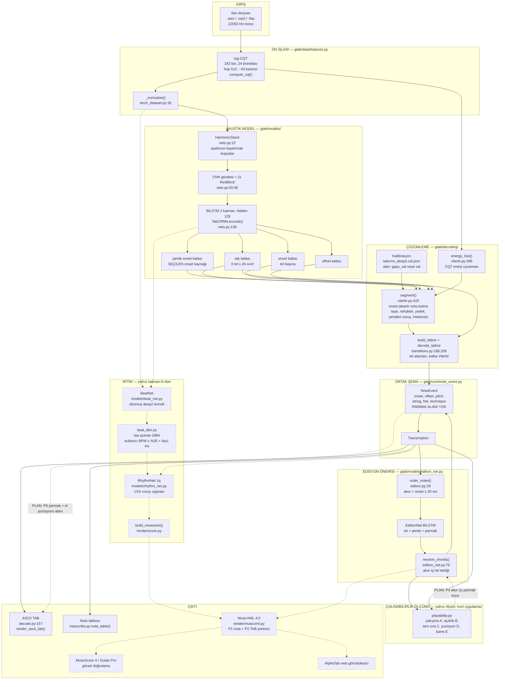
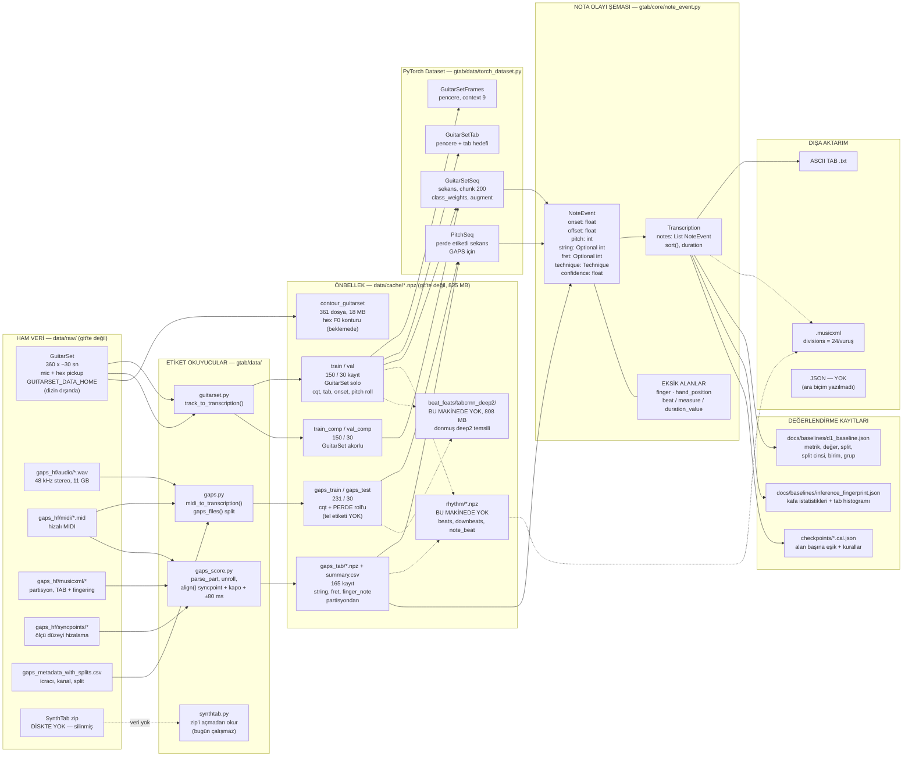
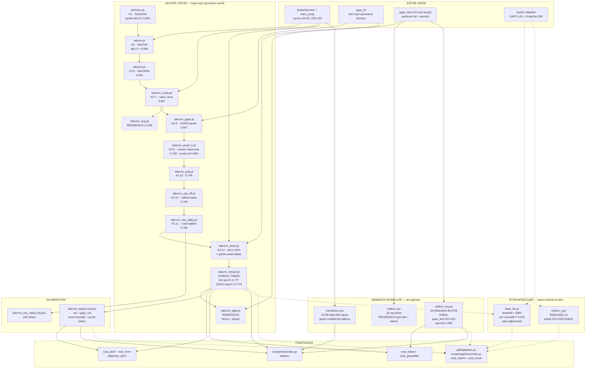
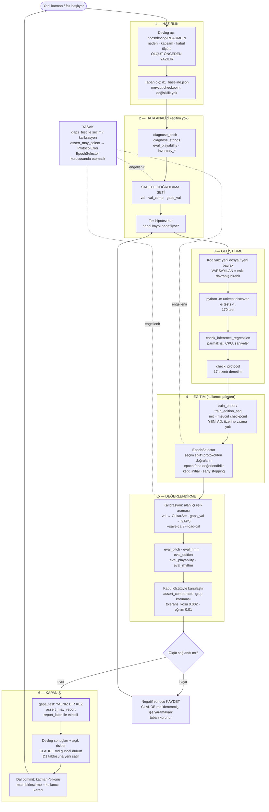

# Sistem Mimarisi ve Veri İlişkileri

> Durum: 14 Ekim 2026 · `Armagan-katman-4` @ `546c7bd` · karşılaştırma `origin/katman-5-ritim` @ `3f1f47d`
>
> Diyagramlar koddan çıkarıldı; her kutu gerçek bir dosya/fonksiyona karşılık gelir.
> **Çizgi anlamları her diyagramda aynı:**
> - **Düz çizgi (`-->`)** = bugün çalışan, mevcut dalda (`Armagan-katman-4`) var olan bağlantı
> - **Kesikli çizgi (`-.->`)** = **yalnız `katman-5-ritim` dalında** var; mevcut dalda YOK
> - **Noktalı/etiketli "PLAN"** = henüz yazılmamış, planlanan bağlantı

---

## Diyagram A — Genel sistem mimarisi

**Okuma notları.**
1. **İki ürün giriş noktası var ve bu diyagramda ikisi birleşmiş görünüyor** — gerçekte ayrı: `scripts/transcribe.py` (mevcut dal, takipsiz) yolun `ASCII`/`TBL` kısmını, `gtab/pipeline.py` + `scripts/app/transcribe.py` (katman-5) `MXML` kısmını sürüyor. Bkz. ISSUE_REGISTER `E-01`.
2. **Onset kaynağı seçimle belirleniyor.** `tabcrnn_deep2.cal.json` iki alanda da **perde-onset kafasını** (`H4`) seçti (`--onset-source pitch`); tel onset kafası (`H2`) yedekte kalıyor.
3. **Kafes Viterbi'nin katkısı sıfır ölçüldü** (`w_transition = 0` seçiliyor) ama yol açık; `decode_lattice` hâlâ çağrılıyor. Bkz. `F-01`.
4. **Edisyon modu ile ses modu karıştırılmaz** (kullanıcı kararı). Ses modu `LAT`'tan tel/perde alır; edisyon modu `EN`'den alır. `scripts/transcribe.py --fingering` üçüncü bir kullanım: konum ses zincirinden gelir, EditionNet'e `fixed` olarak verilir ve **yalnız parmak** alınır.
5. `PL` (çalınabilirlik) **hiçbir kısıt uygulamıyor**, yalnız sayıyor (README18 K1). Kısıt uygulaması P4'ün işi.

---

## Diyagram B — Veri ve şema ilişkileri

> **SQL veritabanı yok.** Aşağıdaki şema dosya biçimleri ve dizi/alan ilişkilerini gösterir;
> "tablo" = `.npz` içindeki dizi kümesi veya dataclass.

**Gerçekten kullanılan alanlar (doğrulandı).**

| Dosya / şema | Alanlar | Kaynak |
|---|---|---|
| `data/cache/{train,val,...}/*.npz` | `cqt` (T, 192) float16; tel/perde hedefleri `tab`; onset / perde roll'u | `torch_dataset.py`, `tab_labels.py` |
| `data/cache/gaps_{train,test}/*.npz` | `cqt` + **perde** roll'u; tel etiketi yok (GAPS'te tel yalnız `gaps_tab` üzerinden) | `build_gaps.py`, `PitchSeq` |
| `data/cache/gaps_tab/*.npz` | nota başına `string`, `fret`, `finger_note`, sıra, akor bayrağı | `edition.py:244 label_sequence()` |
| `data/cache/gaps_tab/summary.csv` | `id, split, use, consistent, shift, notes, labeled, known_frames, roll_agree, fingered, open_finger0, dt_med_ms` | doğrulandı (dosya okundu) |
| `checkpoints/*.cal.json` | alan (`val` / `gaps_val`) → (ölçüt, perde eşiği, onset eşiği, çözümleme kuralları) | `pitch_eval.py:308 load_selection()` |
| `NoteEvent` | 8 alan; **parmak ve ritim yok** | `note_event.py:35-51` |

**Boşluklar.**
- **JSON ara biçimi yok.** Kullanıcı sorusundaki "JSON/JavaScript veri yapıları" projede mevcut değil; MusicXML doğrudan `measures` + diziler üzerinden yazılıyor (`write_musicxml(out, measures, pitch, string, fret, sig, beat_q, ...)`). AlphaTab için bir JSON katmanı gerekirse yeni iştir.
- `NoteEvent`'in parmak/ritim taşımaması nedeniyle hem `scripts/transcribe.py` hem `gtab/pipeline.py` paralel diziler kullanıyor.

---

## Diyagram C — Model ve checkpoint ilişkileri

**Checkpoint envanteri — mevcut dalda `checkpoints/` (20 dosya).**

| Dosya | Durum | Kullanan |
|---|---|---|
| `tabcrnn_deep2.pt` + `.cal.json` | **CANLI TABAN** | tüm değerlendirme, `transcribe.py`, katman-5 pipeline |
| `edition_seq.pt` | **CANLI** (parmaklandırma) | `eval_edition`, `eval_playability`, `transcribe.py --fingering` |
| `transitions.npz` | CANLI ama katkısı 0 ölçüldü | `decode_lattice` (w=0 seçiliyor) |
| `tabcrnn_rep_valley.pt` + `.cal.json` | eski taban (K3.11) | yok |
| `tabcrnn_deep.pt`, `tabcrnn_deep_try.pt` | ara (K3.12) | yok |
| `tabcrnn_rep_off.pt`, `tabcrnn_poly.pt`, `tabcrnn_onset_h.pt`, `tabcrnn_onset.pt` | eski tabanlar | yok |
| `tabcrnn_gaps.pt`, `tabcrnn_comp.pt`, `tabcrnn_base.pt`, `tabcrnn.pt`, `tabcnn.pt`, `pitchcnn.pt` | tarihsel | yok |
| `tabcrnn_aug.pt` | **reddedildi** (−0,06) | yok |
| `edition.npz` | **reddedildi** (2a) | yalnız test (`TestLogLinearDecode`) |

**Katman-5'te checkpoint düzeni değişti:** 14 eski dosya `checkpoints/archive/` altına taşındı
(`tabcrnn_gtab.pt` da oraya eklendi) ve iki yeni dosya geldi: `beat_net.pt`, `rhythm_q.pt`.
`tabcrnn_deep2.pt`, `edition_seq.pt`, `transitions.npz` kökte kaldı.

---

## Diyagram D — Geliştirme ve test döngüsü

**Döngünün koda bağlı kuralları.**

| Kural | Nerede zorlanıyor | Kaynak |
|---|---|---|
| `gaps_test` seçimde/kalibrasyonda kullanılamaz | `assert_may_select()` → `ProtocolError`; `EpochSelector.__init__` otomatik çağırıyor | `protocol.py:127`, `selection.py:39` |
| Eğitim split listesi doğrulanır | `assert_may_train()`; `val`, `val_comp`, `gaps_val`, `gaps_test`, `gaps_skipped`, `val_half_*` eğitimde kullanılamaz | `protocol.py:121` |
| Tanımsız split adı hata verir | yazım hatasıyla sessizce kural dışına çıkılamaz | `protocol.py:113 rule()` |
| Raporlanan her sayı split cinsi etiketi taşır | `report_label(split)` | `protocol.py:141` |
| Farklı metrik grupları karşılaştırılamaz | `assert_comparable()` | `baselines.py:87` |
| Başlangıç modeli de yarışır | `EpochSelector` epoch 0'ı değerlendirir, `kept_initial()` | `selection.py:72` |
| Karantina kaydı eğitim/seçim listelerinden düşer | `gaps_training_files()` → `drop_quarantined()` | `protocol.py:231, 226` |
| Yeni kod eski çıkarımı kırmamalı | `check_inference_regression` parmak izi | `fingerprint.py`, `scripts/eval/check_inference_regression.py` |

**Test verisinin konumu (açıkça).** `gaps_test` bu döngüde **yalnız 6. adımda, faz kapanışında,
bir kez** okunur. 2., 3., 4. ve 5. adımlarda protokolce erişilemez. GuitarSet'te bağımsız test
split'i **yok** — oyuncu 05 (`val`, `val_comp`) hem seçim hem raporlama setidir ve "validation"
olarak etiketlenir (`A-04`).

**Döngünün bilinen boşluğu.** Protokol kapıları **yalnız Faz 0 sonrası yazılan kodda** zorunlu;
`train_onset`, `train_edition_seq`, `eval_pitch`, `eval_hmm` bilinçli olarak değiştirilmedi
(README15 "Açık riskler" 4). Fiilen bir ihlal yaşandı ve kayda geçti: README14 Adım 2'nin kabul
kuralı `gaps_test`'e bakıyordu (`G-07`).
